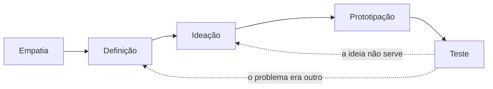
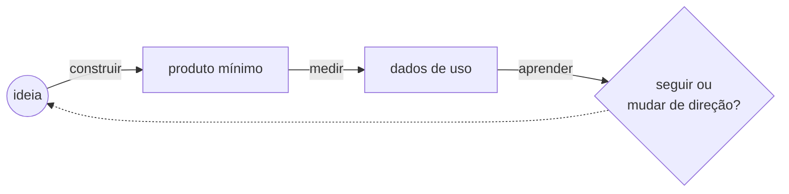
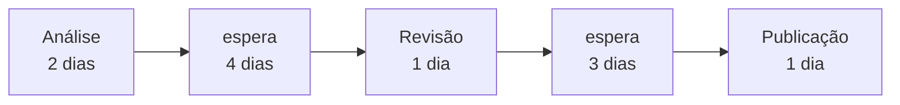
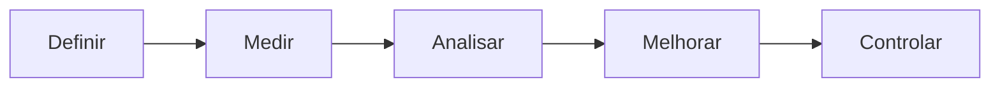
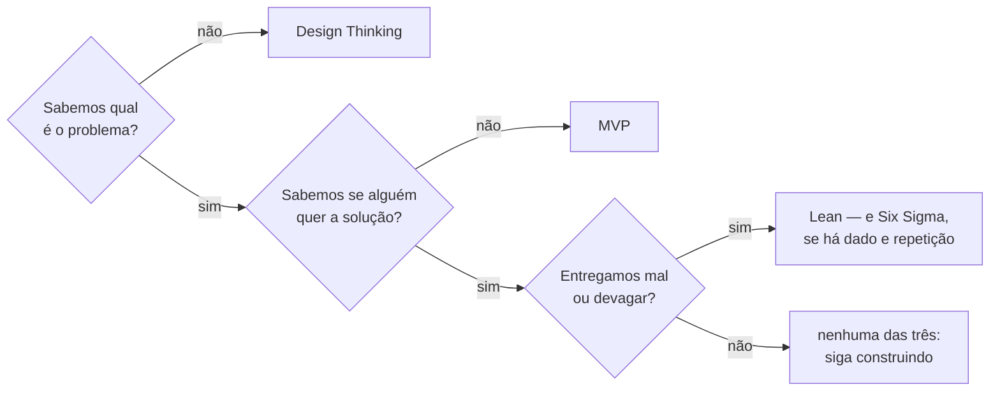

# Aula 08 — Descobrir, enxugar, melhorar

> 🎯 Objetivos: distinguir as perguntas que Design Thinking, MVP, Lean e Six Sigma respondem, percorrer as cinco etapas do Design Thinking, recortar um MVP com hipótese e critério de decisão, reconhecer o desperdício num fluxo de trabalho e a variação num processo repetido.
> 🎬 Slides da aula: [apresentacao-08-design-thinking-mvp-lean.pdf](apresentacao/apresentacao-08-design-thinking-mvp-lean.pdf)

As Aulas 05 a 07 trataram de **como o time trabalha**: os valores do ágil, o ciclo do Scrum e quem responde por cada decisão. Nenhuma delas responde a uma pergunta anterior, e mais cara: **o que vale a pena construir?** Um time que segue o Scrum à risca pode entregar, a cada duas semanas e com qualidade, algo que ninguém queria.

Esta aula fecha o Bloco 2 com quatro abordagens que vêm de fora do software — do design, das startups e da fábrica — e que hoje aparecem em quase todo projeto de TI. Cada uma serve para uma pergunta. A aula inteira é sobre reconhecer qual pergunta o projeto tem.

## 1. Três respostas para três perguntas diferentes

Os três nomes desta aula costumam aparecer juntos em apresentação corporativa, como se fossem sinônimos de "trabalhar melhor". Não são. Cada um responde a uma pergunta específica, e usar o errado é caro:

| Abordagem | A pergunta que ela responde | O que ela produz |
|---|---|---|
| **Design Thinking** | *não sabemos qual é o problema certo* | uma definição do problema que ninguém tinha enunciado |
| **MVP** | *não sabemos se alguém quer isto* | uma decisão: seguir ou mudar de direção |
| **Lean / Six Sigma** | *sabemos o que fazer, e fazemos mal* | um fluxo mais curto (Lean) e mais previsível (Six Sigma) |

No **marketplace de serviços autônomos** — dois fundadores, seis meses de reserva —, a pergunta é a segunda: ninguém sabe ainda se há demanda. Aplicar Six Sigma ali seria otimizar um processo que talvez não deva existir.

Na **Ouvidoria municipal**, é a terceira: o problema está definido em lei, o escopo está no edital, e o que sobra é executar bem — dentro de um prazo com multa.

E há projetos que passam pelas três em sequência, nessa ordem. É o caso comum de um produto novo que dá certo: descobre-se o problema, testa-se se alguém o tem, e depois de anos de operação o gargalo passa a ser o processo. Usar a terceira antes das duas primeiras é que não funciona.

> ⚠️ **O erro mais caro é usar Lean onde a pergunta era MVP.** Otimizar a construção de algo que ninguém quer produz desperdício com excelente indicador de eficiência.

## 2. Design Thinking: as cinco etapas

O Design Thinking parte de uma suspeita desconfortável: **o problema que o cliente enuncia raramente é o problema dele.** Ele já traduziu a dor numa solução antes de falar com você.

A abordagem vem do trabalho de designers — a consultoria IDEO e a escola de design da Universidade Stanford a organizaram nos anos 2000 — e foi levada para problemas que não têm nada de visual: serviços, processos, sistemas. Em projeto de TI, ela entra **antes do backlog**: o que sai dela é o problema que o Product Owner da Aula 07 vai ordenar, e não uma lista de telas.

### As cinco etapas

| Etapa | O que se faz | Uma técnica típica | O que sai |
|---|---|---|---|
| **Empatia** | observar e ouvir quem vive o problema, sem propor nada | acompanhar alguém fazendo a tarefa, no lugar onde ela acontece | o que as pessoas fazem, não o que dizem que fazem |
| **Definição** | escrever o problema numa frase, do ponto de vista do usuário | a frase *"[quem] precisa de [quê], porque [o que se descobriu]"* | uma definição que ninguém tinha enunciado |
| **Ideação** | gerar muitas alternativas, sem julgar durante a geração | quantidade primeiro; depois, cada pessoa vota nas melhores | opções que não apareceriam na primeira conversa |
| **Prototipação** | construir a versão mais barata que permita testar | tela desenhada no papel, ou o serviço feito à mão | algo que se possa mostrar, e jogar fora |
| **Teste** | pôr o protótipo na frente de quem vive o problema | cinco pessoas, uma de cada vez, sem ninguém explicar nada | o que estava errado na definição |

O fluxo não é linear: o teste costuma mandar de volta para a definição, e é justamente isso que o torna útil.



### Empatia: o que se observa, e não o que se pergunta

A entrevista que não serve é a que pergunta sobre o futuro: *"você usaria um aplicativo para isso?"*. Quase todo mundo diz que sim, por educação, e não usa. A que serve pergunta sobre o passado — *"conte a última vez que isso aconteceu com você"* — e a observação vale mais que as duas, porque mostra o que a pessoa faz sem perceber.

No projeto de **achados e perdidos**, a empatia mudaria a definição do problema. O pedido chegou como *"queremos um sistema para cadastrar itens perdidos"*. Observando a portaria por uma manhã, aparece outra coisa: o item quase sempre está lá, e quem procura **não sabe descrever** o que perdeu de um jeito que case com a descrição de quem achou.

### Definição: o pedido não é o problema

O problema não é cadastro — é **pareamento sob descrição ambígua**. São dois projetos diferentes, e só um resolve a dor.

A diferença aparece no que cada definição faz o time construir: a primeira produz um formulário e uma listagem; a segunda produz busca por características parciais, foto do item e uma forma de a portaria sugerir candidatos. Mesmo orçamento, resultados incomparáveis.

A frase de definição costuma ser convertida numa pergunta que abre a ideação sem já trazer a resposta: ***"como poderíamos…?"***. *"Como poderíamos cadastrar os itens?"* já escolheu a solução; *"como poderíamos ajudar alguém a reconhecer o que perdeu?"* deixa espaço para uma foto, uma vitrine na portaria ou nenhum sistema.

### Abrir e fechar: o duplo diamante

As cinco etapas alternam dois movimentos. Primeiro se **abre** — ouve-se muita gente, geram-se muitas ideias — e depois se **fecha**, escolhendo uma definição e uma solução. O desenho mais conhecido desse ritmo é o **duplo diamante**, proposto pelo Design Council britânico em meados dos anos 2000: o primeiro diamante é sobre o **problema**, o segundo, sobre a **solução**.


O erro mais comum é **pular o primeiro diamante**: o time recebe o pedido, trata-o como definição e começa a gerar ideias de solução para um problema que ninguém verificou.

### O caso: as fotos de Nova York

Em 2009, o Airbnb faturava cerca de **200 dólares por semana**, e não crescia. Joe Gebbia, um dos fundadores, abriu os anúncios de Nova York, a cidade que mais importava, e viu o padrão: **as fotos eram ruins**, tiradas com o celular, e ninguém reserva o apartamento de um desconhecido sem conseguir ver o lugar.

A resposta "escalável" seria mandar um e-mail aos anfitriões com dicas de fotografia. Os fundadores fizeram o contrário: foram a Nova York, alugaram uma câmera e fotografaram os apartamentos **de porta em porta** — e, nas visitas, ouviram dos anfitriões o que mais não funcionava no serviço. Uma semana depois, a receita semanal tinha dobrado.

Repare em duas coisas. A empatia aconteceu **fora da sala**, na casa de quem usava o produto. E o protótipo da solução **não tinha uma linha de código**: era uma câmera alugada.

> 📎 Fonte: entrevista de Joe Gebbia à First Round Review, *How design thinking transformed Airbnb from a failing startup to a billion dollar business*.

> 💡 **A etapa de empatia é a única que não se pode pular.** As outras quatro se fazem em sala, com quem já conhece o problema. Essa exige sair da sala e observar — e é justamente a que some quando a oficina é marcada para caber numa tarde.

> ⚠️ **Design Thinking não é dinâmica de post-it.** Se depois da oficina ninguém mudou de ideia sobre nada, ou o problema já estava claro — e a oficina era desnecessária — ou a etapa de empatia não foi feita para valer.

## 3. MVP: o menor produto que ensina alguma coisa

**MVP** é *minimum viable product*, e as três palavras importam. Ele é o **produto** — algo que alguém usa — **mínimo** e **viável**: pequeno o bastante para ser barato, completo o bastante para produzir aprendizado real.

O termo se popularizou com o livro de Eric Ries de 2011, *A startup enxuta* — e "enxuta" é a tradução de *lean*, o mesmo enxugar do título desta aula. Para Ries, o MVP é a versão de um produto novo que permite **aprender o máximo sobre os clientes com o mínimo de esforço**. O que ele entrega não é funcionalidade: é aprendizado.

### O ciclo construir–medir–aprender

O MVP é uma volta de um ciclo. Constrói-se o mínimo, mede-se o que as pessoas fazem com ele, e aprende-se o bastante para decidir: **perseverar** na ideia, ou **mudar de direção** — o que as startups chamam de *pivotar*.



O ciclo se percorre nesse sentido, mas se **planeja ao contrário**: primeiro o que precisamos aprender, depois o que medir para aprender isso, e só então o menor produto que gere essa medida. Quem começa pelo "o que construir" acaba medindo o que deu para medir.

### As três partes obrigatórias

Um MVP tem três partes obrigatórias, e é a ausência delas que produz o falso MVP:

| Parte | Exemplo no marketplace |
|---|---|
| **Hipótese** | prestadores autônomos aceitam pagar comissão em troca de encontrar clientes |
| **Como medir** | 30 prestadores cadastrados e 10 serviços concluídos em 8 semanas |
| **Critério de decisão** | menos de 5 serviços concluídos → o problema não é encontrar cliente; mudamos de direção |

A terceira é a que quase nunca existe. **Se você não consegue completar a frase *"se acontecer X, a gente muda de direção"*, não é MVP** — é a entrega 1 de 8, com nome bonito.

Repare também **qual número decide**. O critério usa os serviços concluídos, e não os cadastros. Cadastro é o que Ries chama de **métrica de vaidade**: só sobe, é bom de mostrar, e não diz se a hipótese está certa — cadastrar-se é grátis. Serviço concluído, com comissão paga, é a métrica que decide, porque é o comportamento que a hipótese prevê.

### Quatro jeitos de fazer um MVP

Do mais barato ao mais caro:

| Tipo | Como funciona | O que ele testa — e o que não testa |
|---|---|---|
| **Página de interesse ou vídeo** | descreve o produto que ainda não existe e mede quantos pedem para entrar | se há interesse; não testa se alguém vai usar |
| **Concierge** | o serviço é feito à mão, e o cliente sabe disso | se o serviço resolve o problema, antes de automatizar qualquer parte |
| **Mágico de Oz** | o cliente vê um produto que parece pronto; por trás, é tudo manual | se as pessoas usam e pagam, sem construir os bastidores |
| **Uma funcionalidade só** | o produto real, com a única função que a hipótese precisa | o uso de verdade, ao custo de já construir algo |

Os dois casos mais citados são de antes de o termo ficar famoso:

- **Dropbox, 2007–2008.** Sincronizar arquivos entre computadores, sem falhar, é difícil de construir. Antes de terminar, Drew Houston gravou um vídeo de poucos minutos mostrando como o produto funcionaria. Na noite em que uma versão do vídeo circulou, a lista de espera foi de cerca de **5 mil para 75 mil inscritos**. A hipótese — *as pessoas têm esse problema* — estava testada sem o produto pronto;
- **Zappos, 1999.** Nick Swinmurn queria vender sapatos pela internet e não sabia se alguém compraria sapato sem experimentar. Em vez de montar estoque, ele fotografou os sapatos de lojas da cidade e os pôs num site; quando chegava um pedido, ia à loja, comprava e enviava. Para o cliente, era uma loja on-line. Por trás, era um Mágico de Oz.

> 💡 **O MVP do marketplace pode não ter plataforma nenhuma.** Um formulário, um grupo de mensagens e os dois fundadores intermediando à mão testam a hipótese em três semanas, sem construir o fluxo de disputa — que é a parte mais cara e depende de a hipótese estar certa. É um MVP concierge.

## 4. O que MVP não é

Quatro confusões comuns, e o que cada uma realmente é:

| Chamam de MVP | É na verdade |
|---|---|
| a primeira fatia do plano original | **entrega incremental** — legítima, e não testa hipótese nenhuma |
| a versão com menos funcionalidades | **escopo reduzido**, se ninguém definiu o que se quer aprender |
| o protótipo de tela | **protótipo** — não é produto, ninguém usa de verdade |
| a versão feita às pressas | **dívida técnica**, e o "mínimo" virou desculpa |

A diferença entre MVP e entrega incremental é sutil e decisiva: **a entrega incremental supõe que o plano está certo e o executa em pedaços; o MVP suspeita do plano e testa.** No sistema de empréstimo de equipamentos, o recorte da Aula 02 era incremental — ninguém duvidava de que o setor precisasse registrar empréstimos.

> ⚠️ **Um MVP que confirma a hipótese não "deu certo" — ele terminou o trabalho dele.** O valor do experimento está em decidir, e decidir "seguir" é tão útil quanto decidir "mudar". O que não vale é rodar o experimento e seguir igual em qualquer resultado.

### O custo político

E há um custo que ninguém menciona: **o MVP pode dar a resposta que o patrocinador não quer ouvir.** Quem financiou seis meses de reserva para construir um marketplace não recebe bem a informação, na semana oito, de que o problema é outro.

É por isso que o critério de decisão precisa ser combinado **antes** do experimento, com quem paga. Depois do resultado, qualquer critério parece escolhido para justificar o que já se queria fazer — e a conversa deixa de ser sobre o dado e passa a ser sobre a régua.

> 💡 **Um MVP mal recebido costuma ter sido bem executado.** O desconforto é o produto: ele antecipou em cinco meses uma informação que chegaria de qualquer jeito, quando a reserva tivesse acabado.

## 5. Lean: valor, fluxo e desperdício

O **Lean** vem da manufatura e pergunta uma coisa só: **o que, neste fluxo, o cliente não pagaria para ter?** Isso é desperdício, e sai.

A origem é o sistema de produção da Toyota, montado por Taiichi Ohno no Japão do pós-guerra, sem dinheiro para estoque nem espaço para fábrica grande. O nome *lean* — enxuto — veio depois, em 1990, no livro *A máquina que mudou o mundo*, que comparou fábricas de carro do mundo inteiro. Ele se apoia em três ideias:

1. **Valor** é o que o cliente reconhece e pagaria para ter — e quem define é ele, não o time;
2. **Fluxo de valor** é o caminho inteiro do pedido até a entrega, com todas as etapas e todas as filas entre elas;
3. **Desperdício** é tudo, nesse caminho, que consome tempo ou esforço sem virar valor.

### Os sete desperdícios em software

Em 2003, Mary e Tom Poppendieck traduziram os sete desperdícios da fábrica para o desenvolvimento de software:

| Na fábrica | Em software | Como ele aparece |
|---|---|---|
| estoque | **Trabalho parcialmente feito** | cinco itens começados e nenhum entregue — o quadro Kanban da leitura [*Ferramentas e comunicação*](../../leituras-complementares/ferramentas-e-comunicacao/README.md) |
| superprodução | **Funcionalidade não usada** | o relatório que alguém pediu e ninguém abriu |
| processamento extra | **Processo extra** | o documento que ninguém lê, a aprovação que ninguém confere |
| transporte | **Troca de contexto** | a pessoa em três projetos ao mesmo tempo, produzindo pouco em todos |
| espera | **Espera** | item pronto há seis dias esperando revisão |
| movimentação | **Passagem de bastão** | quem analisou não é quem constrói, e o que se sabia se perde no caminho |
| defeito | **Defeito e retrabalho** | o que volta porque não estava na Definição de Pronto |

A funcionalidade não usada é a mais cara e a menos visível: ela consumiu o mesmo esforço das outras e não aparece como problema em lugar nenhum — porque **ninguém reclama de um relatório que não usa**. Ela só aparece se alguém medir uso, o que é assunto da [Aula 12](../../bloco-3-do-codigo-a-producao/aula-12-observabilidade-e-manutencao/README.md).

### Mapear o fluxo: onde o tempo vai

O instrumento do Lean para enxergar o fluxo é o **mapa do fluxo de valor**: cada etapa com o tempo de trabalho, e cada fila entre elas com o tempo de espera.



No fluxo acima, **4 dias são trabalho e 7 são espera**. O prazo que o cliente percebe é de 11 dias, e o item só esteve sendo trabalhado em 4 deles: a **eficiência do fluxo** é de 4 ÷ 11, cerca de **36%**. Contratar mais gente para as etapas de trabalho não muda quase nada; atacar a espera corta o prazo pela metade. É esse tipo de leitura que o Lean traz, e ela raramente é intuitiva.

O desperdício mais barato de atacar é a **espera**, e o instrumento é o limite de trabalho em andamento. Seis dias de item pronto esperando revisão não custam esforço de ninguém — custam **tempo de calendário**, que é o que o cliente percebe.

### Puxar, em vez de empurrar

Sem limite, cada etapa **empurra** o que terminou para a fila da seguinte e começa outra coisa — e as filas crescem sem que ninguém perceba, porque todo mundo está ocupado. Com um limite de trabalho em andamento, a etapa seguinte **puxa** quando tem espaço, e a etapa anterior, com a fila cheia, para de começar e vai ajudar a terminar.

É contraintuitivo: o time **começa menos coisas e termina mais**. A pergunta do Lean não é *"todo mundo está ocupado?"*, e sim ***"o item está andando?"***.

## 6. Six Sigma e o DMAIC

O **Six Sigma** ataca outra coisa: a **variação**. Enquanto o Lean pergunta o que sobra, o Six Sigma pergunta por que o mesmo processo às vezes leva dois dias e às vezes doze.

A abordagem nasceu na Motorola, em 1986, e ficou famosa quando a General Electric a adotou na empresa inteira, nos anos 1990. O nome vem da estatística: sigma (σ) é o desvio-padrão, a medida de quanto os resultados se espalham em volta da média. Um processo "seis sigma" varia tão pouco que produz no máximo **3,4 defeitos por milhão de oportunidades**. Em software, o número em si importa menos que a ideia: **um processo previsível é um processo que varia pouco.**

### A média engana

Quando a Ouvidoria estiver no ar, o projeto acabou e começa a operação: responder manifestações, milhares por ano, dentro do prazo legal — **30 dias**, prorrogáveis uma vez por igual período, pela Lei 13.460/2017. Imagine dois órgãos da prefeitura com a **mesma média** de resposta, 14 dias:

| Órgão | Tempo de resposta | Média | Passou do prazo |
|---|---|---|---|
| **Obras** | entre 11 e 17 dias, quase sempre | 14 dias | nunca |
| **Saúde** | de 2 a 40 dias, sem padrão | 14 dias | 1 em cada 6 |

Pela média, os dois estão iguais e bem dentro do prazo. Pela variação, a Saúde descumpre a lei com frequência — e o cidadão não recebe a média, recebe **o caso dele**. É essa leitura que o Six Sigma traz: o problema não é o tempo médio, é o espalhamento.

### O roteiro: DMAIC

O Six Sigma ataca a variação com um roteiro de cinco etapas, o **DMAIC**:



| Etapa | A pergunta | Na Ouvidoria em operação |
|---|---|---|
| **Definir** | qual é o problema, em número? | 1 em cada 6 manifestações da Saúde passa dos 30 dias |
| **Medir** | quanto, onde e quando ele acontece? | o tempo de cada manifestação dos últimos seis meses, por órgão, canal e assunto — o dado já existe, porque a lei exige publicar estatísticas |
| **Analisar** | o que explica a variação? | as que passam do prazo são as **reencaminhadas**: classificadas para o órgão errado, voltam à triagem e perdem dias numa fila |
| **Melhorar** | que mudança ataca essa causa? | uma tabela de assuntos por órgão na triagem, e uma segunda leitura para a manifestação ambígua |
| **Controlar** | como garantir que não volta? | acompanhar toda semana a taxa de reencaminhamento, com alerta quando ela subir |

A última etapa é a que mais se esquece. Sem ela, a melhoria dura até a próxima troca de equipe, e o processo volta a ser o que era.

### Lean e Six Sigma, lado a lado

| | Lean | Six Sigma |
|---|---|---|
| **Ataca** | desperdício | variação |
| **Pergunta** | o que aqui não vira valor? | por que o resultado oscila tanto? |
| **Exige** | ver o fluxo inteiro | dados suficientes para medir |

As duas costumam andar juntas, com o nome de **Lean Six Sigma**: primeiro se tira o que sobra, depois se estabiliza o que ficou.

> ⚠️ **Six Sigma exige medição, e medição exige processo estável e repetido.** Aplicá-lo a um projeto único, que acontece uma vez, é usar uma ferramenta de linha de produção numa obra sob medida. Em software, ele cabe na **operação** — chamados, implantações, incidentes —, não no projeto.

Por isso o exemplo acima é a Ouvidoria **em operação**, e não o projeto que a constrói. O projeto acontece uma vez, em oito meses; a resposta às manifestações se repete todos os dias, por anos.

## 7. Qual usar quando

Três perguntas, na ordem, resolvem a escolha:

1. **Sabemos qual é o problema?** Se não — Design Thinking;
2. **Sabemos se alguém quer a solução?** Se não — MVP;
3. **Sabemos as duas coisas e mesmo assim entregamos mal ou devagar?** — Lean, e Six Sigma se houver dado e repetição.



A quarta saída da árvore é a que mais se esquece: **um projeto que sabe o problema, sabe que há demanda e entrega bem não precisa de nenhuma das três.** Precisa continuar fazendo o que faz.

E vale a advertência de gestão: as três custam tempo, e **as três podem ser usadas para adiar decisão**. Uma oficina de Design Thinking marcada para daqui a três semanas num projeto que já sabe qual é o problema é procrastinação com boa apresentação.

O teste, aqui como no resto do curso, é perguntar **que decisão vai mudar** com o resultado. Se ninguém consegue nomear uma, a atividade é ritual — e ritual caro, porque consome as pessoas que estariam construindo.

> 💡 **O fio comum às três é o mesmo do curso inteiro:** decidir com informação em vez de com opinião, e declarar o que se perde com a escolha. Design Thinking descobre o problema certo, o MVP testa antes de gastar, e o Lean tira o que não vira valor. As três são formas de **não construir o que não devia existir**.

> 📖 O Cruz trata das técnicas ágeis complementares ao Scrum, entre elas o MVP e a prototipação, na parte final do livro. O Guia PMBOK trata da qualidade e da melhoria de processo na área de conhecimento correspondente, onde Lean e Six Sigma aparecem como abordagens. Para ir além: RIES, Eric. *A startup enxuta*, para o MVP e o ciclo construir–medir–aprender; e POPPENDIECK, Mary e Tom. *Lean Software Development: An Agile Toolkit*, de onde vem a tabela dos sete desperdícios.

## 🏋️ Exercícios da aula

Na pasta `aula-08/` do seu repositório:

1. **`ex01.md`** — para cada situação, diga qual das três abordagens serve e **por qual pergunta**: (a) o cadastro leva de 2 a 14 dias para ser aprovado, sem que se saiba por quê; (b) a diretoria quer um aplicativo, e ninguém sabe qual problema ele resolve; (c) dois fundadores vão gastar a reserva construindo algo que talvez ninguém queira; (d) o time entrega no prazo, mas 40% do que entrega nunca é usado. *Confere assim: a (d) tem duas leituras defensáveis — diga qual você escolheu e por quê; é o único item da lista em que isso acontece.*

2. **`ex02.md`** — percorra as **cinco etapas** do Design Thinking no projeto de [achados e perdidos](../../recursos/projetos-para-praticar.md#1-achados-e-perdidos-do-campus), escrevendo o que sairia de cada uma. A etapa de **definição** precisa produzir um enunciado do problema diferente do que o cliente pediu. *Confere assim: se a sua definição for "criar um sistema de achados e perdidos", você repetiu o pedido — a empatia precisa ter mudado alguma coisa.*

3. **`ex03.md`** — recorte o **MVP** do [marketplace de serviços autônomos](../../recursos/projetos-para-praticar.md#9-marketplace-de-serviços-autônomos), com as três partes obrigatórias: hipótese, como medir e critério de decisão. Escreva também **o que fica de fora** e por quê. *Confere assim: o critério de decisão precisa ser um número e um prazo. Se estiver escrito "se a adesão for baixa", ele não decide nada — baixa para quem?*

4. **`ex04.md`** — no fluxo descrito a seguir, identifique **três desperdícios** e proponha uma mudança para cada: *o item é analisado por uma pessoa, espera em média 4 dias por revisão, volta 30% das vezes por não atender a critérios que não estavam escritos, e quem revisa também atende chamados de dois outros projetos.* *Confere assim: um dos três desperdícios não está no fluxo, está na alocação das pessoas — se você só olhou as etapas, faltou um.*

5. **`ex05.md`** — 🌶️ **Desafio.** A diretoria da empresa determinou uma oficina de Design Thinking de dois dias para o projeto da [Ouvidoria municipal](../../recursos/projetos-para-praticar.md#8-ouvidoria-municipal), cujo escopo está anexo ao edital. **Escreva a resposta**, contendo: (i) se a abordagem responde à pergunta que este projeto tem, com o argumento; (ii) o que você propõe no lugar, ou como você usaria os dois dias de forma que produza decisão; (iii) **o que se perde** com a sua proposta em relação à oficina pedida. *Confere assim: recusar por "não temos tempo" não é argumento — a recusa precisa se apoiar em qual pergunta o projeto tem, e essa pergunta está na seção 1.*

### 📤 Entrega

Estes exercícios são feitos em sala e vão para o **seu repositório** `exercicios-projeto-software`:

```bash
cd ..                 # da pasta da aula para a raiz do repositório
git add aula-08/
git commit -m "Resolve exercícios da aula 08"
git push
```

Confira no navegador que a pasta apareceu em `github.com/SEU-USUARIO/exercicios-projeto-software`.

## 🧠 Revisão

[8 questões de múltipla escolha](revisao/README.md) para conferir se os conceitos ficaram sólidos. Responda sem consultar a aula — depois volte e corrija.

**A entrega é pelo formulário:** [responder a revisão da Aula 08](https://docs.google.com/forms/d/e/1FAIpQLSczqeKwoirRf57ApuatqwQB692Dq1zD8jBYpgmPm86X_99mBw/viewform)

Entre com uma conta Google, selecione seu nome na lista e informe seu usuário do GitHub — só o usuário, não o endereço do perfil. Se o seu nome ainda não estiver na lista, marque a última opção e escreva o nome completo no campo seguinte. É **uma resposta por aluno** e não dá para editar depois de enviar, então confira antes. A nota é liberada no AVA depois da revisão em sala e da divulgação do gabarito.

---

⬅️ [Aula 07 — Quem responde pelo quê](../aula-07-quem-responde-pelo-que/README.md) | ➡️ [Aula 09 — Controle de versão e configuração](../../bloco-3-do-codigo-a-producao/aula-09-controle-de-versao-e-configuracao/README.md)
