<!-- _class: capa -->

🔍

# Descobrir, Enxugar, Melhorar

## Aula 08 · Bloco 2 — Metodologias de Gestão

Quatro abordagens, três perguntas — e usar a errada é caro

---

## 🎯 Nesta aula

1. Três abordagens para **três perguntas diferentes**
2. **Design Thinking** — as cinco etapas e o duplo diamante
3. **MVP** — o menor produto que ensina alguma coisa
4. O que MVP **não é**
5. **Lean** — valor, fluxo e desperdício
6. **Six Sigma** e o DMAIC
7. Qual usar **quando**

---

## Cada uma responde a uma pergunta

<b class="t">Design Thinking</b>não sabemos qual é o problema certoproduz uma <b>definição do problema</b> que ninguém tinha enunciadoachados e perdidos

<b class="t">MVP</b>não sabemos se alguém quer istoproduz uma <b>decisão</b>: seguir, ou mudar de direçãomarketplace de serviços

<b class="t">Lean e Six Sigma</b>sabemos o que fazer, e fazemos malproduz um fluxo <b>mais curto</b> e <b>mais previsível</b>Ouvidoria municipal

Há produtos que passam pelas três, <b>nessa ordem</b>. Usar a terceira antes das duas primeiras é que não funciona.

---

<!-- _class: lead -->

## ⚠️ O erro mais caro

é usar Lean
onde a pergunta era MVP.

Otimizar a construção de algo
que ninguém quer produz desperdício
com excelente indicador de eficiência.

---

## Design Thinking: as cinco etapas

Parte de uma suspeita: **o problema que o cliente enuncia raramente é o problema dele** — ele já traduziu a dor numa solução. Em projeto de TI, entra **antes do backlog**.

EMPATIA<small>observar quem vive o problema</small>

→

DEFINIÇÃO<small>o problema numa frase</small>

→

IDEAÇÃO<small>muitas alternativas</small>

→

PROTOTIPAÇÃO<small>a versão mais barata</small>

→

TESTE<small>com quem vive o problema</small>

a ideia não serve

o problema era outro

O teste manda de volta para a definição — <b>e é isso que o torna útil</b>.

---

## O que se faz em cada etapa

Empatiaacompanhar alguém fazendo a tarefa, onde ela aconteceo que fazem, não o que dizem

→

Definiçãouma frase: <i>quem</i> precisa <i>de quê</i>, <i>porque</i>…uma definição que ninguém tinha enunciado

→

Ideaçãoquantidade primeiro, sem julgar; depois, votaropções que não viriam na 1ª conversa

→

Protótipotela no papel, ou o serviço feito à mãoalgo para mostrar — e jogar fora

→

Testecinco pessoas, uma por vez, sem ninguém explicar nadao que estava errado na definição

As quatro últimas se fazem em sala. <b>A empatia exige sair da sala</b> — é a única que não se pode pular.

---

## Empatia: pergunte sobre o passado

<b class="t">⛔ Não serve</b><i>"Você usaria um aplicativo para isso?"</i>Quase todo mundo diz que sim, por educação — e não usa. A pergunta sobre o futuro mede gentileza.

<b class="t">✅ Serve</b><i>"Conte a última vez que isso aconteceu com você."</i>E, melhor que perguntar: <b>observar</b>. A observação mostra o que a pessoa faz sem perceber.

💡 É justamente a etapa que some quando a oficina é marcada <b>para caber numa tarde</b>.

---

## Achados e perdidos: o pedido não é o problema

a definição

o que o time constrói

o pedido

"queremos um sistema para <b>cadastrar</b> itens perdidos"

→

formulário e listagem

↓ uma manhã na portaria: o item quase sempre está lá — quem procura <b>não sabe descrevê-lo</b> ↓

o problema

<b>pareamento</b> sob descrição ambígua

→

busca por características, foto do item, portaria sugere candidatos

Mesmo orçamento, <b>resultados incomparáveis</b> — e só um dos dois resolve a dor.

---

## Definição: da frase à pergunta

quem precisa de quê, porque o que se descobriu

A frase vira uma pergunta que abre a ideação — ***"como poderíamos…?"*** — sem já trazer a resposta:

<b class="t">Já escolheu a solução</b><i>"Como poderíamos <b>cadastrar</b> os itens?"</i>a resposta veio dentro da pergunta: um formulário

<b class="t">Deixa espaço</b><i>"Como poderíamos ajudar alguém a <b>reconhecer</b> o que perdeu?"</i>uma foto, uma vitrine na portaria — ou nenhum sistema

---

## Abrir e fechar: o duplo diamante

o pedido

1º · o PROBLEMA

<b>abre</b> empatia

<b>fecha</b> definição

2º · a SOLUÇÃO

<b>abre</b> ideação

<b>fecha</b> protótipo e teste

a solução

O erro mais comum é <b>pular o primeiro diamante</b>: tratar o pedido como definição e já gerar soluções para um problema que ninguém verificou.

Proposto pelo Design Council britânico, em meados dos anos 2000.

---

## 2009: as fotos de Nova York

US$ 200por semana de receita, e sem crescer

→

os anúnciosde Nova York, a cidade que importava: <b>fotos ruins</b>, de celular

→

porta em portaem vez de um e-mail com dicas: <b>câmera alugada</b> — e ouvir os anfitriões

→

× 2a receita semanal, <b>uma semana depois</b>

Airbnb. A empatia aconteceu <b>fora da sala</b>, na casa de quem usava o produto — e o protótipo <b>não tinha uma linha de código</b>: era uma câmera alugada.

Fonte: Joe Gebbia, cofundador, à First Round Review.

---

<!-- _class: lead -->

## ⚠️ Design Thinking não é

dinâmica de post-it.

Se depois da oficina
ninguém mudou de ideia sobre nada,

ou o problema já estava claro,
ou a etapa de **empatia**
não foi feita para valer.

---

## MVP: o menor produto que ensina alguma coisa

<b class="t">Produto</b>algo que alguém <b>usa de verdade</b> — não uma tela para mostrar

<b class="t">Mínimo</b>pequeno o bastante para ser <b>barato</b>

<b class="t">Viável</b>completo o bastante para produzir <b>aprendizado real</b>

Eric Ries, <i>A startup enxuta</i> (2011): o MVP permite <b>aprender o máximo sobre os clientes com o mínimo de esforço</b>. O que ele entrega não é funcionalidade — é aprendizado.

<i>Enxuta</i> é a tradução de <i>lean</i>: o mesmo enxugar do título desta aula.

---

## Construir, medir, aprender

Cada volta termina numa **decisão**: perseverar na ideia, ou **mudar de direção** — o que as startups chamam de *pivotar*.

Percorre-se nesse sentido, mas <b>planeja-se ao contrário</b>: o que precisamos aprender → o que medir → o menor produto que gera essa medida.

---

## As três partes obrigatórias — no marketplace

Hipótese

prestadores autônomos aceitam pagar comissão em troca de encontrar clientes

Como medir

30 prestadores cadastrados e 10 serviços concluídos em 8 semanas

Critério de decisão

menos de 5 serviços concluídos → o problema não é encontrar cliente; <b>mudamos de direção</b>

<b>A terceira quase nunca existe</b> — e precisa ser combinada <b>antes</b>, com quem paga. Depois do resultado, qualquer régua parece escolhida para justificar o que já se queria.

---

<!-- _class: lead -->

## Se você não consegue completar

*"se acontecer X,
a gente muda de direção"*,

**não é MVP** —
é a entrega 1 de 8,
com nome bonito.

---

## Qual número decide?

30 cadastros<b>Métrica de vaidade:</b> só sobe, é bom de mostrar — e não diz se a hipótese está certa. Cadastrar-se é grátis.

10 serviços<b>Métrica que decide:</b> concluídos, com comissão paga. É o comportamento que a hipótese prevê.

Por isso o critério de decisão do marketplace usa <b>os serviços concluídos</b>, e não os cadastros.

---

## Quatro jeitos de fazer um MVP

mais baratomais caro

<b class="t">Página ou vídeo</b>descreve o produto que ainda não existe e mede quem pede para entrartesta o <b>interesse</b> — não o uso

<b class="t">Concierge</b>o serviço é feito à mão, e o cliente <b>sabe</b> dissotesta se o serviço <b>resolve</b> o problema

<b class="t">Mágico de Oz</b>parece pronto; por trás, é tudo manual — e o cliente <b>não sabe</b>testa se as pessoas <b>usam e pagam</b>

<b class="t">Uma função só</b>o produto real, com a única função que a hipótese precisatesta o <b>uso de verdade</b>

O marketplace pode começar como <b>concierge</b>: formulário, grupo de mensagens e os fundadores intermediando à mão — sem o fluxo de disputa, a parte mais cara.

---

## Dois MVPs de antes de o nome ficar famoso

5 mil → 75 milinscritos na lista de espera do <b>Dropbox</b>, numa noite — por causa de um <b>vídeo</b> de poucos minutos, com o produto ainda inacabado2008 · vídeo

0 paresem estoque na <b>Zappos</b>, em 1999: fotos de sapatos de lojas da cidade; a cada pedido, o fundador ia à loja, comprava e enviava1999 · Mágico de Oz

Os dois testaram a hipótese <b>antes</b> de construir a parte cara — sincronizar arquivos sem falhar, e um estoque de sapatos.

---

## O que MVP não é

| Chamam de MVP | É na verdade |
|---|---|
| a primeira fatia do plano | **entrega incremental** — legítima, e não testa nada |
| a versão com menos funcionalidades | **escopo reduzido** |
| o protótipo de tela | **protótipo** — ninguém usa de verdade |
| a versão feita às pressas | **dívida técnica** |

**Incremental supõe o plano certo e o executa em pedaços. O MVP suspeita do plano e o testa.**

---

## Lean: o que o cliente não pagaria para ter?

Vem do sistema de produção da **Toyota**, no Japão do pós-guerra — sem dinheiro para estoque. O nome *lean*, enxuto, veio em 1990.

<b class="t">Valor</b>o que o cliente reconhece e pagaria para ter — <b>quem define é ele</b>, não o time

<b class="t">Fluxo de valor</b>o caminho inteiro, do pedido à entrega — com as etapas <b>e as filas</b> entre elas

<b class="t">Desperdício</b>tudo o que, nesse caminho, consome tempo ou esforço <b>sem virar valor</b> — e sai

---

## Os sete desperdícios em software

na fábrica: estoque<b class="t">Trabalho parcialmente feito</b>cinco itens começados, nenhum entregue

superprodução<b class="t">Funcionalidade não usada</b>o relatório que ninguém abre — <b>a mais cara e a menos visível</b>

processamento extra<b class="t">Processo extra</b>o documento que ninguém lê, a aprovação que ninguém confere

transporte<b class="t">Troca de contexto</b>a pessoa em três projetos, produzindo pouco em todos

espera<b class="t">Espera</b>item pronto há seis dias esperando revisão

movimentação<b class="t">Passagem de bastão</b>quem analisou não é quem constrói — e o que se sabia se perde

defeito<b class="t">Defeito e retrabalho</b>o que volta porque não estava na Definição de Pronto

<b class="t" style="color:var(--sla)">De onde vem</b>Mary e Tom Poppendieck, 2003: os sete da fábrica, traduzidos para o software

Ninguém reclama de um relatório que não usa: ele só aparece se alguém <b>medir o uso</b> — Aula 12.

---

## O fluxo que revela a espera

Análise <b>2 dias</b>

espera <b>4 dias</b>

Revisão <b>1</b>

espera <b>3 dias</b>

Publicar <b>1</b>

11 dias: o prazo que o cliente percebe

4 diasde trabalho

7 diasde espera — sem esforço de ninguém

36%eficiência do fluxo: 4 ÷ 11

Contratar para as etapas de trabalho <b>quase não muda nada</b>. Atacar a espera corta o prazo pela metade.

---

## Puxar, em vez de empurrar

<b class="t">Empurrar</b>cada etapa joga o que terminou na fila da seguinte e começa outra coisa.As filas crescem — e ninguém percebe, porque <b>todo mundo está ocupado</b>.

<b class="t">Puxar</b>com um <b>limite de trabalho em andamento</b>, a etapa seguinte puxa quando tem espaço.Com a fila cheia, para-se de começar — e vai-se <b>ajudar a terminar</b>.

O time <b>começa menos e termina mais</b>. A pergunta do Lean não é <i>"todo mundo está ocupado?"</i> — é <b><i>"o item está andando?"</i></b>

---

## Six Sigma: o problema é a variação

Nasceu na **Motorola**, em 1986. Sigma (σ) é o desvio-padrão: um processo "seis sigma" varia tão pouco que tem no máximo **3,4 defeitos por milhão**.

<b class="t">Lean</b>ataca o <b>desperdício</b><i>o que aqui não vira valor?</i> exige ver o fluxo inteiro

<b class="t">Six Sigma</b>ataca a <b>variação</b><i>por que o resultado oscila tanto?</i> exige dados suficientes para medir

Juntos, são o <b>Lean Six Sigma</b>: primeiro se tira o que sobra, depois se estabiliza o que ficou.

---

## A média engana — a Ouvidoria em operação

Prazo legal de resposta: **30 dias** (Lei 13.460/2017). Dois órgãos, com a **mesma média** de 14 dias:

Obras

média · 14 diasprazo · 30 dias

Saúde

010203040 dias

O cidadão não recebe a média: <b>recebe o caso dele</b>. A Saúde passa do prazo em 1 de cada 6 — e a média não mostra.

---

## DMAIC: o roteiro do Six Sigma

Definir<i>qual é o problema, em número?</i>1 em 6 da Saúde passa dos 30 dias

→

Medir<i>quanto, onde, quando?</i>seis meses, por órgão, canal e assunto

→

Analisar<i>o que explica a variação?</i>as que foram ao órgão errado e voltaram à triagem

→

Melhorar<i>que mudança ataca a causa?</i>assuntos por órgão na triagem

→

Controlar<i>como garantir que não volta?</i>reencaminhamento toda semana, com alerta

⚠️ <b>Six Sigma exige processo estável e repetido.</b> Cabe na <b>operação</b> — chamados, implantações, incidentes —, não no projeto único que constrói o sistema.

---

## Qual usar quando

A saída que mais se esquece: quem entrega bem <b>não precisa de nenhuma das três</b>.

---

<!-- _class: lead -->

## ⚠️ As três podem adiar decisão

Uma oficina marcada para daqui a três semanas,
num projeto que já sabe o problema,
é procrastinação com boa apresentação.

O teste: **que decisão vai mudar**
com o resultado?
Se ninguém nomeia uma, é ritual.

---

<!-- _class: lead -->

## ➡️ Próxima aula

**Aula 09 — Controle de versão e configuração**

Fecha o Bloco 2.

O Bloco 3 sai do plano e entra no código:
o que mudou, quem mudou —
e como voltar ao que funcionava.
