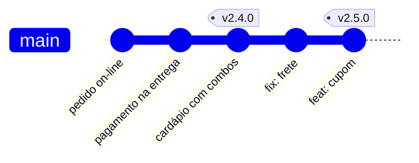
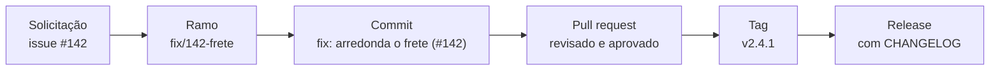
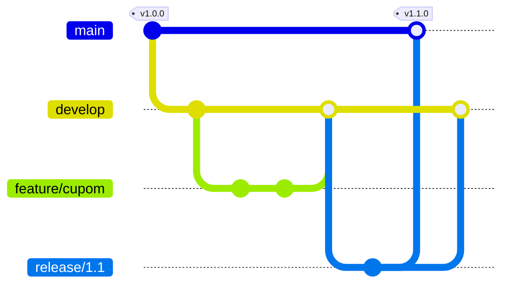
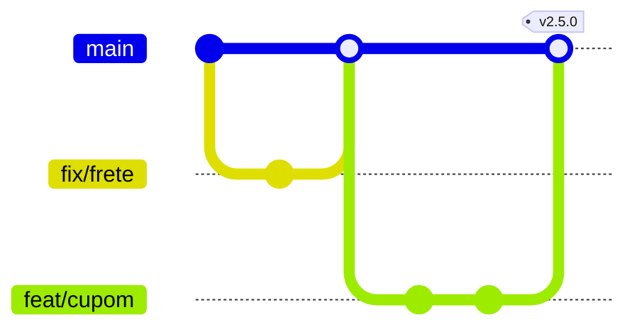
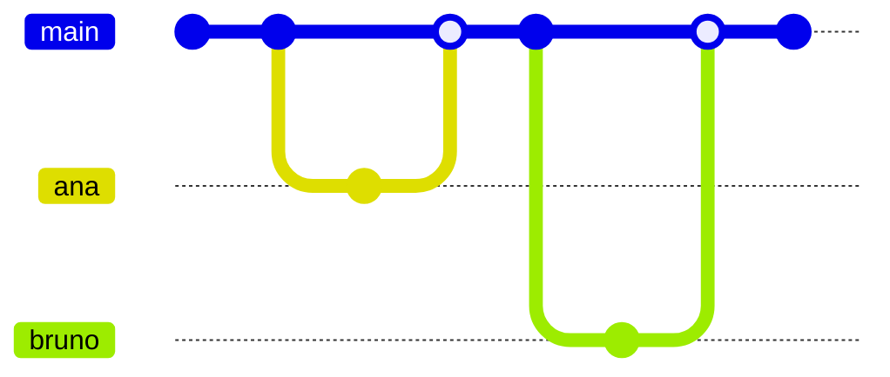
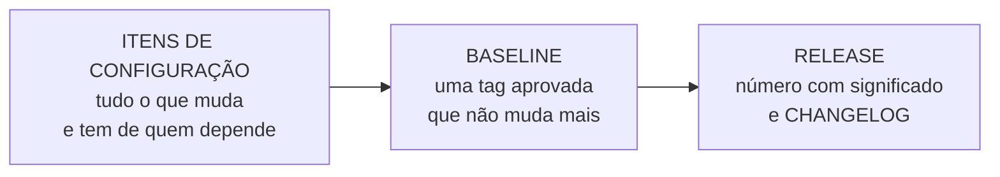

# Aula 09 — Controle de versão e configuração

> 🎯 Objetivos: identificar o que é item de configuração e o que nunca entra num repositório, reconhecer uma baseline e rastrear uma mudança da solicitação à release, escolher a estratégia de ramificação pelo tipo de produto e numerar versões com versionamento semântico e CHANGELOG.
> 🎬 Slides da aula: [apresentacao-09-controle-de-versao-e-configuracao.pdf](apresentacao/apresentacao-09-controle-de-versao-e-configuracao.pdf)

Os dois primeiros blocos trataram do que acontece **antes** do código: escolher o ciclo de vida, dividir as responsabilidades, descobrir o que vale construir. O Bloco 3 acompanha o caminho do código até quem usa o sistema: **versionar** (esta aula), **integrar** (Aula 10), **entregar** (Aula 11) e **acompanhar o que subiu** (Aula 12).

Não é preciso programar para entender nenhuma das quatro. São decisões de projeto sobre **como a mudança anda**, e boa parte delas é tomada por quem não escreve código.

## 1. Três perguntas que só o histórico responde

Sábado, 20h, no [delivery de restaurante do bairro](../../recursos/projetos-para-praticar.md#5-delivery-de-restaurante-do-bairro). Às 19h40 alguém publicou uma correção no cálculo do frete. Às 20h, os pedidos com pagamento on-line deixaram de ser confirmados. O salão está cheio, a cozinha está parada esperando pedido e o dono está ao telefone.

Naquele momento, só três perguntas importam:

1. **O que mudou** desde a última vez em que tudo funcionava?
2. **Quem mudou, e por quê** — a correção do frete tinha mais alguma coisa dentro?
3. **Como volto ao que funcionava**, agora, sem esperar o conserto?

Um time que guarda o projeto numa pasta compartilhada, ou num `.zip` por versão, responde as três de memória — e erra. Um time com **controle de versão** responde cada uma com um comando.

### O que o controle de versão guarda

O controle de versão mais usado hoje é o **Git**, criado em 2005 para o desenvolvimento do Linux. Ele não guarda "o arquivo mais recente": guarda uma sequência de **commits**. Cada commit é uma fotografia do projeto inteiro num momento, com quatro informações presas a ela:

| Parte do commit | O que é | Que pergunta responde |
|---|---|---|
| **identificador** (*hash*) | um código como `a3f9c21`, calculado a partir do conteúdo | *qual versão, exatamente?* Dois commits com o mesmo identificador são o mesmo projeto, byte a byte |
| **autor e data** | quem registrou a mudança, e quando | *quem mudou?* |
| **mensagem** | o que mudou e, quando bem escrita, por quê | *por que mudou?* |
| **commit anterior** | o "pai" desta fotografia | *o que veio antes?* É o encadeamento que forma a história |

Com isso, as três perguntas do sábado viram consulta:

```bash
git log --oneline -3      # o que mudou: as três últimas fotografias
# e81b07d fix: arredonda o frete para cima
# a3f9c21 feat: aceita cupom de desconto
# 7c2d4e0 docs: explica como reabrir a loja

git show e81b07d          # quem mudou, quando, por quê — e cada linha alterada
git revert e81b07d        # volta: cria um commit novo que desfaz aquele
```

Repare no último comando. **Voltar não apaga a história.** O `revert` cria uma fotografia nova que desfaz a mudança, e as duas ficam registradas. Na segunda-feira, o time ainda consegue ler o que aconteceu no sábado — o que seria impossível se alguém tivesse simplesmente sobrescrito o arquivo.

> 💡 **Controle de versão não é backup.** O backup responde *"existe uma cópia?"*. O controle de versão responde *o que mudou, quem mudou, por quê, e como volto* — e responde para qualquer momento da história, não só para a cópia de ontem.

> 🧩 **Ponte com POO:** você já usa Git no curso de Java para entregar os exercícios. O comando é o mesmo, e a pergunta é outra: não *"como salvo o meu trabalho"*, mas **como um time inteiro sabe, a qualquer momento, o que está no ar e de onde aquilo veio**.

### Controle de versão é parte de algo maior

O Git resolve uma das quatro atividades do que a engenharia de software chama de **gerência de configuração**: o conjunto de práticas para saber, a todo momento, de que peças o sistema é feito e em que versão cada uma está.

| Atividade | A pergunta | Onde aparece no curso |
|---|---|---|
| **Gerência de versões** | que versões de cada peça existem, e como se relacionam? | esta aula — o Git |
| **Construção do sistema** (*build*) | como juntar as peças certas num sistema que roda, sempre do mesmo jeito? | Aula 10 |
| **Gerência de mudanças** | quem pede, quem aprova e como se registra cada mudança? | seção 3 desta aula |
| **Gerência de releases** | o que vai para quem usa, quando, e com que número? | seções 5 e 6, e a Aula 11 |

São dois tópicos da ementa, com um pé em cada linha da tabela: **controle de versão**, e **rastreamento de mudanças e configuração**.

> 📖 SOMMERVILLE, *Engenharia de Software*, capítulo de gerência de configuração: é dele a divisão nessas quatro atividades. Para o Git por dentro, o livro *Pro Git*, gratuito e [em português](https://git-scm.com/book/pt-br/v2), capítulos 1 a 3.

## 2. Item de configuração: o que entra e o que nunca entra

### O arquivo que não era código

Em **18 de novembro de 2025**, por cerca de três horas, uma parte enorme da web passou a responder com erro — entre os serviços afetados estavam o X e o ChatGPT. A causa não foi um ataque, nem um programa novo com defeito. Foi um **arquivo de configuração**.

A Cloudflare, cuja rede fica na frente de milhões de sites, gera a cada cinco minutos um arquivo com as características que o seu sistema anti-robôs usa para decidir se um acesso é de gente. Às 11h05 (horário UTC), uma mudança de permissões num banco de dados fez a consulta que monta esse arquivo devolver **linhas duplicadas**. O arquivo dobrou de tamanho e passou do limite de 200 características que o programa aceitava — eram cerca de 60 em uso. O programa que recebe o tráfego parou com erro.

Como o arquivo era gerado de novo a cada cinco minutos, a rede alternava entre funcionar e falhar, e o time chegou a suspeitar de um ataque. O tráfego principal voltou ao normal às 14h30; o resto, às 17h06. Entre as ações que a empresa anunciou depois, a primeira foi **tratar os arquivos de configuração gerados internamente com o mesmo rigor com que se trata a entrada vinda de usuários**.

Repare no que aconteceu: **o código não mudou.** Mudou a configuração, e ela chegou a todos os servidores ao mesmo tempo, sem a validação e sem a cautela que uma mudança de código teria. É a lição desta seção inteira: **configuração é mudança**, e precisa do mesmo controle.

### A pergunta que identifica um item

**Item de configuração** é tudo o que precisa estar numa versão conhecida, porque alguém — ou alguma coisa — depende dele. A pergunta-teste:

> 🔎 **Se isto mudar sozinho, alguma coisa quebra ou alguém se engana?** Se sim, é item de configuração: tem versão, tem histórico e só muda por um caminho combinado.

No delivery, a lista é bem maior do que "o código":

| Item | Por que entra | Exemplo no delivery |
|---|---|---|
| **código da aplicação** | óbvio — e a menor parte da lista | o cálculo do frete |
| **configuração por ambiente**, sem os segredos | a mesma versão do código se comporta diferente com outra configuração | o raio máximo de entrega, o tempo-limite do pagamento |
| **scripts do banco de dados** (*migrações*) | aplicados fora de ordem, derrubam tudo | "acrescenta a coluna `cupom` em `pedidos`" |
| **lista exata das bibliotecas** (*lockfile*) | o que funcionou ontem depende da versão de cada uma | `package-lock.json`, ou `requirements.txt` com versões fixas |
| **infraestrutura como código** | servidor configurado à mão não se reproduz | o `Dockerfile`, os arquivos do Terraform |
| **definição do pipeline** | o processo de verificação também muda, e também quebra | `.github/workflows/verificar.yml` — Aula 10 |
| **documentação de operação** | precisa corresponder à versão que está no ar | "como reabrir a loja se o pagamento cair" |

> 💡 **A tendência é tudo virar arquivo no repositório.** Servidores, redes, permissões e até a regra de quem aprova uma mudança passaram a ser descritos em texto e versionados. É o que se chama de **infraestrutura como código** e, quando o repositório passa a ser a fonte de verdade do que roda em produção, de **GitOps**. A vantagem é que tudo ganha o que o código já tinha: histórico, revisão e caminho de volta.

### O que nunca entra

| Nunca versionar | Por quê | Onde fica, então |
|---|---|---|
| **segredos** — senhas, tokens, chaves de acesso | quem lê o repositório passa a ter a chave | variável de ambiente ou cofre de segredos; no repositório, só um `.env.example` sem os valores |
| **o que se gera a partir do repositório** — bibliotecas baixadas, binários compilados | é reproduzível, pesa e polui a comparação entre versões | é gerado de novo a cada construção |
| **dados reais** — cópia do banco, planilha de clientes | dado pessoal num repositório se espalha a cada cópia, e a LGPD vale para todas elas | no banco, com controle de acesso |
| **arquivos pessoais** — configuração do seu editor, arquivos do sistema operacional | só fazem sentido na sua máquina | no `.gitignore` |

O `.gitignore` é o arquivo que diz ao Git o que ele deve ignorar:

```gitignore
# segredos: o modelo vai para o repositório, o arquivo real não
.env
!.env.example

# gerado a partir do repositório
node_modules/
dist/

# pessoal
.DS_Store
.idea/
.vscode/
```

O segredo versionado é o erro mais comum e mais caro desta lista. Um levantamento da GitGuardian, empresa de segurança, contou **23,8 milhões de segredos expostos em repositórios públicos do GitHub só em 2024** — 25% a mais que no ano anterior. E **70% dos segredos vazados em 2022 continuavam válidos** dois anos depois: alguém viu o vazamento, apagou o arquivo e não trocou a senha.

Desde março de 2024, o GitHub bloqueia por padrão o envio de segredos reconhecíveis para repositórios públicos. Ajuda, mas não basta: o bloqueio pode ser contornado por quem envia, e não reconhece toda senha.

> ⚠️ **Apagar o segredo no commit seguinte não resolve.** O commit anterior continua na história, e toda cópia do repositório o tem. A correção é **revogar a credencial** — trocar a senha, invalidar o token — e só depois limpar o arquivo. Dar o caso por resolvido porque "o arquivo não está mais lá" é o erro clássico.

> 📖 *The Twelve-Factor App*, fator III — [Configurações](https://12factor.net/pt_br/config): por que a configuração mora no ambiente, e não no código.

## 3. Baseline: o retrato aprovado do sistema

### Oito servidores, sete atualizados

Na manhã de **1º de agosto de 2012**, a Knight Capital, uma das maiores operadoras do mercado de ações dos Estados Unidos, colocou no ar uma versão nova do seu sistema de negociação. A instalação era manual, servidor por servidor — e o técnico atualizou **sete dos oito**.

O oitavo continuou com a versão antiga. A versão nova reaproveitava um sinalizador (*flag*) que, anos antes, ligava uma função chamada *Power Peg*: desativada, mas nunca removida do código. Nos sete servidores atualizados, o sinalizador ligava a coisa nova. No oitavo, ressuscitou a função velha, que passou a enviar ordens de compra e venda sem parar.

Em **45 minutos**, a empresa acumulou um prejuízo de cerca de **460 milhões de dólares**. Precisou de socorro de investidores na semana seguinte e, no ano seguinte, foi incorporada por uma concorrente.

O defeito não estava no código novo. Estava em **ninguém saber, com certeza, o que rodava em cada servidor** — e em dois itens de configuração que ninguém controlava: o código morto e o sinalizador reaproveitado.

### O que é uma baseline

Uma **baseline** é um conjunto de itens de configuração, cada um numa versão específica, **revisado e aprovado**, que passa a servir de referência. A partir dela, mudar deixa de ser editar e passa a ser um processo: o que entra na próxima baseline é decidido, não acontece.

É a mesma ideia da **linha de base da Aula 03**, aplicada ao produto em vez do plano. Lá, a linha de base de escopo, prazo e custo era o que permitia medir desvio. Aqui, a baseline do sistema é o que permite responder *"o que, exatamente, está no ar?"*.

No Git, uma baseline se marca com uma **tag**, um nome fixo preso a um commit:



A tag `v2.4.0` não se move — é regra do time, que o repositório pode reforçar protegendo as tags: daqui a dois anos, ela continua apontando exatamente para aquela fotografia. É isso que permite afirmar *"os oito servidores rodam a v2.4.0"* — e conferir.

### As quatro funções da gerência de configuração

As normas da área, das quais a IEEE 828 é a mais citada, organizam a gerência de configuração em quatro funções. No [prontuário de clínica-escola](../../recursos/projetos-para-praticar.md#10-prontuário-de-clínica-escola), que tem auditoria externa todo ano:

| Função | A pergunta | No prontuário |
|---|---|---|
| **Identificação** | quais são os itens, e como cada um se chama? | código, migrações do banco, a regra de quem vê qual prontuário, o termo de consentimento |
| **Controle de mudanças** | quem pode mudar o quê, e por qual caminho? | toda mudança na regra de acesso passa pela revisão de duas pessoas |
| **Contabilização da situação** | o que está onde, agora, e em que versão? | "produção roda a v3.2.1 desde 14/10; homologação, a v3.3.0-rc.1" |
| **Auditoria de configuração** | o que está no ar é mesmo o que foi aprovado? | a auditoria externa confere a versão em produção contra a que o comitê aprovou |

A Knight Capital falhou na terceira: não havia como saber, antes de ligar o sinalizador, que um servidor estava diferente dos outros sete.

### Rastrear uma mudança, da solicitação à release

A baseline diz **o que** está no ar. O **rastreamento de mudanças** diz **por que** cada coisa está lá. A forma moderna de fazer isso é deixar cada passo apontando para o anterior:



Um **pull request** é o pedido para integrar um ramo ao principal. Ele mostra o que muda, linha a linha, e é onde a mudança é discutida, revisada e aprovada antes de entrar — é, ao mesmo tempo, **controle de mudança e registro**.

Com a cadeia inteira, a pergunta *"por que o frete mudou na 2.4.1?"* tem resposta em trinta segundos: a release aponta para os commits, os commits citam a solicitação, a solicitação tem quem pediu e por quê, e o pull request tem quem revisou e aprovou. No prontuário, **essa cadeia é exatamente o que a auditoria pede**.

### Nem toda mudança precisa do mesmo caminho

O ITIL, o arcabouço mais usado de gestão de serviços de TI, classifica as mudanças em três tipos — e o tipo decide o rito:

| Tipo | Exemplo no delivery | Caminho |
|---|---|---|
| **Padrão** | tirar do cardápio um item que acabou | pré-aprovada: segue o roteiro conhecido e registra |
| **Normal** | mudar a regra de cálculo do frete | análise de impacto, revisão, aprovação, nova baseline |
| **Emergencial** | o pagamento parou às 20h de sábado | executa já e **registra depois, com prazo** |

> ⚠️ **Processo de mudança pesado demais é contornado, não seguido.** Se aprovar a correção de um texto leva três dias, as pessoas passam a mexer direto em produção e a avisar depois — e aí não há processo nem registro. E o caminho emergencial precisa dizer o que ele **autoriza pular** (a aprovação prévia, não a revisão) e o que ele **obriga a fazer depois**. Sem a segunda parte, ele vira o caminho normal.

## 4. Estratégias de ramificação

### O custo do ramo que vive demais

Um **ramo** (*branch*) é uma linha de trabalho paralela. Quem desenvolve cria um ramo a partir do principal, trabalha nele sem atrapalhar ninguém e depois **integra** o ramo de volta (o *merge*). No Git, criar um ramo é instantâneo e não custa nada. O custo está em outro lugar: **no tempo que o ramo passa longe do principal**.

Duas pessoas trabalham no delivery. Ana cria um ramo na segunda-feira e integra na terça. Bruno cria um ramo para "refazer o carrinho" e integra três semanas depois.

O de Bruno parece mais cuidadoso — *"vou integrar quando estiver tudo pronto"* — e custa muito mais. Em três semanas, o principal recebeu trinta outras mudanças, e várias mexem nos mesmos arquivos que ele mexeu. A integração vira dias de **conflitos** que nem quem escreveu lembra como resolver, e o carrinho novo nunca foi testado junto com o resto.

| O ramo vive | Custo da integração |
|---|---|
| horas, até um dia | pequeno e previsível |
| até uma semana | administrável |
| semanas | grande, imprevisível, e concentrado no pior momento |

**Adiar a integração não evita o custo: multiplica.** É a lógica da curva de custo da Aula 02 — quanto mais tarde o problema aparece, mais caro ele sai —, e é o trabalho parcialmente feito que o Lean da Aula 08 chama de desperdício.

### Três estratégias

Uma **estratégia de ramificação** é o acordo do time sobre quais ramos existem, quanto tempo cada um vive e por onde a mudança passa até chegar à produção. Três são as mais usadas.

**GitFlow.** Proposto em 2010, tem dois ramos permanentes — o `main`, que só recebe versões publicadas, e o `develop`, onde o trabalho se junta — e três tipos de ramo temporário: `feature/*` para funcionalidades, `release/*` para preparar uma versão e `hotfix/*` para corrigir a produção às pressas.



Serve para software com **várias versões em uso ao mesmo tempo**, cada uma precisando de correção: um aplicativo que o cliente instala, uma biblioteca, um sistema vendido a empresas que atualizam quando querem. Custa ramos de vida longa e integração tardia, por desenho: o `develop` vira o lugar onde os problemas se acumulam até a release.

> 💡 **O próprio autor do GitFlow avisou para quem ele não serve.** Em 2020, Vincent Driessen acrescentou ao texto original um adendo: o modelo foi pensado para software com versões explícitas, e a maior parte do que se constrói hoje são aplicações web entregues continuamente, sem versões antigas a manter. Para essas, ele recomenda um fluxo mais simples, como o GitHub Flow — e lembra que não existe solução que sirva para tudo.

**GitHub Flow.** Um ramo permanente só, o `main`, **sempre pronto para ir ao ar**. Todo trabalho acontece num ramo curto, que termina num pull request revisado e integrado — e o ramo é apagado em seguida.



Serve para aplicações web e serviços com **uma única versão em produção**. Custa uma exigência: o `main` precisa estar sempre em condição de ir ao ar, e isso só se sustenta com verificação automática a cada integração — o assunto da Aula 10.

**Desenvolvimento baseado em tronco** (*trunk-based development*). Todos integram no tronco — o `main` — **pelo menos uma vez por dia**. Se existem ramos, eles vivem horas. A funcionalidade que ainda não está pronta entra no tronco **desligada**, escondida atrás de um sinalizador (*feature flag*), que a Aula 11 detalha.



Serve para times que entregam com muita frequência e confiam na própria verificação automática. Custa disciplina: mudanças pequenas, testes automáticos confiáveis e o hábito de esconder o que está incompleto.

E há evidência a favor dele. O **DORA** — o programa de pesquisa sobre desempenho de entrega de software, hoje mantido pelo Google — encontrou que times com **três ou menos ramos ativos**, que integram no tronco **pelo menos uma vez por dia** e não têm períodos de "congelamento de código" entregam com mais velocidade e mais estabilidade.

| | GitFlow | GitHub Flow | Baseado em tronco |
|---|---|---|---|
| **ramos permanentes** | `main` e `develop` | `main` | `main` |
| **o ramo de trabalho vive** | dias a semanas | horas a poucos dias | horas, quando existe |
| **está sempre pronto para ir ao ar** | o `main`, a cada release | o `main` | o tronco |
| **serve para** | várias versões em uso ao mesmo tempo | uma versão em produção | uma versão, com entrega muito frequente |
| **depende de** | disciplina de integração entre ramos | revisão e verificação automática | verificação automática e *feature flags* |

### Como escolher

A pergunta que decide é uma só: **quantas versões do produto existem ao mesmo tempo nas mãos de quem usa?**

- **Uma só**, porque o sistema roda num servidor do próprio time — como o delivery: **GitHub Flow** ou **tronco**. Manter um `develop` ali só cria mais um lugar onde o trabalho espera.
- **Várias**, porque cada cliente instala e atualiza quando quer: **GitFlow**, ou ramos de release por versão mantida.

E uma confusão frequente: **aprovação formal não exige ramo longo.** No prontuário, o comitê de ética aprova cada implantação e se reúne uma vez por mês. Não é preciso deixar um ramo vivo esperando a reunião. O comitê aprova uma **baseline** — uma tag, que não muda —, e o time continua integrando no `main` enquanto isso. O que espera a aprovação é a versão marcada, não o trabalho de todo mundo.

> ⚠️ **Ramo longo não é cuidado: é risco adiado.** O trabalho parece pronto no quadro e ainda não passou pelo único teste que importa, que é funcionar junto com o resto.

> 📖 O texto original do GitFlow, com o adendo de 2020, está em [nvie.com](https://nvie.com/posts/a-successful-git-branching-model/). A pesquisa do DORA sobre ramos curtos está em [dora.dev](https://dora.dev/capabilities/trunk-based-development/).

## 5. Versionamento semântico

O delivery tem uma **API** — a porta pela qual o aplicativo dos entregadores consulta os pedidos. Quando o time publica uma versão nova, quem cuida do aplicativo precisa de uma resposta antes de qualquer outra: *se eu atualizar, alguma coisa quebra?*

Um número como `v2-final`, `v2-final-agora-vai` ou "a versão de sexta" não responde nada. O **versionamento semântico** (*SemVer*, especificação 2.0.0) é uma convenção pública que dá a cada parte do número um significado:

```
        2  .  4  .  1
        │     │     └── CORREÇÃO (patch) — corrige defeito, sem quebrar nada
        │     └──────── MENOR (minor)    — funcionalidade nova, sem quebrar nada
        └────────────── MAIOR (major)    — a mudança quebra quem depende do sistema
```

Três regras completam a convenção:

- **Ao subir uma parte, as da direita voltam a zero.** De 2.4.1, uma funcionalidade nova leva a 2.5.0 — não a 2.5.1;
- **Antes do 1.0.0, tudo pode mudar.** A série 0.y.z é o desenvolvimento inicial; o 1.0.0 é a promessa de que a interface pública está definida;
- **Versões de teste levam sufixo:** `3.0.0-beta.2` vem antes da `3.0.0` e avisa que ainda não é a definitiva.

Aplicado ao delivery, a partir da 2.4.1:

| Mudança | Quebra quem usa? | Próxima versão |
|---|---|---|
| o frete arredondava errado | não — é defeito | 2.4.2 |
| a API passa a aceitar um cupom, em campo opcional | não — quem não manda cupom continua funcionando | 2.5.0 |
| a busca do cardápio fica mais rápida, sem mudar nada visível | não | 2.4.2 |
| o campo `endereco` passa a se chamar `enderecoEntrega` | **sim** — o aplicativo do entregador para de achar o endereço | 3.0.0 |
| o CPF passa a ser obrigatório no pedido | **sim** — quem não envia passa a receber erro | 3.0.0 |

> 💡 **E num sistema que ninguém mais consome?** Se não há quem dependa da interface, o número continua útil para dizer aos usuários e a quem opera o **tamanho** da mudança. Há produtos que preferem numerar pela data — o *CalVer*, como o Ubuntu 24.04, de abril de 2024 —, quando o que importa comunicar é *quando*, e não *se quebra*.

### A mensagem do commit decide a versão

A convenção **Conventional Commits** liga a mensagem de cada commit ao número de versão:

```text
fix: arredonda o frete para cima                   → CORREÇÃO
feat: aceita cupom de desconto                     → MENOR
feat!: renomeia endereco para enderecoEntrega      → MAIOR (o ! marca a quebra)
docs: explica como reabrir a loja                  → não muda a versão
```

Com as mensagens nesse formato, ferramentas como o *semantic-release* e o *release-please* leem o histórico, calculam a próxima versão e escrevem as notas da release sozinhas. A decisão continua sendo humana — **é quem escreve o commit que diz se ele quebra** —, mas o número deixa de depender de alguém lembrar de mudá-lo.

> ⚠️ **O número é uma promessa.** Quem publica uma mudança que quebra como se fosse correção — de 2.4.1 para 2.4.2 — quebra a confiança de todos que aceitam correções automaticamente. Eles passam a travar a versão, e deixam de receber inclusive as correções de segurança.

## 6. Release e CHANGELOG

Uma **release** é uma baseline publicada: a tag, as notas do que mudou e, quando há, os pacotes prontos para instalar. É a última atividade da gerência de configuração da seção 1.

> 💡 **Publicar uma versão e colocá-la no ar são decisões separadas.** A v2.5.0 pode ficar pronta na sexta e ir ao ar na terça de manhã, longe do pico do restaurante. E, com *feature flags*, uma funcionalidade pode estar no ar e desligada — implantada, mas não liberada. A Aula 11 é sobre essa separação.

### O CHANGELOG é para pessoas

O dono do restaurante pergunta: *"o que tem nessa versão?"*. O log de commits responde com 47 linhas, como "ajusta teste", "merge branch fix/frete" e "corrige typo". A resposta certa é outra: o **CHANGELOG**, um arquivo que registra, versão por versão, **as mudanças que importam para quem usa e para quem opera**.

O formato mais adotado é o **Keep a Changelog**, versão 1.1.0. Seus princípios:

- é feito **para pessoas**, não para máquinas;
- a versão **mais recente vem primeiro**, cada uma com a data no formato `2026-10-29`;
- as mudanças são **agrupadas por tipo**;
- uma seção **Não publicado**, no topo, junta o que já está pronto e ainda não saiu;
- o arquivo diz se o projeto segue o versionamento semântico.

Os seis tipos de mudança:

| Tipo | O que entra |
|---|---|
| **Adicionado** | funcionalidade nova |
| **Modificado** | mudança no que já existia |
| **Obsoleto** | o que ainda funciona, mas vai sair — o aviso antes da quebra |
| **Removido** | o que saiu nesta versão |
| **Corrigido** | defeito corrigido |
| **Segurança** | vulnerabilidade corrigida |

O CHANGELOG do delivery:

```markdown
# Changelog

Todas as mudanças relevantes deste projeto ficam registradas aqui.
O formato segue o Keep a Changelog, e o projeto adota versionamento semântico.

## [Não publicado]
### Adicionado
- Filtro de pedidos por forma de pagamento.

## [3.0.0] - 2026-10-29
### Modificado
- **Quebra compatibilidade:** o campo `endereco` passou a se chamar `enderecoEntrega`.
  O aplicativo do entregador precisa estar na versão 5.0 ou superior.
### Removido
- Pagamento por boleto, sem uso desde agosto.

## [2.5.0] - 2026-10-22
### Adicionado
- Cupom de desconto no pedido.

## [2.4.2] - 2026-10-18
### Corrigido
- O frete era arredondado para baixo em entregas acima de 8 km.
### Segurança
- Atualizada a biblioteca de pagamento, que tinha uma falha conhecida.
```

Repare no **Obsoleto**, que não aparece no exemplo e deveria ter aparecido: o boleto podia ter sido marcado como obsoleto na 2.5.0, uma versão antes de sair. Quem lê o CHANGELOG com atenção teria tido uma semana de aviso.

> ⚠️ **Log de commits não é CHANGELOG.** Copiar o `git log` para as notas da versão despeja no leitor o "ajusta teste" e o "merge branch", e esconde no meio deles a única linha que importa: a que quebra a compatibilidade. O log é para quem desenvolve; o CHANGELOG, para quem usa e opera.

### O que esta aula deixa no lugar

As três ideias da aula se encadeiam:



Falta uma coisa: garantir que **cada** mudança integrada ao `main` não quebrou nada. Conferir isso à mão, a cada commit, não escala — e é o assunto da Aula 10.

## 🏋️ Exercícios da aula

Na pasta `aula-09/` do seu repositório:

1. **`ex01.md`** — o time do [prontuário de clínica-escola](../../recursos/projetos-para-praticar.md#10-prontuário-de-clínica-escola) vai criar o repositório. Classifique cada um dos dez itens em **versionar**, **versionar sem o segredo** ou **nunca versionar** e, para cada "nunca", diga onde ele fica: (a) o código da aplicação; (b) o arquivo `.env` com a senha do banco de produção; (c) as migrações do banco; (d) uma cópia do banco de homologação com prontuários reais, para testes; (e) o `package-lock.json`; (f) a pasta `node_modules/`; (g) a regra de quem pode ver qual prontuário, escrita num arquivo de configuração; (h) o `Dockerfile`; (i) o texto do termo de consentimento, na versão aprovada pelo comitê de ética; (j) as configurações do editor de um dos desenvolvedores. *Confere assim: a (d) nunca entra, nem em repositório privado — dado de saúde é a categoria mais protegida da LGPD, e a cópia se espalha a cada clone. E a (g) e a (i) entram: são itens de configuração que a auditoria vai pedir pela versão. Se alguma das três caiu do lado errado, releia a seção 2.*

2. **`ex02.md`** — a API do [delivery](../../recursos/projetos-para-praticar.md#5-delivery-de-restaurante-do-bairro) está na versão **2.4.1**. As mudanças abaixo serão publicadas **nesta ordem**, cada uma numa versão própria: (a) corrige o arredondamento do frete; (b) acrescenta o campo opcional `observacao` no pedido; (c) remove o pagamento por boleto, que o aplicativo do entregador ainda consulta; (d) corrige uma falha de segurança na biblioteca de pagamento; (e) acrescenta o filtro de pedidos por forma de pagamento. Escreva o número de cada versão, justificando em uma linha, e depois o **CHANGELOG** das cinco versões no formato da seção 6. *Confere assim: a sequência termina em 3.1.0. Se a sua terminou em 3.1.1 ou em 3.2.2, você não zerou as partes da direita ao subir uma parte. E a (d) precisa aparecer em "Segurança", não em "Corrigido".*

3. **`ex03.md`** — 🌶️ **Desafio.** O time do prontuário propõe **GitFlow**: um `develop` onde todos integram e um ramo `release` aberto todo mês, que espera a reunião mensal do comitê de ética para chegar ao `main`. São cinco pessoas, uma única versão em produção, e a auditoria externa anual confere o que está no ar. **Escreva a recomendação ao time**, contendo: (i) a estratégia de ramificação que você recomenda, com o argumento da seção 4; (ii) como a aprovação do comitê entra no fluxo — o que exatamente ele aprova e como a auditoria confere depois; (iii) **o que se perde** com a sua recomendação em relação à proposta do time. *Confere assim: se no seu fluxo algum ramo continua recebendo commits enquanto espera o comitê, a aprovação recai sobre algo que ainda muda. O comitê precisa aprovar uma baseline, e a seção 3 diz como ela se marca.*

### 📤 Entrega

Estes exercícios são feitos em sala e vão para o **seu repositório** `exercicios-projeto-software`:

```bash
cd ..                 # da pasta da aula para a raiz do repositório
git add aula-09/
git commit -m "Resolve exercícios da aula 09"
git push
```

Confira no navegador que a pasta apareceu em `github.com/SEU-USUARIO/exercicios-projeto-software`.

## 🧠 Revisão

[8 questões de múltipla escolha](revisao/README.md) para conferir se os conceitos ficaram sólidos. Responda sem consultar a aula — depois volte e corrija.

**A entrega é pelo formulário:** [responder a revisão da Aula 09](https://docs.google.com/forms/d/e/1FAIpQLScutlhyfPrDPpml8WzM1M_pX1R6FpqBbcaPc8jJYnYeLQ9GgQ/viewform)

Entre com uma conta Google, selecione seu nome na lista e informe seu usuário do GitHub — só o usuário, não o endereço do perfil. Se o seu nome ainda não estiver na lista, marque a última opção e escreva o nome completo no campo seguinte. É **uma resposta por aluno** e não dá para editar depois de enviar, então confira antes. A nota é liberada no AVA depois da revisão em sala e da divulgação do gabarito.

---

⬅️ [Aula 08 — Descobrir, enxugar, melhorar](../../bloco-2-metodologias-de-gestao/aula-08-design-thinking-mvp-lean/README.md) | ➡️ [Aula 10 — Integração contínua](../aula-10-integracao-continua/README.md)
