<style>
/* Paleta da aula — cada cor tem um papel fixo, para o aluno ler a cor antes do texto:
   verde = está certo / entra · vermelho = quebra / nunca entra · âmbar = atenção, baseline
   índigo e violeta = categorias neutras · cinza-azulado = contexto */
section {
  --teal: #0f766e; --teal-s: #e7f2f0;
  --ind: #4338ca;  --ind-s: #e0e7ff;
  --amb: #b45309;  --amb-s: #fef3c7;
  --red: #b91c1c;  --red-s: #fee2e2;
  --grn: #15803d;  --grn-s: #dcfce7;
  --vio: #7c3aed;  --vio-s: #ede9fe;
  --sky: #0369a1;  --sky-s: #e0f2fe;
  --sla: #334155;  --sla-s: #f1f5f9;
}
.grid2 { display: grid; grid-template-columns: 1fr 1fr; gap: 18px 24px; }
.grid3 { display: grid; grid-template-columns: repeat(3, 1fr); gap: 22px; }
.card { border: 3px solid var(--sla); background: var(--sla-s); border-radius: 14px;
        padding: 18px 22px; font-size: 25px; line-height: 1.38; }
.card b.t { display: block; font-size: 28px; margin-bottom: 6px; }
.card .num { display: block; font-size: 64px; font-weight: 800; line-height: 1.05; margin-bottom: 6px; }
.card .pe { display: block; margin-top: 10px; font-size: 22px; color: #475569; }
.card ul { margin: 6px 0 0; padding-left: 24px; }
.card li { font-size: 24px; margin: 4px 0; }
.teal { border-color: var(--teal); background: var(--teal-s); } .teal .num, .teal b.t { color: var(--teal); }
.ind  { border-color: var(--ind);  background: var(--ind-s);  } .ind .num,  .ind b.t  { color: var(--ind); }
.amb  { border-color: var(--amb);  background: var(--amb-s);  } .amb .num,  .amb b.t  { color: var(--amb); }
.red  { border-color: var(--red);  background: var(--red-s);  } .red .num,  .red b.t  { color: var(--red); }
.grn  { border-color: var(--grn);  background: var(--grn-s);  } .grn .num,  .grn b.t  { color: var(--grn); }
.vio  { border-color: var(--vio);  background: var(--vio-s);  } .vio .num,  .vio b.t  { color: var(--vio); }
.sky  { border-color: var(--sky);  background: var(--sky-s);  } .sky .num,  .sky b.t  { color: var(--sky); }
.legenda { font-size: 25px; margin-top: 18px; }
.chip { display: inline-block; border-radius: 999px; padding: 1px 14px; font-weight: 700;
        font-size: 21px; color: #fff; vertical-align: 2px; }
.chip.grn { background: var(--grn); } .chip.red { background: var(--red); } .chip.amb { background: var(--amb); }
.chip.ind { background: var(--ind); } .chip.vio { background: var(--vio); } .chip.sla { background: var(--sla); }
.chip.sky { background: var(--sky); }

/* o commit: campo · exemplo · pergunta */
.commit { display: grid; grid-template-columns: 230px 1fr 330px; gap: 16px 18px; align-items: center; font-size: 25px; }
.campo { color: #fff; font-weight: 700; border-radius: 10px; padding: 12px 12px; text-align: center; }
.campo.ind { background: var(--ind); } .campo.grn { background: var(--grn); }
.campo.amb { background: var(--amb); } .campo.vio { background: var(--vio); }
.valor { background: #1e1e1e; color: #e6e6e6; border-radius: 10px; padding: 10px 16px;
         font-family: Menlo, Consolas, monospace; font-size: 24px; }
.resp { color: var(--sla); font-style: italic; }

/* linha do tempo */
.linha { display: flex; align-items: stretch; gap: 10px; margin-top: 8px; }
.passo { flex: 1; border: 3px solid; border-radius: 12px; padding: 14px 14px; font-size: 22px; line-height: 1.32; }
.passo .hora { display: block; font-size: 27px; font-weight: 800; margin-bottom: 6px; }
.seta { align-self: center; font-size: 30px; color: #64748b; font-weight: 700; }

/* trilho de commits com tags */
.trilho { display: flex; width: max-content; margin: 34px auto 12px; position: relative; }
.trilho::before { content: ""; position: absolute; top: 19px; left: 105px; right: 105px; height: 7px;
                  background: var(--teal); border-radius: 3px; }
.cm { width: 210px; display: flex; flex-direction: column; align-items: center; gap: 10px;
      font-size: 25px; text-align: center; position: relative; z-index: 1; }
.bola { width: 44px; height: 44px; border-radius: 50%; background: #fff; border: 8px solid var(--teal); box-sizing: border-box; }
.cm.base .bola { width: 54px; height: 54px; margin-top: -5px; background: var(--amb); border-color: var(--amb); }
.cm.depois .bola { border-color: #94a3b8; }
.tag { background: var(--amb-s); border: 2px solid var(--amb); border-radius: 8px; padding: 1px 12px;
       font-weight: 700; font-size: 23px; white-space: nowrap; }

/* barras do custo da integração */
.barras .lin { display: flex; align-items: center; gap: 18px; margin: 22px 0; font-size: 25px; }
.barras .rot { width: 250px; flex: none; font-weight: 700; text-align: right; }
.barras .bar { height: 56px; border-radius: 8px; flex: none; }

/* número de versão */
.semver { text-align: center; font-size: 150px; font-weight: 800; line-height: 1.05; letter-spacing: 4px; margin: 0 0 12px; }
.semver .maj { color: var(--red); } .semver .min { color: var(--ind); }
.semver .pat { color: var(--grn); } .semver .pt { color: #94a3b8; }

/* mensagem de commit → versão */
.cc .l { display: grid; grid-template-columns: 640px 50px 1fr; align-items: center; margin: 18px 0; font-size: 25px; }
.cc .msg { background: #1e1e1e; color: #e6e6e6; border-radius: 8px; padding: 8px 16px;
           font-family: Menlo, Consolas, monospace; font-size: 24px; }
.cc .msg b { color: #e5c07b; }
.cc .sx { font-size: 28px; color: #64748b; text-align: center; font-weight: 700; }

/* documento CHANGELOG */
.doc { border: 2px solid #cbd5e1; border-radius: 12px; background: #fff; padding: 14px 26px;
       font-size: 23px; line-height: 1.45; box-shadow: 0 5px 0 #e2e8f0; }
.doc .v { font-weight: 800; font-size: 25px; margin-top: 8px; }
.doc .v .dt { color: #64748b; font-weight: 600; }
.doc .it { margin: 3px 0 3px 12px; }

/* terminal */
.term { background: #1e1e1e; color: #cbd5e1; border-radius: 12px; padding: 14px 20px;
        font-family: Menlo, Consolas, monospace; font-size: 21px; line-height: 1.6; }
.term .h { color: #e5c07b; }
.term .alerta { background: #7f1d1d; color: #fff; font-weight: 700; display: inline-block; padding: 0 6px; border-radius: 4px; }
</style>

<!-- _class: capa -->

<div class="emoji">🗂️</div>

# Controle de Versão e Configuração

## Aula 09 · Bloco 3 — Do Código à Produção

<div class="meta">O que mudou, quem mudou — e como voltar ao que funcionava</div>

---

## 🎯 Nesta aula

1. O que o **histórico** responde — e a cópia de segurança não
2. **Item de configuração**: o que entra e o que nunca entra
3. **Baseline**: o retrato aprovado, e a mudança rastreável
4. **Estratégias de ramificação**: GitFlow, GitHub Flow e tronco
5. **Versionamento semântico**, release e CHANGELOG

---

## Sábado, 20h: o pagamento parou

Às 19h40, alguém publicou uma correção no frete do **delivery**. Às 20h, os pedidos on-line deixaram de ser confirmados — com o salão cheio.

<div class="grid3">
<div class="card amb"><span class="num">1</span><b class="t">O que mudou?</b>desde a última vez em que tudo funcionava</div>
<div class="card ind"><span class="num">2</span><b class="t">Quem mudou, e por quê?</b>a correção do frete tinha mais alguma coisa dentro?</div>
<div class="card teal"><span class="num">3</span><b class="t">Como volto?</b>agora, sem esperar o conserto</div>
</div>

<p class="legenda">Sem controle de versão, as três se respondem <b>de memória</b>. Com ele, cada uma é <b>um comando</b>.</p>

---

## O commit: uma fotografia com autor

O Git não guarda "o arquivo mais recente": guarda uma sequência de **commits** — cada um, uma fotografia do projeto inteiro.

<div class="commit">
<div class="campo ind">identificador</div><div class="valor">e81b07d</div><div class="resp">qual versão, exatamente?</div>
<div class="campo grn">autor e data</div><div class="valor">Ana · sáb 24/10, 19:40</div><div class="resp">quem mudou? quando?</div>
<div class="campo amb">mensagem</div><div class="valor">fix: arredonda o frete para cima</div><div class="resp">por que mudou?</div>
<div class="campo vio">commit anterior</div><div class="valor">a3f9c21</div><div class="resp">o que veio antes?</div>
</div>

<p class="legenda">É o encadeamento pelo <b>commit anterior</b> que forma a história.</p>

---

## As três perguntas viram consulta

```bash
git log --oneline -3      # 1. o que mudou
e81b07d fix: arredonda o frete para cima
a3f9c21 feat: aceita cupom de desconto
7c2d4e0 docs: explica como reabrir a loja

git show e81b07d          # 2. quem, quando, por quê — e cada linha
git revert e81b07d        # 3. volta: um commit novo que desfaz aquele
```

> 💡 **Voltar não apaga a história.** O `revert` cria uma fotografia nova que desfaz a mudança — na segunda-feira, ainda dá para ler o que aconteceu no sábado. **Controle de versão não é backup.**

---

## O Git é uma parte da gerência de configuração

<div class="grid2">
<div class="card ind"><b class="t">Gerência de versões</b>que versões de cada peça existem, e como se relacionam?<span class="pe">o Git · esta aula</span></div>
<div class="card amb"><b class="t">Construção do sistema</b>juntar as peças certas num sistema que roda, sempre do mesmo jeito<span class="pe">Aula 10</span></div>
<div class="card teal"><b class="t">Gerência de mudanças</b>quem pede, quem aprova, como se registra cada mudança<span class="pe">esta aula</span></div>
<div class="card vio"><b class="t">Gerência de releases</b>o que vai para quem usa, quando, e com que número<span class="pe">esta aula e a Aula 11</span></div>
</div>

<p class="legenda">As quatro atividades vêm do Sommerville. <b>O Git sozinho só faz a primeira.</b></p>

---

<!-- _class: lead -->

## 🔎 A pergunta-teste

**Se isto mudar sozinho,
alguma coisa quebra
ou alguém se engana?**

Então é **item de configuração**:
tem versão, tem histórico
e só muda por um caminho combinado.

---

## 18/11/2025: o arquivo que não era código

<div class="linha">
<div class="passo" style="border-color:var(--sla);background:var(--sla-s)"><span class="hora">11:05</span>muda a permissão de um banco de dados</div>
<div class="seta">→</div>
<div class="passo" style="border-color:var(--amb);background:var(--amb-s)"><span class="hora">×2</span>a consulta devolve linhas duplicadas: o arquivo <b>dobra</b></div>
<div class="seta">→</div>
<div class="passo" style="border-color:var(--red);background:var(--red-s)"><span class="hora">&gt; 200</span>passa do limite do programa, que <b>para</b></div>
<div class="seta">→</div>
<div class="passo" style="border-color:var(--red);background:var(--red-s)"><span class="hora">↻ 5 min</span>um arquivo novo, bom ou ruim: falha, volta, falha</div>
<div class="seta">→</div>
<div class="passo" style="border-color:var(--grn);background:var(--grn-s)"><span class="hora">14:30</span>tráfego principal normal — tudo, às 17:06</div>
</div>

<p class="legenda">Cloudflare — X e ChatGPT fora do ar por horas. <b>Nenhuma linha de código mudou.</b></p>

> 💡 **Configuração é mudança.** A primeira lição que a empresa listou: tratar a configuração gerada internamente com o mesmo rigor da entrada de usuário — validar antes de distribuir, e distribuir aos poucos.

---

## O que entra, e o que nunca entra

<div class="grid2">
<div class="card grn"><b class="t">✅ Entra — tem versão</b><ul>
<li>o código da aplicação</li>
<li>a configuração por ambiente, <b>sem segredo</b></li>
<li>os scripts do banco (migrações)</li>
<li>a lista exata das bibliotecas (<i>lockfile</i>)</li>
<li>o <code>Dockerfile</code>, os arquivos do Terraform</li>
<li>a definição do pipeline</li>
<li>a documentação de operação</li>
</ul></div>
<div class="card red"><b class="t">⛔ Nunca entra — e onde fica</b><ul>
<li><b>segredos</b> → cofre ou variável de ambiente; no repositório, só o <code>.env.example</code></li>
<li><b>bibliotecas baixadas, binários</b> → gerados de novo a cada construção</li>
<li><b>dados reais</b> → no banco, com controle de acesso — LGPD</li>
<li><b>arquivos pessoais</b> → no <code>.gitignore</code></li>
</ul></div>
</div>

---

## O segredo que foi parar no repositório

<div class="grid2">
<div class="card red"><span class="num">23,8 milhões</span>de segredos expostos em repositórios públicos do GitHub <b>só em 2024</b> — 25% a mais que em 2023</div>
<div class="card amb"><span class="num">70%</span>dos segredos vazados em 2022 <b>continuavam válidos</b> dois anos depois</div>
</div>

<p class="legenda">Fonte: GitGuardian, <i>State of Secrets Sprawl 2025</i>.</p>

> ⚠️ **Apagar no commit seguinte não resolve:** a história guarda, e toda cópia do repositório também. Primeiro **revogue a credencial** — troque a senha, invalide o token. Só depois limpe o arquivo.

---

## Baseline: o retrato aprovado

Itens de configuração em versões específicas, **revisados e aprovados**, que passam a servir de referência. No Git, ela se marca com uma **tag** — um nome fixo preso a um commit.

<div class="trilho">
<div class="cm"><span class="bola"></span><span>pedido<br>on-line</span></div>
<div class="cm"><span class="bola"></span><span>pagamento<br>na entrega</span></div>
<div class="cm base"><span class="bola"></span><span>combos</span><span class="tag">v2.4.0 · baseline</span></div>
<div class="cm depois"><span class="bola"></span><span>fix: frete</span></div>
<div class="cm depois"><span class="bola"></span><span>feat: cupom</span><span class="tag">v2.5.0</span></div>
</div>

<p class="legenda">É a linha de base da Aula 03, aplicada ao produto. A <code>v2.4.0</code> não se move, por regra do time — e responde <i>o que, exatamente, está no ar?</i></p>

---

## 1º/08/2012: oito servidores, sete atualizados



<p class="legenda">Knight Capital. O defeito não estava no código novo: <b>ninguém sabia, com certeza, o que rodava em cada servidor</b> — e o código morto nunca tinha saído.</p>

---

## As quatro funções — no prontuário de clínica-escola

<div class="grid2">
<div class="card ind"><b class="t">Identificação</b>quais são os itens? código, migrações, a regra de quem vê qual prontuário, o termo de consentimento</div>
<div class="card teal"><b class="t">Controle de mudanças</b>quem muda o quê, por qual caminho? a regra de acesso só muda com revisão de duas pessoas</div>
<div class="card red"><b class="t">Contabilização da situação</b>o que está onde, agora? <i>"produção roda a v3.2.1 desde 14/10"</i><span class="pe">⚠️ foi aqui que a Knight falhou</span></div>
<div class="card vio"><b class="t">Auditoria de configuração</b>o que está no ar é o que foi aprovado? a auditoria externa confere todo ano</div>
</div>

---

## Da solicitação à release: a cadeia rastreável

<div class="linha">
<div class="passo" style="border-color:var(--sla);background:var(--sla-s)"><span class="hora">issue</span>#142 — quem pediu, e por quê</div>
<div class="seta">→</div>
<div class="passo" style="border-color:var(--ind);background:var(--ind-s)"><span class="hora">ramo</span><code>fix/142-frete</code></div>
<div class="seta">→</div>
<div class="passo" style="border-color:var(--amb);background:var(--amb-s)"><span class="hora">commit</span>fix: arredonda o frete (#142)</div>
<div class="seta">→</div>
<div class="passo" style="border-color:var(--teal);background:var(--teal-s)"><span class="hora">pull request</span>revisado e aprovado</div>
<div class="seta">→</div>
<div class="passo" style="border-color:var(--vio);background:var(--vio-s)"><span class="hora">tag</span>v2.4.1 — com CHANGELOG</div>
</div>

<p class="legenda">O <b>pull request</b> é o pedido para integrar um ramo: mostra cada linha que muda e é onde a mudança é revisada. É <b>controle de mudança e registro</b> ao mesmo tempo.</p>

<p class="legenda"><i>"Por que o frete mudou na 2.4.1?"</i> — trinta segundos. É exatamente o que a auditoria do prontuário pede.</p>

---

## Nem toda mudança pede o mesmo caminho

<div class="grid3">
<div class="card grn"><b class="t">Padrão</b>tirar do cardápio o item que acabou<span class="pe">pré-aprovada: segue o roteiro e registra</span></div>
<div class="card amb"><b class="t">Normal</b>mudar a regra de cálculo do frete<span class="pe">impacto, revisão, aprovação, nova baseline</span></div>
<div class="card red"><b class="t">Emergencial</b>o pagamento parou às 20h de sábado<span class="pe">executa já e <b>registra depois, com prazo</b></span></div>
</div>

<p class="legenda">Os três tipos são do ITIL.</p>

> ⚠️ **Processo pesado demais é contornado, não seguido.** E o emergencial precisa dizer o que **autoriza pular** — a aprovação prévia, não a revisão — e o que **obriga a fazer depois**.

---

## O custo do ramo que vive demais

Ana integra o ramo dela no dia seguinte. Bruno integra o dele três semanas depois — e, nesse tempo, o principal recebeu trinta outras mudanças.

<div class="barras">
<div class="lin"><span class="rot">horas, até 1 dia</span><span class="bar" style="width:70px;background:var(--grn)"></span><span>pequeno e previsível</span></div>
<div class="lin"><span class="rot">até 1 semana</span><span class="bar" style="width:240px;background:var(--amb)"></span><span>administrável</span></div>
<div class="lin"><span class="rot">semanas</span><span class="bar" style="width:540px;background:var(--red)"></span><span>grande e imprevisível</span></div>
</div>

<p class="legenda"><b>Adiar a integração não evita o custo: multiplica.</b> É a curva de custo da Aula 02 — e o trabalho parcialmente feito que o Lean chama de desperdício.</p>

---

## GitFlow — várias versões em uso ao mesmo tempo



<p class="legenda">Para aplicativo instalado, biblioteca, sistema vendido a clientes. <b>O próprio autor, em 2020:</b> para aplicação web entregue continuamente, use algo mais simples.</p>

---

## GitHub Flow — uma versão em produção



<p class="legenda">Um ramo permanente, <b>sempre pronto para ir ao ar</b>. Todo trabalho num ramo curto, que termina num pull request revisado.</p>

---

## Tronco — todo mundo integra, todo dia



<p class="legenda">Ramos de horas. O que ainda não está pronto entra <b>desligado</b>, atrás de uma <i>feature flag</i> — Aula 11.</p>

---

## Como escolher



<p class="legenda"><b>Aprovação formal não exige ramo longo.</b> O comitê do prontuário aprova uma <i>tag</i> — e o time continua integrando no <code>main</code>.</p>

---

## O que a pesquisa mostra

<div class="grid3">
<div class="card teal"><span class="num">≤ 3</span>ramos ativos no repositório</div>
<div class="card ind"><span class="num">1× / dia</span>integração no tronco, no mínimo</div>
<div class="card amb"><span class="num">0</span>períodos de congelamento de código</div>
</div>

<p class="legenda">Times assim entregam com mais velocidade <b>e</b> mais estabilidade — DORA, o programa de pesquisa sobre entrega de software mantido pelo Google.</p>

> ⚠️ **Ramo longo não é cuidado: é risco adiado.** O trabalho parece pronto no quadro e ainda não passou pelo único teste que importa — funcionar junto com o resto.

---

## Versionamento semântico

<div class="semver"><span class="maj">2</span><span class="pt">.</span><span class="min">4</span><span class="pt">.</span><span class="pat">1</span></div>

<div class="grid3">
<div class="card red"><b class="t">MAIOR</b>a mudança <b>quebra</b> quem depende do sistema</div>
<div class="card ind"><b class="t">MENOR</b>funcionalidade nova, <b>sem quebrar</b> nada</div>
<div class="card grn"><b class="t">CORREÇÃO</b>corrige defeito, <b>sem quebrar</b> nada</div>
</div>

<p class="legenda">Ao subir uma parte, as da direita voltam a zero: <code>2.4.1 → 2.5.0</code>. Antes do <code>1.0.0</code>, tudo pode mudar.</p>

---

## Qual é a próxima versão, a partir da 2.4.1?

| Mudança | Quebra quem usa? | Próxima |
|---|:---:|:---:|
| o frete arredondava errado | não | **2.4.2** |
| aceita cupom, num campo opcional | não | **2.5.0** |
| o campo `endereco` vira `enderecoEntrega` | **sim** | **3.0.0** |
| o CPF passa a ser obrigatório no pedido | **sim** | **3.0.0** |

> ⚠️ **O número é uma promessa.** Quebrar numa correção ensina todo mundo a travar a versão — e a deixar de receber até as correções de segurança.

---

## A mensagem do commit decide a versão

<div class="cc">
<div class="l"><span class="msg"><b>fix:</b> arredonda o frete para cima</span><span class="sx">→</span><span><span class="chip grn">CORREÇÃO</span> 2.4.2</span></div>
<div class="l"><span class="msg"><b>feat:</b> aceita cupom de desconto</span><span class="sx">→</span><span><span class="chip ind">MENOR</span> 2.5.0</span></div>
<div class="l"><span class="msg"><b>feat!:</b> renomeia endereco</span><span class="sx">→</span><span><span class="chip red">MAIOR</span> 3.0.0</span></div>
<div class="l"><span class="msg"><b>docs:</b> explica como reabrir a loja</span><span class="sx">→</span><span><span class="chip sla">não muda</span></span></div>
</div>

<p class="legenda"><b>Conventional Commits.</b> Ferramentas como o <i>semantic-release</i> leem o histórico e calculam o número — mas <b>quem diz se quebra é quem escreve o commit</b>.</p>

---

## Publicar não é colocar no ar


<p class="legenda">A <b>release</b> é a baseline publicada: tag, notas e pacotes. Pôr no ar e ligar para os clientes são outras duas decisões — e a Aula 11 é sobre separá-las.</p>

---

## O CHANGELOG é para pessoas

<div class="doc">
<div class="v">[3.0.0] <span class="dt">— 2026-10-29</span></div>
<div class="it"><span class="chip amb">Modificado</span> <b>Quebra compatibilidade:</b> <code>endereco</code> passou a se chamar <code>enderecoEntrega</code></div>
<div class="it"><span class="chip red">Removido</span> pagamento por boleto, sem uso desde agosto</div>
<div class="v">[2.5.0] <span class="dt">— 2026-10-22</span></div>
<div class="it"><span class="chip grn">Adicionado</span> cupom de desconto no pedido</div>
<div class="v">[2.4.2] <span class="dt">— 2026-10-18</span></div>
<div class="it"><span class="chip ind">Corrigido</span> o frete era arredondado para baixo acima de 8 km</div>
<div class="it"><span class="chip vio">Segurança</span> atualizada a biblioteca de pagamento, que tinha uma falha conhecida</div>
</div>

<p class="legenda"><b>Keep a Changelog:</b> a versão mais recente primeiro, data no formato ISO, seis tipos de mudança. Falta um aqui: <span class="chip sky">Obsoleto</span> — o boleto merecia uma versão de aviso antes de sair.</p>

---

## Log de commits não é CHANGELOG

<div class="grid2">
<div class="term">
<span class="h">e81b07d</span> ajusta teste do carrinho<br>
<span class="h">9f1c2aa</span> Merge branch 'fix/frete'<br>
<span class="h">4b7e0d1</span> corrige typo<br>
<span class="h">c0ffee1</span> wip<br>
<span class="alerta">5d3a9b2 feat!: renomeia endereco</span><br>
<span class="h">8a2b4c6</span> atualiza dependências<br>
<span class="h">77d0e3f</span> ajusta lint<br>
<span class="h">2e9f1b0</span> Merge branch 'feat/cupom'
</div>
<div class="card teal"><b class="t">O que o dono do restaurante precisava ler</b>uma linha só: <b>a 3.0.0 quebra o aplicativo do entregador</b>, que precisa estar na versão 5.0.<span class="pe">No log, essa linha está no meio de 47 outras.</span></div>
</div>

<p class="legenda">O log é para quem <b>desenvolve</b>. O CHANGELOG, para quem <b>usa e opera</b>.</p>

---

## O que esta aula deixa no lugar


<p class="legenda">Falta garantir que <b>cada</b> mudança integrada ao <code>main</code> não quebrou nada. Conferir à mão, a cada commit, não escala.</p>

---

<!-- _class: lead -->

## ➡️ Próxima aula

**Aula 10 — Integração contínua**

Integrar todo dia só é seguro
se uma máquina conferir
**cada** integração.

É o que o pipeline faz.
