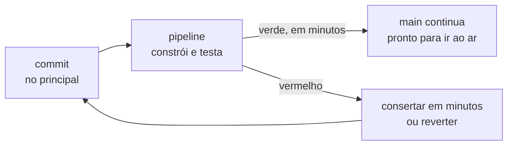
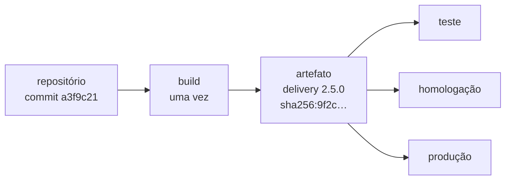
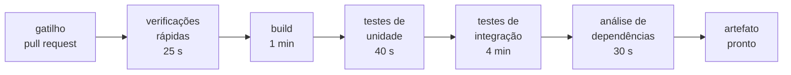

# Aula 10 — Integração contínua

> 🎯 Objetivos: explicar a integração contínua como prática — integrar todo dia e verificar cada integração —, reconhecer o que torna um build reproduzível, ordenar os estágios de um pipeline e as camadas da pirâmide de testes, e decidir o que barra uma mudança sem deixar a métrica virar meta.
> 🎬 Slides da aula: [apresentacao-10-integracao-continua.pdf](apresentacao/apresentacao-10-integracao-continua.pdf)

A Aula 09 terminou com uma pendência. Integrar no `main` todo dia, como pedem o GitHub Flow e o tronco, só é seguro se alguém conferir **cada** integração. E conferir à mão, a cada commit, não escala.

Esta aula é sobre quem confere. Não é uma pessoa: é uma máquina, seguindo um roteiro que o time escreveu e versiona junto com o código. Como na Aula 09, não é preciso programar para entender nada aqui. O que se decide é **o que conta como "não quebrou"**, e essa decisão é de projeto.

## 1. Integrar todo dia, verificar toda vez

### O sábado que um teste teria evitado

Volte ao sábado da Aula 09. Às 19h40, alguém publicou no [delivery](../../recursos/projetos-para-praticar.md#5-delivery-de-restaurante-do-bairro) uma correção no cálculo do frete, e às 20h os pagamentos on-line deixaram de ser confirmados. A correção passou a calcular o frete com três casas decimais, e o serviço de pagamento recusa qualquer valor que não tenha exatamente duas. O `git revert` desfez o estrago em minutos, mas o estrago aconteceu, com o salão cheio.

Agora a mesma correção num time com **integração contínua**:

| Hora | Sem integração contínua | Com integração contínua |
|---|---|---|
| 19h32 | Ana termina a correção do frete | Ana termina a correção e envia para o repositório |
| 19h33 | — | uma máquina monta o sistema do zero e roda os 1.030 testes automáticos |
| 19h38 | — | um teste falha: *"pedido com pagamento on-line deveria ficar confirmado, ficou pendente"* |
| 19h40 | a correção vai para o ar | a correção **não entra** no `main`; Ana vê o erro e corrige |
| 20h00 | os pagamentos param | os pagamentos continuam |

Ana não teve mais talento nem mais cuidado no segundo sábado. Mudou **quando o defeito foi descoberto**: seis minutos depois de enviado, antes de chegar a qualquer cliente, e não vinte minutos depois, em produção.

### O que é integração contínua

**Integração contínua** (*continuous integration*, ou CI) é a prática de **integrar o trabalho de todos no ramo principal com frequência — pelo menos uma vez por dia — e verificar automaticamente cada integração**, de modo que um problema apareça em minutos, enquanto ainda é pequeno.

A prática nasceu na *Extreme Programming* (XP), de Kent Beck, nos anos 1990. O texto que a popularizou é de Martin Fowler, publicado em 2000 e revisto em janeiro de 2024. A lista dele tem onze práticas, que se resumem em três exigências:

| Exigência | O que significa | Sem ela |
|---|---|---|
| **Integrar no principal, todo dia** | ramos curtos, como no GitHub Flow e no tronco da Aula 09 | a máquina confere trabalho isolado, e o problema de juntar tudo fica para depois |
| **Verificar cada integração, automaticamente** | a cada envio, uma máquina constrói o sistema e roda os testes | depende de alguém lembrar, e ninguém lembra às 19h30 de sábado |
| **Consertar o vermelho antes de qualquer outra coisa** | integração quebrada é a prioridade do time até voltar a passar | o vermelho vira paisagem, e a verificação deixa de significar alguma coisa |

O resultado é um ciclo curto de retorno:



> 💡 **Integração contínua é a prática, não a ferramenta.** Ter um pipeline configurado e ramos que vivem três semanas não é integração contínua: é uma máquina conferindo, com toda a pontualidade, um trabalho que continua sendo integrado tarde. Fowler é direto: rodar o pipeline num ramo que só volta ao principal quando a funcionalidade termina é, nas palavras dele, **meia integração**.

### O vermelho é a prioridade

A terceira exigência é a que mais falha, porque é cultural. Kent Beck a resumiu numa frase: *"ninguém tem tarefa mais prioritária do que consertar o build"*.

Na prática, quem quebrou tem alguns minutos para consertar. Se o conserto não é óbvio, **reverte** — o `git revert` da Aula 09 — e conserta com calma no próprio ramo. Reverter não é derrota: é devolver o principal ao estado em que todo mundo consegue trabalhar.

O motivo da pressa é o que acontece quando o vermelho fica. As integrações seguintes caem sobre uma base quebrada, e ninguém sabe se a própria mudança quebrou mais alguma coisa, porque o pipeline já estava vermelho antes. Em três dias, o time aprende a integrar sem olhar o resultado.

> ⚠️ **Um alarme que toca o tempo todo é um alarme desligado.** Pipeline vermelho por dias não é um pipeline com um problema: é um time sem integração contínua, com uma ferramenta ligada.

### Por que isso importa mais agora

O relatório **DORA de 2024** — o mesmo programa de pesquisa da Aula 09 — dedicou boa parte da pesquisa ao efeito da inteligência artificial no desenvolvimento. A adoção de IA veio acompanhada de ganhos na qualidade da documentação, na qualidade do código e na velocidade da revisão. Mas, no desempenho de **entrega**, veio acompanhada de uma queda estimada de **1,5% na vazão** e de **7,2% na estabilidade**. A explicação dos autores: melhorar o processo de escrever código não melhora a entrega sozinho, sem o básico — **mudanças pequenas e testes robustos**.

O relatório de 2025, com quase cinco mil profissionais, chegou a uma conclusão parecida e mais geral: a IA funciona como **amplificador**. Ela reforça as práticas de um time que já entrega bem e expõe as fraquezas de um time que não entrega.

A leitura para esta aula é direta. Quem escreve código mais depressa produz mais mudanças, e maiores, por dia. Se a verificação continua manual, ela vira o gargalo — ou é pulada. **Quanto mais rápido se escreve, mais a verificação automática importa.**

## 2. O build: o mesmo resultado em qualquer máquina

### "Funciona na minha máquina"

No [prontuário de clínica-escola](../../recursos/projetos-para-praticar.md#10-prontuário-de-clínica-escola), o sistema compila sem erro no computador de Bruno e falha no servidor. Depois de uma tarde de investigação, aparecem três motivos: Bruno instalou à mão, meses atrás, uma versão de uma biblioteca que o servidor não tem; existe um arquivo de configuração que só está no computador dele; e o servidor usa uma versão mais nova do Node.js.

*"Funciona na minha máquina"* é a frase que anuncia um build que depende de coisas que não estão no repositório.

O **build** (a construção do sistema) é a segunda atividade da gerência de configuração da Aula 09: transformar o conteúdo do repositório num sistema que roda — baixar as bibliotecas nas versões certas, compilar, empacotar. Para servir de base à integração contínua, ele precisa de quatro propriedades:

| Propriedade | O que exige | No delivery |
|---|---|---|
| **automático** | um comando só, sem passo manual | `npm run build` — ninguém precisa lembrar a ordem das etapas |
| **a partir do repositório** | tudo de que o build precisa está versionado, ou é baixado numa versão fixada | o `package-lock.json` da Aula 09 diz a versão exata de cada biblioteca |
| **em ambiente limpo** | cada execução começa numa máquina nova, sem resto da anterior | a máquina do pipeline é criada para o build e apagada no fim |
| **reproduzível** | a mesma entrada produz o mesmo resultado | o build do commit `a3f9c21` sai hoje igual ao de ontem |

O ambiente limpo é o motivo de o pipeline rodar numa máquina que ninguém usa. É o único lugar onde o *"funciona na minha máquina"* é desmentido antes de chegar ao cliente.

### 22 de março de 2016: onze linhas

Azer Koçulu mantinha mais de duzentos pequenos pacotes no **npm**, o repositório público de bibliotecas JavaScript. Depois de uma disputa sobre o nome de um deles com a empresa Kik, ele retirou do ar todos os seus pacotes. Entre eles estava o **left-pad**: onze linhas de código que completam um texto com espaços à esquerda.

Milhares de projetos dependiam dele, e quase nenhum sabia. O left-pad era dependência de uma dependência de ferramentas usadas no mundo inteiro, como o Babel e o React. Por algumas horas, builds do mundo todo falharam — e não por mudança no código de ninguém: uma peça que vinha de fora deixou de existir. O npm tomou a medida inédita de republicar o pacote e, em seguida, mudou as regras para retirar um pacote do ar.

A lição é a da Aula 09, vista do build: **as dependências são itens de configuração**, mesmo as que você não escolheu diretamente. Três práticas respondem a ela:

- o **lockfile**, que fixa a versão exata de cada biblioteca, inclusive das dependências das dependências;
- uma **cópia das dependências** que a empresa usa, guardada num repositório interno, para o build não depender de um serviço de fora estar no ar;
- a **lista de materiais do software** (SBOM, *software bill of materials*): o inventário de tudo o que entra no sistema, gerado pelo build. Quando sai a notícia de uma falha numa biblioteca, a pergunta *"nós usamos isso?"* passa a ter resposta em segundos.

> 💡 **O build também é por onde se ataca.** Em março de 2024, o engenheiro Andres Freund estranhou que o acesso remoto por SSH a uma máquina de testes estava meio segundo mais lento. Investigando, descobriu uma porta dos fundos no **xz**, uma biblioteca de compressão presente em quase toda distribuição Linux. A parte maliciosa não estava no código do repositório: estava no pacote de release preparado por um colaborador que ganhara a confiança do projeto ao longo de dois anos, e em arquivos de teste que só eram ativados durante o build. A descoberta veio antes de as versões afetadas chegarem às distribuições estáveis. É um dos argumentos a favor de construir **a partir do repositório**, por um processo que qualquer um pode repetir e comparar.

### Construa uma vez

O build produz um **artefato**: o pacote que segue adiante — um arquivo `.jar`, uma imagem de contêiner, uma pasta pronta para publicar. A regra é construir **uma vez só** e levar **o mesmo artefato**, identificado pelo seu *hash*, a todos os ambientes:



Construir de novo para cada ambiente é dar ao sistema uma nova chance de sair diferente: basta uma biblioteca publicar uma versão entre um build e outro. Com um artefato só, o que foi testado é exatamente o que vai para o ar. Os ambientes e o caminho até a produção são o assunto da Aula 11.

## 3. O pipeline: a esteira de verificações

O **pipeline** (ou esteira) é a sequência de passos automáticos que roda a cada integração: constrói o sistema, executa as verificações e produz o artefato. Cada passo é um **estágio**. Se um estágio falha, os seguintes não rodam, e a mudança fica vermelha.

O pipeline do delivery, a cada pull request:



| Estágio | A pergunta que responde | Se falhar |
|---|---|---|
| **verificações rápidas** | o código segue o padrão do time? Há alguma senha ou token no meio dele? | erro de estilo, ou o segredo da Aula 09 chegando ao repositório |
| **build** | o sistema se constrói do zero, a partir do repositório? | falta arquivo, biblioteca ou passo que só existia na máquina de alguém |
| **testes de unidade** | cada regra, isolada, faz o que deveria? | uma regra de negócio quebrou — o frete, o cupom, o carrinho |
| **testes de integração** | as peças funcionam juntas, com o banco e com o pagamento simulado? | o encontro entre duas peças quebrou — foi o defeito do sábado |
| **análise de dependências** | alguma biblioteca usada tem falha de segurança conhecida? | é preciso atualizar a biblioteca antes de integrar |
| **artefato** | — | é o pacote verificado, com identificador, pronto para a Aula 11 |

As verificações rápidas são **análise estática**: leem o código sem executá-lo. Os testes, ao contrário, executam o código e conferem o resultado.

### Barato e rápido primeiro

Os estágios seguem um princípio: **falhar cedo**. O que é mais barato e mais provável de falhar roda primeiro. A verificação de estilo leva 15 segundos e pega um erro em cada dez envios; não faz sentido esperar quatro minutos de testes de integração para descobri-lo. E os estágios que não dependem um do outro rodam **em paralelo**: a busca de segredos não precisa esperar o build.

### Dez minutos

A XP propôs um limite que continua de pé: **o build de dez minutos**. Fowler registra que a maior parte dos projetos modernos consegue, e que um build de uma hora não é razoável.

O tempo importa por causa do comportamento que ele produz. Com um pipeline de 40 minutos, ninguém espera o resultado: a pessoa passa para a tarefa seguinte, e o vermelho chega quando ela já está em outro assunto. Pior, o time começa a juntar mudanças para "economizar execução" — que é exatamente o contrário da integração contínua.

Quando o pipeline fica lento, há três saídas, e nenhuma delas é rodar menos vezes:

- **paralelizar** os estágios independentes e dividir os testes em várias máquinas;
- **mover o lento para outro momento**: o teste de carga, que simula o sábado à noite, roda de madrugada ou antes de cada release, e não a cada pull request;
- **trocar testes lentos por testes rápidos** onde for possível, que é o assunto da seção 4.

### O pipeline é um arquivo

O pipeline não é configurado clicando numa tela: é um **arquivo de texto no repositório**, versionado como o resto. É a "definição do pipeline" da lista de itens de configuração da Aula 09. No GitHub Actions, a ferramenta de pipeline do GitHub, o arquivo do delivery seria assim. Você não precisa saber escrever um: precisa saber ler o que ele diz.

```yaml
# .github/workflows/verificar.yml
name: verificar                       # o nome que aparece em cada pull request

on:                                   # QUANDO roda
  pull_request:                       #   a cada pull request
  push:
    branches: [main]                  #   e a cada integração no main

permissions:
  contents: read                      # o mínimo: só ler o código (seção 5)

jobs:
  verificar:
    runs-on: ubuntu-latest            # ONDE roda: uma máquina nova, criada para isto
    timeout-minutes: 15               # se passar disso, alguma coisa está errada
    steps:
      # componentes de terceiros fixados pelo hash do commit, não pela versão (seção 5)
      - uses: actions/checkout@3d3c42e5aac5ba805825da76410c181273ba90b1     # v7.0.1
      - uses: actions/setup-node@949feb2413d6458794dcd2491c4babbbce0c15c1   # v7.1.0
      - run: npm ci                   # instala as versões exatas do lockfile
      - run: npm run segredos         # procura senhas e tokens: o mais barato primeiro
      - run: npm run lint             # estilo e erros óbvios
      - run: npm run build            # constrói do zero
      - run: npm test                 # testes de unidade e de integração
      - run: npm audit --audit-level=high   # dependências com falha grave conhecida
```

Quem muda esse arquivo muda **o que conta como "não quebrou"** para o time inteiro. Por isso a mudança no pipeline passa pelo mesmo caminho de qualquer mudança: ramo, pull request e revisão.

O GitLab CI/CD, o Jenkins e o Azure Pipelines fazem a mesma coisa com outro formato de arquivo. A máquina que executa os passos se chama ***runner***.

## 4. A pirâmide de testes

Nem todo teste custa o mesmo. No delivery, há três níveis:

| Nível | O que verifica | Exemplo no delivery | Quanto leva | Quando falha, aponta |
|---|---|---|---|---|
| **unidade** | uma regra, isolada do resto | o frete de 9,5 km custa R$ 12,00 | milissegundos | a função exata |
| **integração** | duas ou mais peças juntas | o pedido é gravado no banco, e o pagamento simulado o confirma | segundos | o encontro entre as peças |
| **ponta a ponta** (*end-to-end*) | o sistema inteiro, como o cliente usa | no navegador, o cliente monta o pedido, paga e vê "confirmado" | dezenas de segundos a minutos | "alguma coisa, em algum lugar do caminho" |

Um teste de unidade, escrito em JavaScript, é assim:

```javascript
test("frete de 9,5 km custa R$ 12,00", () => {
  expect(calcularFrete(9.5)).toBe(12.00);
});
```

> 🧩 **Ponte com POO:** em Java, o mesmo teste usa o **JUnit**, que o curso de Java apresenta na Aula 16. É a mesma ideia — código que verifica código:
>
> ```java
> @Test
> void freteDeNoveEMeioKmCustaDozeReais() {
>     assertEquals(12.00, Frete.calcular(9.5), 0.001);
> }
> ```

### A forma da pirâmide

Mike Cohn, no livro *Succeeding with Agile*, de 2009, desenhou a proporção recomendada como uma **pirâmide**: muitos testes de unidade na base, alguns de integração no meio, poucos ponta a ponta no topo.

```text
                /\
               /  \           ponta a ponta · 10 testes · minutos
              /----\
             /      \         integração · 120 testes · segundos
            /--------\
           /          \       unidade · 900 testes · milissegundos
          /____________\
```

Os testes ponta a ponta ficam poucos porque, como resume Fowler, são **frágeis, caros de escrever e demorados** de rodar. Mudar a posição de um botão quebra o teste sem quebrar o sistema, e uma falha deles diz que algo deu errado sem dizer onde.

Mas a base sozinha não basta, e o sábado mostra por quê. O teste de unidade do frete **passava**: a conta estava certa. O teste de unidade do pagamento também passava. O defeito estava no **encontro** dos dois — o frete com três casas chegando a um serviço que só aceita duas —, e só um teste de integração o pega. Cada nível vê uma coisa; a pirâmide diz a proporção, não que um nível substitui o outro.

> ⚠️ **O cone de sorvete.** É a pirâmide de cabeça para baixo: quase toda a verificação feita por testes ponta a ponta, ou à mão, e quase nenhum teste de unidade. O pipeline fica lento, falha por motivos que não são defeito e, com o tempo, ninguém mais confia nele.

> 💡 **A pirâmide é proporção, não dogma.** Há quem defenda mais testes de integração do que de unidade, em sistemas que são sobretudo a cola entre serviços. O ponto em que todos concordam: a maior parte dos testes precisa ser rápida, e os lentos, poucos e escolhidos.

### O teste instável

Um **teste instável** (*flaky test*) passa e falha **com o mesmo código**. Em 2016, o Google publicou que cerca de **16% dos seus testes** mostravam algum grau de instabilidade, e que **1,5% de todas as execuções** davam um resultado instável. E o que ele mais registrou foi a dificuldade de acabar com o problema: os testes instáveis novos apareciam mais ou menos no mesmo ritmo em que os antigos eram corrigidos.

As causas costumam ser as mesmas:

- o teste depende do **relógio** — e falha perto da meia-noite, ou no último dia do mês;
- depende da **ordem** em que os testes rodam, ou de um dado que outro teste deixou;
- depende de **rede** ou de um serviço externo, que às vezes demora;
- **espera um tempo fixo** — *"aguarda dois segundos e confere"* — e às vezes a resposta leva três.

O perigo do teste instável não é a falha: é o hábito que ela cria. A regra informal vira *"falhou? roda de novo"*. No dia em que o teste falhar por um defeito de verdade, alguém roda de novo, ele passa por acaso, e o defeito entra.

> ⚠️ **Um teste instável treina o time a ignorar o vermelho.** A conduta é a **quarentena**: o teste sai do conjunto que barra a integração (continua rodando, mas não bloqueia), ganha **um responsável e um prazo** e, no fim do prazo, é corrigido ou apagado. O que não se faz é deixá-lo bloqueando de vez em quando, nem adotar o *"roda até passar"* como regra.

## 5. A verificação que barra a mudança

### O pull request que não pode entrar

O GitHub, o GitLab e as outras plataformas permitem **proteger o ramo principal**: o `main` só aceita uma integração quando as verificações obrigatórias passaram e outra pessoa aprovou a mudança. É o controle de mudanças da Aula 09, agora executado pela máquina.

```text
Pull request #187 — feat: cupom de desconto

  ✅  verificar / verificações rápidas        22s
  ✅  verificar / build                     1m 02s
  ✅  verificar / testes de unidade            41s
  ❌  verificar / testes de integração      3m 48s
        pedido com cupom e pagamento on-line:
        esperado "confirmado", obtido "pendente"
  ✅  revisão: aprovado por Carla

  ⛔  Integração bloqueada: 1 verificação obrigatória falhou
```

Repare que **a revisão humana aprovou** e a integração continua bloqueada. As duas verificações são independentes, e cada uma vê o que a outra não vê.

### O que barra e o que só avisa

Nem toda verificação deve impedir a integração. O critério: **barra o que é objetivo e sempre indica problema; avisa o que depende de julgamento**.

| Barra a integração | Só avisa, na revisão |
|---|---|
| o build falhou | a cobertura do código alterado caiu (seção 6) |
| algum teste falhou | uma função ficou mais complexa que o padrão do time |
| há senha ou token no código | uma biblioteca tem versão nova disponível |
| uma biblioteca tem falha de segurança grave conhecida | o pipeline ficou dois minutos mais lento |
| falta a aprovação de outra pessoa | — |

As duas colunas erram em direções opostas. Uma barreira por motivo discutível é contornada, como avisa a Aula 09 sobre o processo pesado demais. E um aviso que ninguém lê não serve para nada: o lugar dele é a revisão, onde uma pessoa decide.

### A máquina confere o objetivo; a pessoa, o resto

O pipeline não substitui a revisão. Ele não sabe se a mudança faz o que o dono do restaurante pediu, se o nome da função faz sentido ou se havia um jeito mais simples. O que ele faz é **liberar quem revisa** de conferir espaço, vírgula e teste quebrado, para que a atenção vá para a intenção e para o desenho.

É também onde a **Definição de Pronto** da Aula 06 encontra a máquina. A parte dela que se responde com sim ou não sem julgamento — *"o build passa"*, *"os testes passam"*, *"não há segredo no código"* — vira verificação obrigatória. É o **sistema de qualidade** do time ficando executável: a regra deixa de depender de alguém lembrar dela. A leitura complementar [Qualidade que se mede](../../leituras-complementares/qualidade-que-se-mede/README.md) trata do sistema de qualidade do projeto inteiro, além do código.

### 14 de março de 2025: o pipeline tinha as chaves

O **tj-actions/changed-files** era um componente gratuito de GitHub Actions, usado em mais de 23 mil repositórios para descobrir quais arquivos um pull request alterou. Em 14 de março de 2025, atacantes que tinham obtido a credencial da conta automatizada que o mantinha alteraram o código e **moveram as tags de versão** existentes — `v45`, `v44` e quase todas as outras — para o commit alterado.

Nenhum dos repositórios afetados mudou uma linha. Na execução seguinte, os pipelines que usavam `tj-actions/changed-files@v45` baixaram o código do invasor, que leu a memória da máquina do pipeline e **escreveu nos registros da execução as senhas e chaves disponíveis ali**. Em repositório público, esses registros são públicos. A agência de cibersegurança dos Estados Unidos (CISA) emitiu um alerta, e a orientação foi a da Aula 09: tratar todo segredo exposto como comprometido e trocá-lo.

Três lições, todas desta aula e da anterior:

- **A tag se move; o hash do commit, não.** Na Aula 09, a tag da baseline não se move porque o time combinou assim. No componente de terceiros, quem decide é o dono dele — ou quem roubou a chave do dono. O hash do commit é calculado a partir do conteúdo e não pode apontar para outra coisa. Por isso o arquivo da seção 3 fixa os componentes pelo hash, com a versão só no comentário;
- **Permissão mínima.** O pipeline de um pull request precisa ler o código, não publicar pacotes. O `permissions: contents: read` do arquivo diz isso, e os segredos ficam só nos estágios que precisam deles;
- **O pipeline é parte do sistema.** Ele roda código de terceiros com acesso às chaves do time. Merece o mesmo cuidado de um servidor de produção.

> ⚠️ **"Na emergência, pula o pipeline."** O caminho emergencial da Aula 09 autoriza pular a **espera pela aprovação**, não a **verificação**. A correção feita às pressas, às 20h de sábado, é justamente a que mais precisa ser conferida — e, se o pipeline é lento demais para a emergência, o problema a resolver é o pipeline.

## 6. A métrica que vira meta

### O que a cobertura mede

A **cobertura de testes** é a porcentagem das linhas (ou dos caminhos) do código que **foram executadas** enquanto os testes rodavam. É útil para uma coisa: mostrar onde não há teste nenhum.

Veja dois testes para a mesma função:

```javascript
// teste A — executa e confere
test("frete de 9,5 km custa R$ 12,00", () => {
  expect(calcularFrete(9.5)).toBe(12.00);
});

// teste B — executa e não confere nada
test("calcula o frete", () => {
  calcularFrete(9.5);
});
```

Os dois dão a mesma cobertura à função `calcularFrete`. Se alguém quebrar o arredondamento do frete, o teste A falha e o teste B continua passando. **A cobertura diz que o código foi executado, não que foi verificado.**

### Quando a medida vira meta

Em 1975, o economista Charles Goodhart observou que qualquer regularidade estatística tende a desaparecer quando se passa a usá-la como instrumento de controle. Em 1997, a antropóloga Marilyn Strathern deu à ideia a forma pela qual ela ficou conhecida: **quando uma medida vira meta, ela deixa de ser uma boa medida**.

Com a cobertura, o mecanismo é previsível. A coordenação determina: *"abaixo de 90%, a integração não entra"*. O caminho mais rápido até os 90% é escrever testes como o B, testar trechos triviais e tirar da conta os arquivos difíceis. Em duas semanas o número sobe, e os defeitos continuam os mesmos.

Não é preciso má-fé para isso acontecer. Diante de uma barreira numérica, escrever o teste mais fácil que passa nela é o comportamento racional de quem precisa entregar. É o mesmo mecanismo da **velocidade usada para cobrar** da Aula 06: o número melhora, e o que ele deveria indicar, não.

### A cobertura como lanterna

Em 2020, o time de testes do Google publicou o que aprendeu medindo cobertura em escala. Primeiro: **não existe um número ideal**. Como referência geral, chamaram 60% de aceitável, 75% de louvável e 90% de exemplar, mas preferem que cada time escolha a própria referência a uma meta imposta de cima. Segundo: depois de certo ponto, o ganho de subir a cobertura é cada vez menor. E a pesquisa deles de 2019 concluiu que a cobertura é mais útil **no nível de cada mudança, durante a revisão**, do que como número do projeto inteiro.

Daí três bons usos:

- **olhar a cobertura do código alterado, no pull request**, como informação para quem revisa. *"A regra nova do cupom não tem nenhum teste"* é uma frase útil; *"o projeto tem 87%"* raramente é;
- **procurar o que está com cobertura zero no código de maior risco**: o pagamento, no delivery; a regra de quem vê qual prontuário, no prontuário;
- **avisar quando a cobertura cai**, em vez de barrar quando ela não atinge um número.

> 💡 **Teste de mutação: testar os testes.** A ferramenta introduz pequenos defeitos de propósito no código — troca um `>` por `>=`, um `+` por `-` — e roda os testes. Se eles continuam passando, o "mutante sobreviveu": nenhum teste confere aquela linha de verdade. O teste B deixa todos os mutantes vivos. Em 2018, o Google descreveu o sistema com que mostra os mutantes sobreviventes aos revisores, dentro da própria revisão de código.

### As métricas do pipeline que servem

O pipeline produz outras medidas, e algumas apoiam decisões de verdade:

| Métrica | A decisão que ela apoia | Sinal de problema |
|---|---|---|
| **duração do pipeline** | paralelizar, ou tirar o lento do pull request | passa de 10 a 15 minutos |
| **tempo para voltar ao verde** | reforçar a regra de consertar ou reverter | horas, ou dias |
| **testes em quarentena** | reservar tempo para corrigi-los | o número só cresce |
| **integrações no `main` por dia** | ver se os ramos voltaram a viver demais | menos de uma por pessoa |

Todas valem **para o time, nunca para a pessoa**, e nenhuma deve ser atrelada a bônus — senão vira meta, como a cobertura.

> 📖 FOWLER, [*Continuous Integration*](https://martinfowler.com/articles/continuousIntegration.html) (revisto em 2024), para a prática inteira, e, no mesmo site, [*The Practical Test Pyramid*](https://martinfowler.com/articles/practical-test-pyramid.html), de Ham Vocke, para a pirâmide. HUMBLE e FARLEY, *Entrega Contínua*, capítulos 3 e 5, para o pipeline. Para métrica que vira meta fora do código, a leitura complementar [Qualidade que se mede](../../leituras-complementares/qualidade-que-se-mede/README.md), seção 4.

### O que esta aula deixa no lugar

As três ideias da aula se encadeiam:


O artefato que sai verde do pipeline está **pronto** para ir ao ar. Estar pronto e estar no ar são coisas diferentes, e a distância entre as duas — quem decide, quando, para quantos clientes de cada vez — é a Aula 11.

## 🏋️ Exercícios da aula

Na pasta `aula-10/` do seu repositório:

1. **`ex01.md`** — o time do [delivery](../../recursos/projetos-para-praticar.md#5-delivery-de-restaurante-do-bairro) vai montar o pipeline. São oito verificações, com o tempo de cada uma: (a) construir e empacotar o sistema — 1 min; (b) 900 testes de unidade das regras de frete, cupom e carrinho — 40 s; (c) verificação de estilo do código — 15 s; (d) 120 testes de integração do pedido com o banco de dados e o pagamento simulado — 4 min; (e) 10 testes ponta a ponta do pedido completo, no navegador — 9 min; (f) busca de senhas e tokens no código — 10 s; (g) busca de bibliotecas com falha de segurança conhecida — 30 s; (h) teste de carga que simula o pico de sábado à noite — 25 min. Faça três coisas: (i) diga o nível da pirâmide de (b), (d) e (e), e o que é cada uma das outras; (ii) monte o pipeline que roda **a cada pull request**, em estágios, na ordem, dizendo o que roda em paralelo e o tempo total; (iii) diga o que fica **fora** desse pipeline e quando roda. *Confere assim: o seu pipeline precisa ficar perto dos dez minutos da seção 3. Se a (h) entrou nele, quem abre um pull request espera mais de meia hora — e passa a juntar mudanças para "economizar" execução. A (e) pode rodar em paralelo com a (d) ou só depois da integração no `main`; as duas escolhas se defendem, a (e) em série depois de tudo não se defende. E a (c) e a (f) vêm antes do build: não dependem dele e falham em segundos.*

2. **`ex02.md`** — leia o que o time do [prontuário de clínica-escola](../../recursos/projetos-para-praticar.md#10-prontuário-de-clínica-escola) disse na última retrospectiva e, para cada uma das cinco falas, escreva **o problema**, **a seção da aula que trata dele** e **o que você mudaria**: (a) *"O pipeline está vermelho desde terça, mas é aquele teste que sempre falha. A gente continua integrando."*; (b) *"O teste do login falha mais ou menos uma vez a cada cinco execuções. Quando falha, a gente roda de novo até passar."*; (c) *"A coordenação exigiu 90% de cobertura. Saímos de 61% para 91% em duas semanas, e os defeitos que chegam à homologação continuam os mesmos."*; (d) *"O `main` aceita integração com o pipeline falhando, para não travar ninguém."*; (e) *"O pipeline instala sempre a versão mais nova de cada biblioteca. Semana passada o build quebrou sem ninguém ter mexido no código."*. *Confere assim: nenhuma das cinco se resolve com "ter mais cuidado". Se a sua correção para a (c) foi exigir 95%, releia a seção 6 — o número subiu e o defeito não caiu, e é isso que diz o que aconteceu. E a (e) é o lockfile da Aula 09, visto pela seção 2.*

3. **`ex03.md`** — 🌶️ **Desafio.** O pipeline do delivery leva **14 minutos**. No sábado passado, às 20h10, uma correção urgente no pagamento esperou o pipeline inteiro enquanto os pedidos se acumulavam, e o dono do restaurante pediu: *"quero um botão para pular o pipeline nas emergências"*. **Escreva a recomendação ao dono**, contendo: (i) se o botão deve existir e, se existir, quem pode usá-lo, em que condições e com que registro, usando o caminho emergencial da Aula 09; (ii) o que muda no pipeline ou no processo para que a emergência não dependa do botão; (iii) **o que se perde** com a sua recomendação. *Confere assim: o dono tem uma preocupação legítima — 14 minutos de pedidos parados custam dinheiro. Se a sua resposta só diz "não pode pular", você recusou sem resolver. E se o botão existe sem registro e sem revisão depois, ele vira o caminho normal, como avisa a seção 3 da Aula 09.*

### 📤 Entrega

Estes exercícios são feitos em sala e vão para o **seu repositório** `exercicios-projeto-software`:

```bash
cd ..                 # da pasta da aula para a raiz do repositório
git add aula-10/
git commit -m "Resolve exercícios da aula 10"
git push
```

Confira no navegador que a pasta apareceu em `github.com/SEU-USUARIO/exercicios-projeto-software`.

## 🧠 Revisão

[8 questões de múltipla escolha](revisao/README.md) para conferir se os conceitos ficaram sólidos. Responda sem consultar a aula — depois volte e corrija.

**A entrega é pelo formulário:** [responder a revisão da Aula 10](https://docs.google.com/forms/d/e/1FAIpQLSeeZrk6WMdCCBNTZDWUSyXwpkkqWF2XKqs_EMqpASgP9xffwg/viewform)

Entre com uma conta Google, selecione seu nome na lista e informe seu usuário do GitHub — só o usuário, não o endereço do perfil. Se o seu nome ainda não estiver na lista, marque a última opção e escreva o nome completo no campo seguinte. É **uma resposta por aluno** e não dá para editar depois de enviar, então confira antes. A nota é liberada no AVA depois da revisão em sala e da divulgação do gabarito.

---

⬅️ [Aula 09 — Controle de versão e configuração](../aula-09-controle-de-versao-e-configuracao/README.md) | ➡️ [Aula 11 — Entrega e implantação contínuas](../aula-11-entrega-e-implantacao-continuas/README.md)
