<style>
/* Paleta da aula — a mesma da Aula 09, com os mesmos papéis:
   verde = está certo / passa · vermelho = quebra / barra · âmbar = atenção
   índigo e violeta = categorias neutras · cinza-azulado = contexto */
section {
  --teal: #0f766e; --teal-s: #e7f2f0;
  --ind: #4338ca;  --ind-s: #e0e7ff;
  --amb: #b45309;  --amb-s: #fef3c7;
  --red: #b91c1c;  --red-s: #fee2e2;
  --grn: #15803d;  --grn-s: #dcfce7;
  --vio: #7c3aed;  --vio-s: #ede9fe;
  --sky: #0369a1;  --sky-s: #e0f2fe;
  --sla: #334155;  --sla-s: #f1f5f9;
}
.grid2 { display: grid; grid-template-columns: 1fr 1fr; gap: 18px 24px; }
.grid3 { display: grid; grid-template-columns: repeat(3, 1fr); gap: 22px; }
.card { border: 3px solid var(--sla); background: var(--sla-s); border-radius: 14px;
        padding: 18px 22px; font-size: 25px; line-height: 1.38; }
.card b.t { display: block; font-size: 28px; margin-bottom: 6px; }
.card .num { display: block; font-size: 64px; font-weight: 800; line-height: 1.05; margin-bottom: 6px; }
.card .pe { display: block; margin-top: 10px; font-size: 22px; color: #475569; }
.card ul { margin: 6px 0 0; padding-left: 24px; }
.card li { font-size: 24px; margin: 4px 0; }
.teal { border-color: var(--teal); background: var(--teal-s); } .teal .num, .teal b.t { color: var(--teal); }
.ind  { border-color: var(--ind);  background: var(--ind-s);  } .ind .num,  .ind b.t  { color: var(--ind); }
.amb  { border-color: var(--amb);  background: var(--amb-s);  } .amb .num,  .amb b.t  { color: var(--amb); }
.red  { border-color: var(--red);  background: var(--red-s);  } .red .num,  .red b.t  { color: var(--red); }
.grn  { border-color: var(--grn);  background: var(--grn-s);  } .grn .num,  .grn b.t  { color: var(--grn); }
.vio  { border-color: var(--vio);  background: var(--vio-s);  } .vio .num,  .vio b.t  { color: var(--vio); }
.sky  { border-color: var(--sky);  background: var(--sky-s);  } .sky .num,  .sky b.t  { color: var(--sky); }
.legenda { font-size: 25px; margin-top: 18px; }
.chip { display: inline-block; border-radius: 999px; padding: 1px 14px; font-weight: 700;
        font-size: 21px; color: #fff; vertical-align: 2px; }
.chip.grn { background: var(--grn); } .chip.red { background: var(--red); } .chip.amb { background: var(--amb); }
.chip.ind { background: var(--ind); } .chip.vio { background: var(--vio); } .chip.sla { background: var(--sla); }
.chip.sky { background: var(--sky); }

/* linha do tempo */
.linha { display: flex; align-items: stretch; gap: 10px; margin-top: 8px; }
.passo { flex: 1; min-width: 0; border: 3px solid; border-radius: 12px; padding: 14px 14px; font-size: 22px; line-height: 1.32; }
.passo .hora { display: block; font-size: 27px; font-weight: 800; margin-bottom: 6px; }
.seta { align-self: center; font-size: 30px; color: #64748b; font-weight: 700; }
.p-sla { border-color: var(--sla); background: var(--sla-s); } .p-ind { border-color: var(--ind); background: var(--ind-s); }
.p-amb { border-color: var(--amb); background: var(--amb-s); } .p-red { border-color: var(--red); background: var(--red-s); }
.p-grn { border-color: var(--grn); background: var(--grn-s); } .p-vio { border-color: var(--vio); background: var(--vio-s); }
.p-teal { border-color: var(--teal); background: var(--teal-s); }

/* duas faixas lado a lado no tempo: sem CI × com CI */
.faixa { display: grid; grid-template-columns: 150px 1fr; gap: 14px; margin: 16px 0; }
.faixa .rot { color: #fff; font-weight: 800; font-size: 25px; border-radius: 12px;
              display: flex; align-items: center; justify-content: center; text-align: center; line-height: 1.2; }
.faixa .rot.red { background: var(--red); } .faixa .rot.grn { background: var(--grn); }
.faixa .linha { margin-top: 0; }
.faixa .passo { font-size: 21px; padding: 10px 12px; }
.faixa .passo .hora { font-size: 25px; margin-bottom: 2px; }

/* estágios do pipeline: estágio · pergunta · tempo */
.estagios { display: grid; grid-template-columns: 300px 1fr 100px; gap: 10px 18px; align-items: center; font-size: 24px; }
.est { color: #fff; font-weight: 700; border-radius: 10px; padding: 9px 12px; text-align: center; }
.est.sla { background: var(--sla); } .est.amb { background: var(--amb); } .est.ind { background: var(--ind); }
.est.grn { background: var(--grn); } .est.vio { background: var(--vio); } .est.red { background: var(--red); }
.est.teal { background: var(--teal); }
.tempo { font-family: Menlo, Consolas, monospace; font-weight: 700; text-align: right; color: var(--sla); }

/* barras de tempo */
.barras .lin { display: flex; align-items: center; gap: 18px; margin: 8px 0; font-size: 24px; }
.barras .rot { width: 300px; flex: none; font-weight: 700; text-align: right; }
.barras .bar { height: 40px; border-radius: 8px; flex: none; }

/* pirâmide de testes: três trapézios empilhados */
.piramide { width: 640px; display: flex; flex-direction: column; gap: 6px; }
.piramide .n { height: 118px; display: flex; flex-direction: column; justify-content: center; align-items: center;
               color: #fff; font-weight: 800; font-size: 27px; line-height: 1.2; text-align: center; }
.piramide .n small { font-weight: 500; font-size: 21px; }
.piramide .topo { background: var(--amb); clip-path: polygon(37% 0, 63% 0, 75% 100%, 25% 100%); }
.piramide .meio { background: var(--ind); clip-path: polygon(25% 0, 75% 0, 87.5% 100%, 12.5% 100%); }
.piramide .base { background: var(--grn); clip-path: polygon(12.5% 0, 87.5% 0, 100% 100%, 0 100%); }
.piramide.mini { width: 470px; margin: 0 auto; }
.piramide.mini .n { height: 92px; font-size: 23px; }
.piramide.cone .n:nth-child(1) { background: var(--red); clip-path: polygon(0 0, 100% 0, 87.5% 100%, 12.5% 100%); }
.piramide.cone .n:nth-child(2) { background: var(--ind); clip-path: polygon(12.5% 0, 87.5% 0, 75% 100%, 25% 100%); }
.piramide.cone .n:nth-child(3) { background: var(--grn); clip-path: polygon(25% 0, 75% 0, 63% 100%, 37% 100%); }
.lado { display: grid; grid-template-columns: 640px 1fr; gap: 30px; align-items: center; }

/* pull request com verificações */
.pr { border: 2px solid #cbd5e1; border-radius: 12px; background: #fff; overflow: hidden; font-size: 23px; }
.pr .cab { background: var(--sla-s); padding: 10px 22px; font-weight: 800; font-size: 25px; border-bottom: 2px solid #cbd5e1; }
.pr .ck { display: grid; grid-template-columns: 46px 1fr 110px; padding: 7px 22px; border-bottom: 1px solid #e2e8f0; align-items: center; }
.pr .ck .t { font-family: Menlo, Consolas, monospace; text-align: right; color: #475569; font-size: 21px; }
.pr .ck.falha { background: var(--red-s); }
.pr .det { grid-column: 2 / 4; font-family: Menlo, Consolas, monospace; font-size: 19px; color: var(--red); margin-top: 2px; }
.pr .bloq { background: var(--red); color: #fff; font-weight: 800; padding: 12px 22px; font-size: 25px; }

/* trilho de commits com a tag movida */
.trilho { display: flex; width: max-content; margin: 30px auto 6px; position: relative; }
.trilho::before { content: ""; position: absolute; top: 19px; left: 120px; right: 120px; height: 7px;
                  background: #94a3b8; border-radius: 3px; }
.cm { width: 240px; display: flex; flex-direction: column; align-items: center; gap: 10px;
      font-size: 23px; text-align: center; position: relative; z-index: 1; }
.bola { width: 44px; height: 44px; border-radius: 50%; background: #fff; border: 8px solid var(--teal); box-sizing: border-box; }
.cm.mal .bola { border-color: var(--red); background: var(--red); }
.tag { border: 2px solid; border-radius: 8px; padding: 1px 12px; font-weight: 700; font-size: 23px; white-space: nowrap;
       font-family: Menlo, Consolas, monospace; }
.tag.velha { border-style: dashed; border-color: #94a3b8; color: #94a3b8; text-decoration: line-through; }
.tag.nova { background: var(--red-s); border-color: var(--red); color: var(--red); }

/* código escuro, com destaque */
.cod { background: #1e1e1e; color: #e6e6e6; border-radius: 12px; padding: 14px 20px; white-space: pre;
       font-family: Menlo, Consolas, monospace; font-size: 21px; line-height: 1.55; }
.cod .c { color: #7f9c68; font-style: italic; } .cod .s { color: #d69d78; } .cod .f { color: #ddd9a0; }
.cod .ok { color: #86efac; font-weight: 700; }
.res { margin-top: 12px; font-size: 23px; line-height: 1.6; }

section.codigo pre > code { font-size: 19px; line-height: 1.45; }
</style>

<!-- _class: capa -->

<div class="emoji">🔁</div>

# Integração Contínua

## Aula 10 · Bloco 3 — Do Código à Produção

<div class="meta">Integrar todo dia — e deixar uma máquina conferir cada integração</div>

---

## 🎯 Nesta aula

1. **Integrar todo dia**, verificar toda vez — e o vermelho como prioridade
2. O **build** que dá o mesmo resultado em qualquer máquina
3. O **pipeline**: os estágios, a ordem e os dez minutos
4. A **pirâmide de testes** — e o teste instável
5. A **verificação que barra** a mudança, e a métrica que vira meta

---

## O mesmo sábado, duas vezes

A correção do frete, da Aula 09, passou a calcular com **três casas decimais** — e o serviço de pagamento só aceita duas.

<div class="faixa"><div class="rot red">sem CI</div>
<div class="linha">
<div class="passo p-sla"><span class="hora">19h32</span>Ana termina a correção</div>
<div class="seta">→</div>
<div class="passo p-amb"><span class="hora">19h40</span>a correção vai para o ar</div>
<div class="seta">→</div>
<div class="passo p-red"><span class="hora">20h00</span>os pagamentos param, com o salão cheio</div>
</div></div>

<div class="faixa"><div class="rot grn">com CI</div>
<div class="linha">
<div class="passo p-sla"><span class="hora">19h32</span>Ana envia ao repositório</div>
<div class="seta">→</div>
<div class="passo p-ind"><span class="hora">19h33</span>uma máquina monta e roda 1.030 testes</div>
<div class="seta">→</div>
<div class="passo p-red"><span class="hora">19h38 ✗</span>"deveria ficar confirmado, ficou pendente"</div>
<div class="seta">→</div>
<div class="passo p-grn"><span class="hora">20h00</span>a correção não entrou; os pagamentos seguem</div>
</div></div>

<p class="legenda">Ana não teve mais cuidado no segundo sábado. Mudou <b>quando o defeito foi descoberto</b>.</p>

---

## O que é integração contínua

<div class="grid3">
<div class="card ind"><b class="t">Integrar no principal, todo dia</b>ramos curtos, como no GitHub Flow e no tronco da Aula 09<span class="pe">sem isso: a máquina confere trabalho isolado</span></div>
<div class="card teal"><b class="t">Verificar cada integração</b>a cada envio, uma máquina constrói o sistema e roda os testes<span class="pe">sem isso: depende de alguém lembrar</span></div>
<div class="card red"><b class="t">Consertar o vermelho primeiro</b>integração quebrada é a prioridade do time até voltar a passar<span class="pe">sem isso: o vermelho vira paisagem</span></div>
</div>

<p class="legenda">A prática nasceu na <b>XP</b>, de Kent Beck, nos anos 1990. O texto de referência é de Martin Fowler — 2000, revisto em janeiro de 2024.</p>

---

## O ciclo curto de retorno



<p class="legenda">O ganho não é impedir o erro: é <b>descobri-lo em minutos</b>, quando ainda é uma linha, e não em semanas, quando são quatrocentas.</p>

---

<!-- _class: lead -->

## 💡 A prática, não a ferramenta

Um pipeline configurado
com ramos que vivem três semanas
**não é integração contínua**.

É uma máquina conferindo, com pontualidade,
um trabalho que continua integrado tarde —
a **"meia integração"**, nas palavras de Fowler.

---

## O vermelho é a prioridade

> *"Ninguém tem tarefa mais prioritária do que consertar o build."* — Kent Beck

<div class="linha">
<div class="passo p-red"><span class="hora">falhou</span>o pipeline do <code>main</code> ficou vermelho</div>
<div class="seta">→</div>
<div class="passo p-amb"><span class="hora">minutos</span>quem quebrou tenta consertar</div>
<div class="seta">→</div>
<div class="passo p-ind"><span class="hora">não é óbvio?</span>reverte — o <code>git revert</code> da Aula 09</div>
<div class="seta">→</div>
<div class="passo p-grn"><span class="hora">verde</span>conserta com calma no próprio ramo</div>
</div>

> ⚠️ **Um alarme que toca o tempo todo é um alarme desligado.** Vermelho por três dias, e o time aprende a integrar sem olhar o resultado.

---

## Por que isso importa mais agora

<div class="grid3">
<div class="card sla"><span class="num">+25%</span>de adoção de IA no desenvolvimento — a referência da comparação</div>
<div class="card amb"><span class="num">−1,5%</span>na <b>vazão</b> da entrega, estimada</div>
<div class="card red"><span class="num">−7,2%</span>na <b>estabilidade</b> da entrega, estimada</div>
</div>

<p class="legenda">DORA 2024. A explicação dos autores: escrever melhor não vira entregar melhor sem o básico — <b>mudanças pequenas e testes robustos</b>.</p>

> 💡 **DORA 2025, com quase 5 mil profissionais:** a IA é um **amplificador**. Reforça o time que já entrega bem e expõe o que não entrega. Quanto mais rápido se escreve, mais a verificação automática importa.

---

## "Funciona na minha máquina"

<div class="grid2">
<div class="card ind"><b class="t">Automático</b>um comando só, sem passo manual<span class="pe"><code>npm run build</code></span></div>
<div class="card amb"><b class="t">A partir do repositório</b>tudo versionado, ou baixado numa versão fixada<span class="pe">o lockfile da Aula 09</span></div>
<div class="card teal"><b class="t">Em ambiente limpo</b>cada execução começa numa máquina nova<span class="pe">criada para o build, apagada no fim</span></div>
<div class="card vio"><b class="t">Reproduzível</b>a mesma entrada dá o mesmo resultado<span class="pe">o build do <code>a3f9c21</code> sai hoje igual a ontem</span></div>
</div>

<p class="legenda">O <b>build</b> é a construção do sistema — a 2ª atividade da gerência de configuração da Aula 09.</p>

---

## 22/03/2016: onze linhas

<div class="linha">
<div class="passo p-sla"><span class="hora">a disputa</span>um autor perde para uma empresa o nome de um pacote</div>
<div class="seta">→</div>
<div class="passo p-amb"><span class="hora">a retirada</span>ele tira do npm todos os seus pacotes</div>
<div class="seta">→</div>
<div class="passo p-red"><span class="hora">left-pad</span>11 linhas, dependência de dependência de Babel e React</div>
<div class="seta">→</div>
<div class="passo p-red"><span class="hora">horas</span>builds do mundo todo falham — sem ninguém mudar código</div>
<div class="seta">→</div>
<div class="passo p-grn"><span class="hora">a volta</span>o npm republica o pacote e muda a regra</div>
</div>

<p class="legenda"><b>As dependências são itens de configuração</b> — inclusive as que você não escolheu diretamente.</p>

---

## O que o build não pode deixar ao acaso

<div class="grid3">
<div class="card ind"><b class="t">Lockfile</b>a versão exata de cada biblioteca, inclusive das indiretas</div>
<div class="card teal"><b class="t">Cópia interna</b>as dependências guardadas pela empresa, para não depender de um serviço de fora</div>
<div class="card vio"><b class="t">SBOM</b>a lista de materiais do software: <i>"nós usamos isso?"</i> com resposta em segundos</div>
</div>

> 💡 **O build também é por onde se ataca.** Em 2024, uma porta dos fundos no **xz**, biblioteca de quase todo Linux, estava no pacote de release e em arquivos de teste ativados no build — não no código do repositório. Foi achada porque o SSH ficou **meio segundo** mais lento. Construir a partir do repositório, por um processo que qualquer um repete, é parte da defesa.

---

## Construa uma vez



<p class="legenda">O build produz um <b>artefato</b> — identificado pelo hash — e é <b>ele</b> que vai a todos os ambientes. Construir de novo para cada um é dar ao sistema outra chance de sair diferente. Os ambientes são a Aula 11.</p>

---

## O pipeline do delivery, a cada pull request

<div class="estagios">
<div class="est sla">⚡ gatilho</div><div>cada pull request, e cada integração no <code>main</code></div><div class="tempo">—</div>
<div class="est amb">🔎 verificações rápidas</div><div>há senha no código? O estilo segue o padrão do time?</div><div class="tempo">25 s</div>
<div class="est ind">🔨 build</div><div>o sistema se constrói do zero, a partir do repositório?</div><div class="tempo">1 min</div>
<div class="est grn">🧪 testes de unidade</div><div>cada regra, isolada, faz o que deveria?</div><div class="tempo">40 s</div>
<div class="est vio">🔗 testes de integração</div><div>as peças funcionam juntas — banco, pagamento simulado?</div><div class="tempo">4 min</div>
<div class="est red">🛡️ dependências</div><div>alguma biblioteca tem falha de segurança conhecida?</div><div class="tempo">30 s</div>
<div class="est teal">📦 artefato</div><div>o pacote verificado, pronto para a Aula 11</div><div class="tempo">✓</div>
</div>

<p class="legenda">Se um estágio falha, os seguintes não rodam — e a mudança fica <b>vermelha</b>.</p>

---

## Barato e rápido primeiro — e dez minutos no total

<div class="barras">
<div class="lin"><span class="rot">verificações rápidas</span><span class="bar" style="width:55px;background:var(--amb)"></span><span>25 s · falha em 1 de cada 10 envios</span></div>
<div class="lin"><span class="rot">build</span><span class="bar" style="width:130px;background:var(--ind)"></span><span>1 min</span></div>
<div class="lin"><span class="rot">testes de unidade</span><span class="bar" style="width:87px;background:var(--grn)"></span><span>40 s</span></div>
<div class="lin"><span class="rot">testes de integração</span><span class="bar" style="width:520px;background:var(--vio)"></span><span>4 min</span></div>
<div class="lin"><span class="rot">dependências</span><span class="bar" style="width:65px;background:var(--red)"></span><span>30 s</span></div>
</div>

<p class="legenda"><b>Falhar cedo:</b> o mais barato e o mais provável de falhar vão na frente; o que não depende de nada roda em paralelo. Total: <b>6,5 min</b> — a XP propôs <b>10</b>.</p>

> ⚠️ **Pipeline de 40 minutos:** ninguém espera o resultado, e o time passa a **juntar mudanças** para economizar execução — o contrário da integração contínua.

---

<!-- _class: codigo -->

## O pipeline é um arquivo — versionado como o resto

```yaml
on: [pull_request, push]               # QUANDO: a cada pull request e a cada envio
permissions: { contents: read }        # o mínimo: só ler o código
jobs:
  verificar:
    runs-on: ubuntu-latest             # ONDE: uma máquina nova, criada para isto
    steps:
      - uses: actions/checkout@3d3c42e5aac5ba805825da76410c181273ba90b1   # v7.0.1
      - run: npm ci                    # as versões exatas do lockfile
      - run: npm run segredos          # o mais barato primeiro
      - run: npm run lint
      - run: npm run build             # constrói do zero
      - run: npm test                  # unidade e integração
      - run: npm audit --audit-level=high
```

<p class="legenda">Item de configuração da Aula 09: quem muda este arquivo muda o que conta como <i>"não quebrou"</i>.</p>

---

## A pirâmide de testes

<div class="lado">
<div class="piramide">
<div class="n topo">ponta a ponta<small>10 · minutos</small></div>
<div class="n meio">integração<small>120 · segundos</small></div>
<div class="n base">unidade<small>900 · milissegundos</small></div>
</div>
<div>
<div class="card amb"><b class="t">↑ No topo</b>frágeis, caros de escrever, demorados — e, quando falham, não dizem onde</div>
<p></p>
<div class="card grn"><b class="t">↓ Na base</b>rápidos, baratos — e apontam a função exata</div>
</div>
</div>

<p class="legenda">Mike Cohn, <i>Succeeding with Agile</i> (2009). A pirâmide diz a <b>proporção</b> — não que um nível substitui o outro.</p>

---

## Cada nível vê uma coisa

| Nível | Verifica | No delivery |
|---|---|---|
| **unidade** | uma regra, isolada | o frete de 9,5 km custa R$ 12,00 |
| **integração** | as peças juntas | o pedido é gravado, e o pagamento simulado o confirma |
| **ponta a ponta** | o sistema inteiro, como o cliente usa | no navegador: monta o pedido, paga, vê "confirmado" |

<p class="legenda">No sábado: unidade do frete <span class="chip grn">passou</span> · unidade do pagamento <span class="chip grn">passou</span> · integração dos dois <span class="chip red">falhou</span><br>O defeito estava no <b>encontro</b> — e só o meio da pirâmide o pega.</p>

---

## A pirâmide e o cone de sorvete

<div class="grid2">
<div>
<div class="piramide mini">
<div class="n topo">ponta a ponta</div>
<div class="n meio">integração</div>
<div class="n base">unidade</div>
</div>
<p class="legenda" style="text-align:center"><span class="chip grn">rápido e confiável</span></p>
</div>
<div>
<div class="piramide mini cone">
<div class="n">ponta a ponta e à mão</div>
<div class="n">integração</div>
<div class="n">unidade</div>
</div>
<p class="legenda" style="text-align:center"><span class="chip red">lento e desacreditado</span></p>
</div>
</div>

<p class="legenda">O <b>cone</b> é a pirâmide de cabeça para baixo: o pipeline fica lento, falha por motivos que não são defeito — e, com o tempo, ninguém mais confia nele.</p>

---

## O teste instável

Passa e falha **com o mesmo código**. Os números do Google, em 2016:

<div class="grid2">
<div class="card amb"><span class="num">16%</span>dos testes mostravam algum grau de instabilidade</div>
<div class="card red"><span class="num">1,5%</span>de todas as execuções davam resultado instável</div>
</div>

<p class="legenda">As causas de sempre: <span class="chip sla">o relógio</span> <span class="chip sla">a ordem dos testes</span> <span class="chip sla">a rede</span> <span class="chip sla">"espera 2 s e confere"</span></p>

> ⚠️ **O perigo não é a falha: é o hábito.** *"Falhou? Roda de novo."* — e, no dia em que a falha for de verdade, ela passa por acaso.

---

## Quarentena, não "roda até passar"



<p class="legenda">Na quarentena, o teste <b>continua rodando</b> e deixa de barrar a integração — com <b>um responsável e um prazo</b>. No fim do prazo, é corrigido ou apagado.</p>

---

## O pull request que não pode entrar

<div class="pr">
<div class="cab">Pull request #187 — feat: cupom de desconto</div>
<div class="ck"><span>✅</span><span>verificar / verificações rápidas</span><span class="t">22s</span></div>
<div class="ck"><span>✅</span><span>verificar / build</span><span class="t">1m 02s</span></div>
<div class="ck"><span>✅</span><span>verificar / testes de unidade</span><span class="t">41s</span></div>
<div class="ck falha"><span>❌</span><span>verificar / testes de integração</span><span class="t">3m 48s</span><span class="det">pedido com cupom e pagamento on-line: esperado "confirmado", obtido "pendente"</span></div>
<div class="ck"><span>✅</span><span>revisão: aprovado por Carla</span><span class="t"></span></div>
<div class="bloq">⛔ Integração bloqueada: 1 verificação obrigatória falhou</div>
</div>

<p class="legenda">A pessoa aprovou — e a integração continua bloqueada. O <b>ramo protegido</b> é o controle de mudanças da Aula 09, executado pela máquina.</p>

---

## O que barra, e o que só avisa

<div class="grid2">
<div class="card red"><b class="t">⛔ Barra — é objetivo</b><ul>
<li>o build falhou</li>
<li>algum teste falhou</li>
<li>há senha ou token no código</li>
<li>biblioteca com falha grave conhecida</li>
<li>falta a aprovação de outra pessoa</li>
</ul></div>
<div class="card sky"><b class="t">💬 Avisa — pede julgamento</b><ul>
<li>a cobertura do código alterado caiu</li>
<li>uma função ficou mais complexa</li>
<li>há versão nova de uma biblioteca</li>
<li>o pipeline ficou mais lento</li>
</ul></div>
</div>

<p class="legenda">A máquina confere o objetivo; a pessoa revisa a intenção e o desenho. É a parte da <b>Definição de Pronto</b> da Aula 06 que se responde com sim ou não — o <b>sistema de qualidade</b> ficando executável.</p>

---

## 14/03/2025: o pipeline tinha as chaves

<div class="linha">
<div class="passo p-sla"><span class="hora">a peça</span><code>tj-actions/</code><br><code>changed-files</code>, em mais de 23 mil repositórios</div>
<div class="seta">→</div>
<div class="passo p-amb"><span class="hora">a chave</span>atacantes têm a credencial da conta que o mantém</div>
<div class="seta">→</div>
<div class="passo p-red"><span class="hora">as tags</span>o código muda, e <code>v45</code> e as outras <b>são movidas</b></div>
<div class="seta">→</div>
<div class="passo p-red"><span class="hora">os registros</span>os pipelines escrevem as senhas nos logs — públicos</div>
<div class="seta">→</div>
<div class="passo p-grn"><span class="hora">a resposta</span>alerta da CISA: trocar todo segredo exposto</div>
</div>

<p class="legenda"><b>Nenhum dos repositórios afetados mudou uma linha.</b> Bastou o pipeline baixar o componente pela tag, como sempre.</p>

---

## A tag se move; o hash do commit, não

<div class="trilho">
<div class="cm"><span class="bola"></span><span>versão legítima</span><span class="tag velha">v45</span></div>
<div class="cm"><span class="bola"></span><span>…</span></div>
<div class="cm mal"><span class="bola"></span><span><code>0e58ed8</code><br>código do invasor</span><span class="tag nova">v45</span></div>
</div>

<div class="grid3">
<div class="card grn"><b class="t">Fixar pelo hash</b>calculado do conteúdo, não aponta para outra coisa — a versão vai no comentário</div>
<div class="card ind"><b class="t">Permissão mínima</b>o pull request só lê o código; segredo só no estágio que precisa</div>
<div class="card red"><b class="t">Segredo exposto se troca</b>apagar o log não desfaz o vazamento — a lição da Aula 09</div>
</div>

---

## Cobertura: executado não é verificado

<div class="grid2">
<div>
<div class="cod"><span class="c">// teste A — executa e confere</span>
<span class="f">test</span>(<span class="s">"frete de 9,5 km custa R$ 12"</span>, () => {
  <span class="ok">expect(calcularFrete(9.5)).toBe(12.00);</span>
});</div>
<div class="res">cobertura <span class="chip grn">100%</span><br>quebrou o arredondamento? <span class="chip grn">falha</span></div>
</div>
<div>
<div class="cod"><span class="c">// teste B — executa e não confere</span>
<span class="f">test</span>(<span class="s">"calcula o frete"</span>, () => {
  calcularFrete(9.5);
});</div>
<div class="res">cobertura <span class="chip grn">100%</span><br>quebrou o arredondamento? <span class="chip red">continua passando</span></div>
</div>
</div>

> 💡 **Teste de mutação: testar os testes.** A ferramenta troca um `>` por `>=`, um `+` por `-`, e roda a suíte. O teste B deixa **todos os mutantes vivos**.

---

## Quando a medida vira meta

> **Quando uma medida vira meta, ela deixa de ser uma boa medida.**
> — Marilyn Strathern (1997), a partir de Charles Goodhart (1975)

<div class="linha">
<div class="passo p-sla"><span class="hora">a regra</span>"abaixo de 90% de cobertura, não entra"</div>
<div class="seta">→</div>
<div class="passo p-amb"><span class="hora">o atalho</span>testes como o B, trechos triviais, arquivos difíceis fora da conta</div>
<div class="seta">→</div>
<div class="passo p-red"><span class="hora">o resultado</span>o número sobe em duas semanas; os defeitos, iguais</div>
</div>

<p class="legenda">Sem má-fé: é o comportamento racional diante de uma barreira numérica. É a <b>velocidade usada para cobrar</b>, da Aula 06.</p>

---

## A cobertura como lanterna

<div class="grid3">
<div class="card sla"><span class="num">60%</span>aceitável</div>
<div class="card ind"><span class="num">75%</span>louvável</div>
<div class="card teal"><span class="num">90%</span>exemplar</div>
</div>

<p class="legenda">Referências do Google (2020) — que diz que <b>não existe número ideal</b> e prefere que cada time escolha a sua.</p>

<div class="grid3">
<div class="card grn"><b class="t">No pull request</b>a cobertura do <b>código alterado</b>, para quem revisa</div>
<div class="card amb"><b class="t">No risco</b>o que está com zero no pagamento, ou no acesso ao prontuário</div>
<div class="card sky"><b class="t">Avisar quando cai</b>em vez de barrar abaixo de um número</div>
</div>

---

## O que esta aula deixa no lugar


<p class="legenda">O artefato que sai verde está <b>pronto</b> para ir ao ar. Estar pronto e estar no ar são coisas diferentes.</p>

---

<!-- _class: lead -->

## ➡️ Próxima aula

**Aula 11 — Entrega e implantação contínuas**

O artefato está pronto.
Quem decide quando ele vai ao ar —
e para quantos clientes de cada vez?
