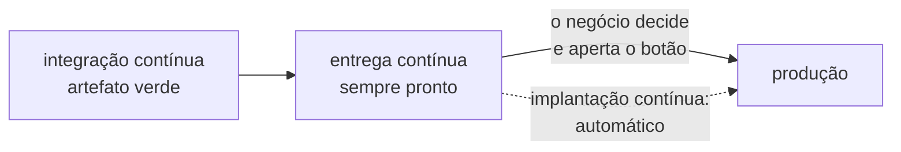
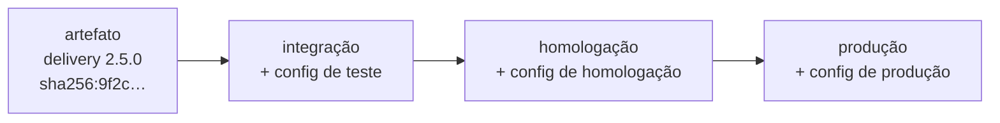
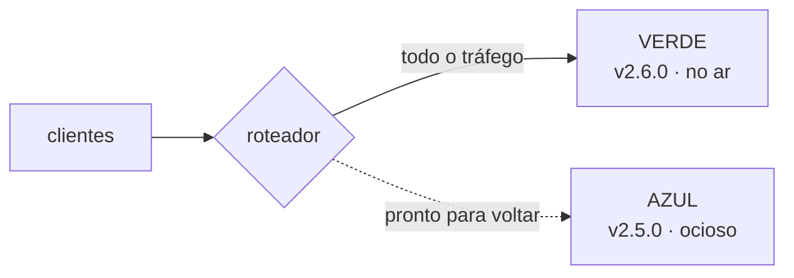
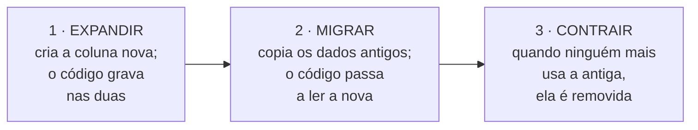
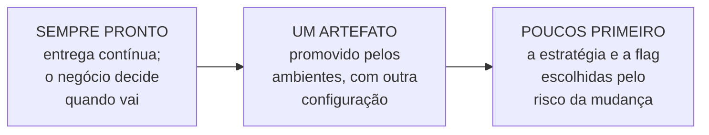

# Aula 11 — Entrega e implantação contínuas

> 🎯 Objetivos: distinguir entrega contínua de implantação contínua e saber quem decide cada uma, acompanhar o mesmo artefato pelos ambientes até a produção, escolher entre implantação direta, gradual, azul-verde e canário pelo risco da mudança, separar implantar de liberar com *feature flags*, e ler as métricas DORA em conjunto.
> 🎬 Slides da aula: [apresentacao-11-entrega-e-implantacao-continuas.pdf](apresentacao/apresentacao-11-entrega-e-implantacao-continuas.pdf)

A Aula 10 terminou com um artefato verde: construído uma vez, verificado pelo pipeline, com identificador. Ele está **pronto** para ir ao ar. Esta aula é sobre a distância entre estar pronto e estar no ar — e sobre as três perguntas que essa distância esconde: **quem decide** que vai, **quando** vai, e **para quantos clientes de cada vez**.

É a aula do bloco em que o projeto mais encosta no negócio. Escolher como uma mudança chega ao cliente é decidir quanto risco se aceita correr, e com que caminho de volta.

## 1. Pronto não é no ar

### Três decisões, três momentos

A Aula 09 já separou as coisas, no [delivery](../../recursos/projetos-para-praticar.md#5-delivery-de-restaurante-do-bairro). A versão 2.5.0, com o cupom de desconto, passa por três momentos que costumam ser confundidos:

| Momento | O que acontece | No delivery | Quem decide |
|---|---|---|---|
| **publicar** (*release*) | a baseline vira uma versão, com tag e CHANGELOG | sexta, 18h: a v2.5.0 fica pronta | o time |
| **implantar** (*deploy*) | a versão passa a rodar em produção | terça, 10h: a v2.5.0 no ar, com o cupom desligado | o time, ou o pipeline sozinho |
| **liberar** | os clientes passam a usar a funcionalidade | quarta: o cupom ligado para 10% dos clientes | o negócio |

Quando as três acontecem no mesmo instante, cada problema de uma vira problema das outras. Separá-las é o que permite implantar longe do pico do restaurante, e liberar quando o dono quiser.

### Entrega contínua e implantação contínua

As duas expressões continuam a Aula 10 e começam com as mesmas palavras, mas dizem coisas diferentes:

- **Entrega contínua** (*continuous delivery*) é manter o sistema **sempre em condição de ir ao ar**. Toda mudança que passa no pipeline é uma candidata à produção, e implantá-la é uma decisão de negócio, tomada a qualquer momento — um botão. Jez Humble, coautor do livro que deu nome à prática, descreve o objetivo assim: tornar as implantações **previsíveis e rotineiras, feitas sob demanda**;
- **Implantação contínua** (*continuous deployment*) é ir um passo além: **toda mudança que passa no pipeline vai ao ar automaticamente**, sem ninguém apertar o botão. O resultado são muitas implantações por dia.

| | Integração contínua | Entrega contínua | Implantação contínua |
|---|---|---|---|
| **o que garante** | o trabalho de todos se junta e é verificado várias vezes por dia | o sistema está sempre pronto para ir ao ar | cada mudança aprovada vai ao ar sozinha |
| **a ida à produção** | não trata dela | um botão, apertado quando se decide | automática |
| **quem decide quando vai** | — | o negócio | ninguém, a cada mudança: a regra foi decidida antes |
| **aula** | 10 | esta | esta |

Martin Fowler resume a relação numa frase: para fazer implantação contínua, **é preciso fazer entrega contínua**; e entrega contínua quer dizer apenas que se é capaz de implantar com frequência, **podendo escolher não fazê-lo**. O teste que ele propõe é direto: se o responsável pelo negócio pedir *"põe no ar a versão de agora"*, dá para fazer isso já, com segurança?



### "O negócio não aceita mudança todo dia"

A frase aparece em quase toda conversa sobre o assunto, e ela recusa a implantação contínua — não a entrega contínua.

O [prontuário de clínica-escola](../../recursos/projetos-para-praticar.md#10-prontuário-de-clínica-escola) é o exemplo perfeito. O comitê de ética aprova cada implantação e se reúne uma vez por mês, então implantação contínua está fora de questão. Mas o prontuário pode e deve fazer **entrega contínua**: o time integra todo dia, o artefato está sempre pronto, e o comitê aprova uma baseline — a tag da Aula 09. Aprovada, a implantação é um botão, numa terça de manhã, e não um fim de semana de tensão. E, se aparecer uma falha de segurança no meio do mês, a correção sai pelo caminho emergencial em horas, porque o sistema já estava pronto para ir ao ar.

O delivery pode ir mais longe: implantação contínua **com janela**. Toda mudança aprovada vai ao ar sozinha, exceto de sexta a domingo, entre 18h e 23h, quando o restaurante está cheio. A janela é uma regra do pipeline, decidida uma vez pelo negócio, e não uma decisão a cada mudança.

### Mudança pequena é mudança segura

Parece contraintuitivo: implantar todo dia deveria ser mais arriscado do que implantar a cada três meses. Os dados dizem o contrário, e o motivo é o tamanho de cada implantação.

| | Implantação trimestral | Implantação diária |
|---|---|---|
| **mudanças em cada uma** | 200 | 3 |
| **se der errado, a causa está entre** | 200 mudanças, de 20 pessoas, de três meses atrás | 3 mudanças, de ontem, de quem ainda lembra |
| **voltar atrás desfaz** | três meses de trabalho | um dia |
| **o time pratica a implantação** | quatro vezes por ano | todo dia |

É o mesmo argumento do ramo longo da Aula 09 e do *"mudanças pequenas e testes robustos"* do DORA na Aula 10. **A implantação ideal é um não-evento**: tão pequena e tão rotineira que ninguém precisa ficar até tarde por causa dela.

## 2. Os ambientes: o mesmo artefato, outra configuração

### O caminho até a produção

Entre o commit e o cliente, a mudança passa por **ambientes**, cada um respondendo a uma pergunta:

| Ambiente | A pergunta que responde | Quem usa |
|---|---|---|
| **desenvolvimento** | funciona isolado, na máquina de quem escreveu? | quem programa |
| **integração** | funciona junto com o resto? — é o pipeline da Aula 10 | a máquina |
| **homologação** (*staging*) | funciona numa cópia fiel da produção? O cliente aprova? | o time, o cliente, o comitê |
| **produção** | funciona para quem usa de verdade? | os clientes |

O caminho inteiro, do commit à produção, automatizado, é o que Humble e Farley chamam de ***pipeline* de implantação**: o pipeline da Aula 10, continuado até o fim. Em cada passagem de um ambiente para o próximo há um **portão**, automático ou manual. No delivery, todos são automáticos. No prontuário, o último é a aprovação do comitê.

### Promover o artefato, não reconstruí-lo

A regra da Aula 10 vale aqui inteira: **o mesmo artefato atravessa todos os ambientes**. O que muda de um ambiente para outro é a **configuração**, que mora fora do artefato, como a Aula 09 ensinou: o endereço do banco, a chave do serviço de pagamento — de teste na homologação, de verdade na produção —, o nível de detalhe dos registros.



Levar o artefato de um ambiente ao seguinte se chama **promover**. Se a homologação aprovou o `sha256:9f2c…`, é o `sha256:9f2c…` que vai para a produção — e dá para conferir. Reconstruir para produção é testar uma coisa e implantar outra.

### Homologação que não se parece com produção não homologa nada

A homologação só vale o que ela tem de parecido com a produção. O *Twelve-Factor App* chama isso de **paridade entre ambientes**, e as diferenças que mais escondem defeito são sempre as mesmas:

- **dados** — a homologação tem 50 pedidos de teste; a produção, 400 mil, com endereços escritos de todo jeito;
- **carga** — ninguém testa a homologação com o movimento de um sábado à noite;
- **integrações** — o pagamento na homologação é um simulador; na produção, é o serviço de verdade, com as falhas de verdade;
- **versões** — a homologação roda uma versão do banco de dados; a produção, outra.

No prontuário, há um limite que não se cruza: **dado real de paciente nunca vai para a homologação**, nem para "testar com o volume certo". A Aula 09 já tratou disso: dado de saúde é a categoria mais protegida da LGPD. Os dados da homologação são gerados ou anonimizados de forma irreversível.

E, mesmo com toda a paridade possível, homologação não é produção. Há clientes reais, combinações que ninguém imaginou e uma carga que nenhum teste reproduz. **A última verificação sempre acontece em produção.** A pergunta é com quantos clientes ela acontece — e é o assunto das próximas três seções.

## 3. Todos de uma vez: o raio da explosão

### 19 de julho de 2024

Às **04h09 (horário UTC)** de uma sexta-feira — 01h09 em Brasília —, a CrowdStrike, uma das maiores empresas de segurança do mundo, distribuiu uma atualização para o seu programa de proteção instalado em computadores com Windows. Não era uma versão nova do programa: era um **arquivo de conteúdo**, do tipo que a empresa envia com frequência para ensinar o programa a reconhecer ameaças novas.

O arquivo tinha um defeito: definia **21 campos** onde o programa esperava **20**. Ao lê-lo, o programa acessou uma posição de memória que não existia e derrubou o sistema operacional inteiro — a tela azul do Windows, seguida de reinício, seguida de tela azul. Antes de sair, o arquivo tinha passado por um validador automático. O validador tinha um erro, e deixou o defeito passar.

A empresa retirou o arquivo às **05h27**, 78 minutos depois. Mas o arquivo já tinha chegado **ao mesmo tempo a todos os computadores ligados naquele intervalo**, e cada máquina que travou precisou de conserto manual, uma a uma. A Microsoft estimou **8,5 milhões de computadores afetados** — menos de 1% das máquinas com Windows, concentrado justamente em empresas que dependem delas para funcionar. Companhias aéreas cancelaram voos, hospitais adiaram atendimentos, bancos e emissoras de TV ficaram fora do ar.

Entre as medidas que a empresa anunciou depois, duas são o assunto desta aula: distribuir os arquivos de conteúdo **de forma escalonada, começando por um canário**, e dar aos clientes **controle sobre quando e onde** as atualizações chegam.

Repare no paralelo com a Cloudflare da Aula 09. Nos dois casos, **não era código: era conteúdo, configuração**. E nos dois casos ele chegou a todos ao mesmo tempo, sem passar pela cautela com que se trataria uma versão nova do programa.

### O que a experiência do Google diz

O livro de SRE do Google (*Site Reliability Engineering*, 2016) registra uma constatação: **cerca de 70% das interrupções de serviço se devem a mudanças num sistema em produção**. E lista as três práticas que mais reduzem o dano:

1. **implantar de forma progressiva**, aos poucos;
2. **detectar problemas rápido e com precisão**;
3. **voltar atrás com segurança** quando algo dá errado.

A primeira é desta aula. A segunda e a terceira são a Aula 12.

### O raio da explosão

O conceito que organiza o resto da aula é o **raio da explosão** (*blast radius*): **quantos clientes uma mudança defeituosa atinge antes que alguém perceba e a interrompa**. Na CrowdStrike, o raio foi o mundo inteiro, porque a mudança foi a todos de uma vez.

O raio não depende da qualidade da mudança — o defeito vai acontecer, cedo ou tarde, apesar dos testes. Depende de **como** a mudança chega aos clientes. E isso é uma escolha de projeto.

## 4. Quatro maneiras de pôr no ar

| Estratégia | Como funciona | Raio da explosão | Caminho de volta | Custo |
|---|---|---|---|---|
| **direta** | a versão nova substitui a antiga de uma vez, às vezes com o sistema parado numa janela de manutenção | todos | reimplantar a versão anterior, com o mesmo tempo da ida | o menor |
| **gradual** (*rolling*) | os servidores são atualizados aos poucos, alguns de cada vez | cresce a cada leva | parar a sequência e reverter os que já foram | baixo — e as duas versões convivem por um tempo |
| **azul-verde** (*blue-green*) | dois ambientes de produção idênticos; a versão nova sobe no ocioso e o tráfego é trocado de uma vez | todos, mas só depois de testada no ambiente real | trocar o tráfego de volta, em segundos | dobro de infraestrutura enquanto os dois existem |
| **canário** | a versão nova vai para uma pequena parte dos clientes, é observada e só então ampliada | a fatia do canário | tirar o canário do tráfego | o mais trabalhoso: exige medir e comparar |

### Azul-verde: a volta em segundos

O nome veio de Dan North e Jez Humble, e Fowler descreveu a técnica em 2010. Há dois ambientes de produção idênticos. Um deles, o **azul**, atende os clientes. A versão nova sobe no **verde**, que está ocioso, e é verificada lá, com a configuração e a infraestrutura da produção. Quando está tudo certo, o roteador troca **todo o tráfego** do azul para o verde.



A grande vantagem é a volta: se algo der errado, o roteador troca o tráfego de volta, e o azul, que nunca foi desligado, retoma em segundos. Na implantação seguinte, os papéis se invertem.

### Canário: alguns primeiro, todos depois

O nome vem das minas de carvão: os mineiros levavam um canário para baixo da terra, porque o gás tóxico afetava o pássaro antes de afetar as pessoas. Na implantação **canário**, uma pequena parte dos clientes recebe a versão nova primeiro, e o comportamento dela é comparado com o da versão antiga, que continua atendendo o resto:

```text
   1% dos clientes ──observa 30 min──▶ 5% ──observa 1 h──▶ 25% ──observa 1 dia──▶ 100%
         │                              │                    │
         └────────── se o critério for violado, volta a 0% ──┘
```

Quem entra no canário é uma escolha. Pode ser uma amostra aleatória, uma região ou, muitas vezes, **os próprios funcionários primeiro**. O Facebook começou assim: o primeiro canário era visível só para os funcionários, com todas as funcionalidades novas ligadas.

O que faz o canário funcionar é o **critério**, e ele precisa ser escrito **antes** de começar. No delivery: *"se a taxa de pedidos confirmados no canário ficar mais de 2 pontos abaixo da versão atual, ou se os erros de pagamento dobrarem, volta a 0%"*. Sem critério, a decisão de avançar é tomada por otimismo, e a de voltar, por desgaste. Como medir esses números em produção é a Aula 12.

> 💡 **Combinar é o normal.** Um mesmo time usa azul-verde para a infraestrutura, canário para as mudanças arriscadas e implantação direta para corrigir o texto do cardápio. A estratégia é escolhida por mudança, não de uma vez para sempre — e a seção 6 mostra como escolher.

### O banco de dados não volta tão fácil

As estratégias gradual, azul-verde e canário têm uma coisa em comum: **por algum tempo, a versão antiga e a nova rodam juntas, sobre o mesmo banco de dados**. E o código se volta em segundos; uma tabela alterada, nem sempre.

Lembre a mudança que quebrava compatibilidade na Aula 09: o `endereco` passa a se chamar `enderecoEntrega`. No banco, isso é renomear uma coluna. Se a migração renomear a coluna e a versão nova subir num canário de 5%, os outros 95% — que rodam a versão antiga — passam a procurar uma coluna que não existe mais. A solução é **expandir e contrair** (*expand and contract*, ou mudança em paralelo), em três implantações separadas:



Em cada passo, as duas versões do código convivem com o banco, e cada passo tem volta. Só o terceiro é irreversível, e ele acontece quando já não há nada a voltar.

> ⚠️ **Toda migração destrutiva muda o risco da implantação.** Remover uma coluna, converter um formato, apagar dados: não há canário que desfaça isso. Se não dá para evitar, a decisão de seguir sem volta precisa ser tomada **antes**, por quem tem autoridade para isso — e não descoberta às 21h de sábado.

E a Knight Capital da Aula 09 aparece de novo aqui, pelo avesso. Oito servidores atualizados à mão, um esquecido, e nenhuma forma de saber qual versão rodava em cada um. Era uma implantação gradual sem verificação, sem critério e sem caminho de volta.

## 5. Feature flag: no ar não é ligado

### O código vai ao ar desligado

Uma ***feature flag*** (sinalizador de funcionalidade) é uma condição no código, controlada por uma configuração que muda **sem uma implantação nova**:

```javascript
if (flags.ligada("pagamento-pix", cliente)) {
  return pagarComPix(pedido);
}
return pagarComCartao(pedido);
```

Com ela, **implantar e liberar deixam de ser o mesmo momento**. O código do Pix vai ao ar na terça, desligado para todos. Na quarta, a flag é ligada para os funcionários do restaurante; na quinta, para 5% dos clientes; na semana seguinte, para todos. Nenhum desses passos é uma implantação, e cada um se desfaz desligando a flag.

É também o que torna o desenvolvimento baseado em tronco da Aula 09 possível: o trabalho incompleto entra no `main` todo dia, **desligado**, sem esperar num ramo longo.

### Os quatro tipos de flag

Pete Hodgson, num artigo de 2017 que virou referência, separa as flags em quatro categorias. A diferença entre elas é para que servem e, principalmente, **quanto tempo devem viver**:

| Tipo | Para que serve | No delivery | Vive |
|---|---|---|---|
| **de liberação** | esconder o que ainda não está pronto, ou liberar aos poucos | o pagamento por Pix, ligado em etapas | dias a semanas |
| **de experimento** | dividir os clientes em grupos e comparar | metade vê o botão "pedir de novo", metade não | o tempo do experimento |
| **de operação** | desligar ou simplificar algo em produção, às pressas — o *kill switch* | se o serviço de mapas cair, o frete volta a ser fixo | curto, mas alguns ficam para sempre |
| **de permissão** | liberar algo só para um grupo | o relatório de vendas, só para o dono | meses a anos |

### 12 de junho de 2025: a flag que faltou

Em **29 de maio de 2025**, o Google Cloud acrescentou uma verificação nova ao **Service Control**, o sistema que confere permissão e cota de cada chamada às suas APIs. A mudança foi implantada **região por região**, como manda a boa prática. Mas o trecho novo só era executado diante de um tipo específico de política, e nenhuma região o executou durante a implantação. Segundo o relatório do próprio Google, a mudança **não tinha tratamento de erro adequado nem estava protegida por uma feature flag**.

Em **12 de junho**, por volta das 10h45 no horário do Pacífico (14h45 em Brasília), alguém gravou uma política nova com **campos em branco**. Os dados de política são replicados para o mundo inteiro, e chegaram a todas as regiões **em segundos**. O trecho novo, enfim executado, tentou ler um campo vazio e derrubou o Service Control. Dezenas de produtos do Google Cloud e do Google Workspace passaram a responder com erro — e, com eles, serviços de outras empresas que rodavam sobre eles.

A causa foi identificada em 10 minutos, e o desligamento de emergência do trecho novo foi concluído em 40. Mesmo assim, a recuperação completa levou horas em algumas regiões. Entre os compromissos do relatório, o primeiro foi este: **toda mudança em sistemas críticos passa a ser protegida por feature flag, desligada por padrão**.

São duas lições, e a segunda é a mais sutil:

- **com a flag desligada por padrão**, o código novo teria chegado a todas as regiões sem ser executado, e seria ligado aos poucos;
- **a implantação gradual do código não protegeu nada**, porque o dado que disparou o defeito não foi gradual: chegou ao mundo todo em segundos. É a terceira vez no bloco — Cloudflare, CrowdStrike, Google — em que configuração e dados precisam da mesma cautela que o código.

### Flag é dívida com prazo

Toda flag acrescenta um caminho ao sistema. Duas flags produzem quatro combinações possíveis; dez flags, **1.024**. Ninguém testa 1.024 combinações, e as flags velhas, que ninguém lembra mais o que fazem, ninguém tem coragem de apagar.

Hodgson recomenda tratar as flags como **estoque**, e mantê-lo pequeno:

- toda flag tem **um dono e uma data de remoção** — a tarefa de removê-la entra no backlog no dia em que ela é criada;
- o número de flags ativas tem **limite**;
- **uma flag nunca é reaproveitada.** A Knight Capital da Aula 09 reaproveitou o sinalizador de uma função desativada havia anos, e o servidor esquecido o interpretou do jeito antigo.

> ⚠️ **Flag de liberação que fica para sempre vira código morto com interruptor.** Depois que a funcionalidade foi liberada para todos e estabilizou, a flag e o caminho antigo saem do código. É o que a Aula 12 vai chamar de dívida técnica.

## 6. Escolher pelo risco, medir pelo DORA

### A matriz aplicada à mudança

Toda mudança é um risco no sentido da leitura complementar [Risco](../../leituras-complementares/risco/README.md): um evento incerto, com probabilidade e impacto. A mesma **matriz probabilidade × impacto** ajuda a escolher como implantar:

- a **probabilidade** de dar errado cresce com o tamanho da mudança, com a novidade da área (nunca se mexeu ali?) e com a falta de testes de integração que a cubram;
- o **impacto** cresce com o número de clientes afetados, com dinheiro e dado sensível no caminho e, sobretudo, com a **irreversibilidade** — mudança que não volta é sempre de impacto alto.

| | Impacto baixo | Impacto médio | Impacto alto |
|---|---|---|---|
| **Prob. alta** | gradual | canário | canário com flag, fora do pico — ou rever a mudança |
| **Prob. média** | direta | gradual ou azul-verde | canário com flag |
| **Prob. baixa** | direta | direta | azul-verde ou canário, com caminho de volta pronto |

No delivery:

| Mudança | Probabilidade | Impacto | Como implantar |
|---|---|---|---|
| corrigir um erro de digitação no cardápio | baixa | baixo | direta, a qualquer hora |
| calcular o frete por bairro, e não mais por distância | média — regra nova | médio — o cliente vê o valor antes de pagar | azul-verde, fora do pico |
| trocar o provedor de pagamento | média | alto — é o dinheiro do restaurante | canário com flag: funcionários, 5%, 25%, todos, com o provedor antigo a um clique |

E a mesma armadilha da leitura: **probabilidade baixa com impacto alto não é "direta"**. A mudança que "não tem como dar errado" no pagamento é exatamente a que precisa de caminho de volta pronto.

### As métricas que dizem se a entrega vai bem

O programa **DORA**, que apareceu nas duas aulas anteriores, mede o desempenho de entrega de um time com **cinco métricas** desde 2024, em dois grupos:

| Grupo | Métrica | O que mede |
|---|---|---|
| **vazão** | **tempo de espera da mudança** | do commit à produção |
| | **frequência de implantação** | quantas implantações por período |
| | **tempo de recuperação de implantação com falha** | quanto leva para voltar ao normal quando uma implantação dá errado |
| **instabilidade** | **taxa de falha de mudança** | a proporção de implantações que exigem intervenção imediata — reverter ou corrigir às pressas |
| | **taxa de retrabalho** | a proporção de implantações não planejadas, feitas para corrigir um incidente em produção |

A leitura complementar [Qualidade que se mede](../../leituras-complementares/qualidade-que-se-mede/README.md) apresenta as quatro métricas clássicas. A quinta, a taxa de retrabalho, entrou em 2024, e o tempo de recuperação passou do grupo da estabilidade para o da vazão.

No relatório de 2024, a diferença entre os extremos é grande. O grupo de **desempenho mais alto** leva **menos de um dia** do commit à produção, se recupera de uma implantação com falha em **menos de uma hora** e tem cerca de **5%** de taxa de falha. O de **desempenho mais baixo** leva **de um a seis meses** do commit à produção, e de **uma semana a um mês** para se recuperar.

O achado mais importante da pesquisa, repetido ano após ano, desmente a intuição da seção 1: **velocidade e estabilidade não são uma troca**. Os times que entregam mais rápido tendem a ser também os mais estáveis, porque entregam em pedaços pequenos, com verificação automática e caminho de volta.

> ⚠️ **As métricas DORA também viram meta.** O próprio DORA avisa: transformar *"implantar várias vezes por dia até o fim do ano"* em objetivo faz o time jogar com o número — a lei de Goodhart da Aula 10. As métricas se leem **juntas**, valem **por aplicação** e servem para o time comparar a si mesmo ao longo do tempo, não para comparar times diferentes entre si.

> 📖 HUMBLE e FARLEY, *Entrega Contínua*, capítulos 5 (o pipeline de implantação) e 10 (implantar e liberar). No site de Fowler: [*ContinuousDelivery*](https://martinfowler.com/bliki/ContinuousDelivery.html), [*BlueGreenDeployment*](https://martinfowler.com/bliki/BlueGreenDeployment.html), [*CanaryRelease*](https://martinfowler.com/bliki/CanaryRelease.html) e o artigo de Pete Hodgson sobre [*Feature Toggles*](https://martinfowler.com/articles/feature-toggles.html). As métricas estão em [dora.dev](https://dora.dev/guides/dora-metrics/).

### O que esta aula deixa no lugar

As três ideias da aula se encadeiam:



A versão nova está no ar, para 5% dos clientes, e o critério para avançar ou voltar está escrito. Falta saber **como se enxerga** o que está acontecendo em produção, o que fazer **quando o critério é violado** e como o sistema continua mudando depois de entregue — a Aula 12.

## 🏋️ Exercícios da aula

Na pasta `aula-11/` do seu repositório:

1. **`ex01.md`** — o time do [delivery](../../recursos/projetos-para-praticar.md#5-delivery-de-restaurante-do-bairro) tem cinco mudanças para implantar: (a) corrigir um erro de digitação no nome de um prato; (b) acrescentar a tela "acompanhe seu pedido", que hoje não existe e ninguém usa; (c) passar a aceitar Pix, mantendo o cartão; (d) mudar o arredondamento do frete, que hoje é feito para baixo; (e) dividir, no banco de dados, a coluna `nome_cliente` da tabela de pedidos em duas, `nome` e `sobrenome`. Para cada uma, escreva: a **probabilidade** de dar errado e o **impacto**, cada um com o motivo em uma linha; a **estratégia de implantação** (direta, gradual, azul-verde, canário, com ou sem flag); e o **caminho de volta**, em uma linha. *Confere assim: a (e) não se resolve só com a estratégia — se você planejou uma implantação só, a versão antiga que ainda roda durante o canário ou a troca passa a gravar e ler uma coluna que não existe mais; releia "expandir e contrair" na seção 4 e conte quantas implantações ela pede. A (b) tem impacto baixo mesmo sendo novidade: ninguém depende dela ainda. E a (c) não pode ser direta: é dinheiro, e a volta precisa estar a um clique.*

2. **`ex02.md`** — desenhe o caminho do [prontuário de clínica-escola](../../recursos/projetos-para-praticar.md#10-prontuário-de-clínica-escola) do commit à produção, como diagrama ou lista. Para cada ambiente, diga: (i) a pergunta que ele responde; (ii) o que muda de configuração; (iii) se o portão para o próximo é automático ou manual, e quem o abre. Depois, responda: o prontuário faz **entrega contínua**? E **implantação contínua**? Justifique cada resposta em duas linhas. *Confere assim: se o seu caminho constrói o sistema de novo em algum ambiente depois do pipeline, releia "promover o artefato" na seção 2. O comitê de ética aprova uma baseline — a tag da Aula 09 —, e não "o que estiver na homologação no dia". E se os dados da sua homologação vêm de uma cópia da produção, mesmo "só para testar o volume", releia a seção 2: dado de saúde não sai da produção.*

3. **`ex03.md`** — 🌶️ **Desafio.** O dono do delivery fechou com um influenciador local uma campanha para o lançamento do **pagamento por Pix**, no **sábado às 19h**, e quer que o Pix *"apareça para todo mundo ao mesmo tempo, na hora do anúncio"*. O código do Pix fica pronto na segunda-feira anterior. **Escreva a recomendação ao dono**, contendo: (i) o plano, dia a dia, separando **implantar** de **liberar** — o que vai ao ar quando, ligado para quem; (ii) o **critério** para avançar e para voltar atrás, com os números que serão acompanhados; (iii) **o que se perde** com a sua recomendação em relação ao pedido dele. *Confere assim: o dono tem um desejo legítimo — o anúncio precisa coincidir com o Pix funcionando. Se no seu plano o sábado às 19h é a primeira vez que um cliente de verdade paga com Pix, você repetiu o "todos de uma vez" da seção 3. E se o seu plano não tem nenhum custo para o dono, releia o item (iii): algum cliente vai ver o Pix antes do anúncio, ou o lançamento perde alguma coisa.*

### 📤 Entrega

Estes exercícios são feitos em sala e vão para o **seu repositório** `exercicios-projeto-software`:

```bash
cd ..                 # da pasta da aula para a raiz do repositório
git add aula-11/
git commit -m "Resolve exercícios da aula 11"
git push
```

Confira no navegador que a pasta apareceu em `github.com/SEU-USUARIO/exercicios-projeto-software`.

## 🧠 Revisão

[8 questões de múltipla escolha](revisao/README.md) para conferir se os conceitos ficaram sólidos. Responda sem consultar a aula — depois volte e corrija.

**A entrega é pelo formulário:** [responder a revisão da Aula 11](https://docs.google.com/forms/d/e/1FAIpQLSf2BsxCT1TVd6J4KIhzQFmVF4XzVHMVZ4VpWbL1e-0KF9yDMw/viewform)

Entre com uma conta Google, selecione seu nome na lista e informe seu usuário do GitHub — só o usuário, não o endereço do perfil. Se o seu nome ainda não estiver na lista, marque a última opção e escreva o nome completo no campo seguinte. É **uma resposta por aluno** e não dá para editar depois de enviar, então confira antes. A nota é liberada no AVA depois da revisão em sala e da divulgação do gabarito.

---

⬅️ [Aula 10 — Integração contínua](../aula-10-integracao-continua/README.md) | ➡️ [Aula 12 — Operação: observabilidade e manutenção](../aula-12-observabilidade-e-manutencao/README.md)
