<!-- _class: capa -->

🚦

# Entrega e Implantação Contínuas

## Aula 11 · Bloco 3 — Do Código à Produção

Quem decide que vai, quando vai — e para quantos clientes de cada vez

---

## 🎯 Nesta aula

1. **Pronto não é no ar**: entrega contínua × implantação contínua
2. Os **ambientes**: o mesmo artefato, outra configuração
3. **Todos de uma vez**: o raio da explosão
4. **Quatro maneiras de pôr no ar** — e o banco de dados
5. **Feature flag**: no ar não é ligado
6. **Escolher pelo risco**, medir pelo DORA

---

## Três decisões, três momentos

publicarsexta, 18h: a v2.5.0 fica pronta, com tag e CHANGELOG  <b>quem decide:</b> o time

→

implantarterça, 10h: a v2.5.0 roda em produção, com o cupom <b>desligado</b>  <b>quem decide:</b> o time, ou o pipeline

→

liberarquarta: o cupom ligado para 10% dos clientes   <b>quem decide:</b> o negócio

A separação veio da Aula 09. Quando as três acontecem no mesmo instante, <b>cada problema de uma vira problema das outras</b>.

---

## Entrega contínua × implantação contínua

<b class="t">Entrega contínua</b>o sistema está <b>sempre pronto</b>; ir ao ar é um botão, apertado quando o negócio decide

<b class="t">Implantação contínua</b>toda mudança que passa no pipeline <b>vai ao ar sozinha</b> — a regra foi decidida antes

Fowler: para fazer implantação contínua, <b>é preciso</b> fazer entrega contínua. O teste: <i>"põe no ar a versão de agora"</i> — dá para fazer já, com segurança?

---

<!-- _class: lead -->

## "O negócio não aceita mudança todo dia"

A frase recusa a **implantação** contínua —
não a **entrega** contínua.

O **prontuário** integra todo dia e está sempre pronto.
O comitê aprova uma **tag**, uma vez por mês,
e a implantação vira um botão numa terça de manhã.

O **delivery** pode ir sozinho ao ar —
menos de sexta a domingo, das 18h às 23h.

---

## Mudança pequena é mudança segura

<b class="t">A cada três meses</b><ul>
<li><b>200</b> mudanças em cada implantação</li>
<li>se der errado, a causa está entre 200, de 20 pessoas</li>
<li>voltar desfaz três meses de trabalho</li>
<li>o time pratica <b>4 vezes por ano</b></li>
</ul>

<b class="t">Todo dia</b><ul>
<li><b>3</b> mudanças em cada implantação</li>
<li>a causa está entre 3, de ontem, de quem lembra</li>
<li>voltar desfaz um dia</li>
<li>o time pratica <b>todo dia</b></li>
</ul>

É o ramo longo da Aula 09 e as <b>mudanças pequenas</b> do DORA na Aula 10. A implantação ideal é um <b>não-evento</b>.

---

## Os ambientes até a produção

desenvolvimento

funciona isolado, na máquina de quem escreveu?

quem programa

integração

funciona junto com o resto? — o pipeline da Aula 10

a máquina

homologação

funciona numa cópia fiel da produção? O cliente aprova?

time, cliente, comitê

produção

funciona para quem usa de verdade?

os clientes

O caminho inteiro, automatizado, é o <b>pipeline de implantação</b> de Humble e Farley. Entre um ambiente e o próximo há um <b>portão</b> — automático no delivery; no prontuário, o último é o comitê.

---

## Promover o artefato — não reconstruí-lo

O artefato é o mesmo do começo ao fim; o que muda é a <b>configuração</b>, que mora fora dele (Aula 09). Se a homologação aprovou o <code>sha256:9f2c…</code>, é ele que vai à produção — <b>e dá para conferir</b>.

> ⚠️ **Reconstruir para a produção é testar uma coisa e implantar outra.**

---

## Homologação que não parece produção não homologa nada

<b class="t">Dados</b>50 pedidos de teste contra 400 mil reais

<b class="t">Carga</b>ninguém testa com o movimento de sábado à noite

<b class="t">Integrações</b>simulador de pagamento contra o serviço de verdade

<b class="t">Versões</b>um banco de dados na homologação, outro na produção

LGPD No prontuário, <b>dado real de paciente nunca vai para a homologação</b> — nem "para testar o volume". Gera-se ou anonimiza-se.

> 💡 **A última verificação sempre acontece em produção.** A pergunta é: com quantos clientes?

---

## 19/07/2024: um arquivo para todos de uma vez

04h09 UTCa CrowdStrike envia um <b>arquivo de conteúdo</b> ao seu programa de proteção

→

21 ≠ 20o arquivo define 21 campos; o programa espera 20 — e o validador tinha um erro

→

tela azulo Windows trava, reinicia, trava de novo

→

05h27o arquivo é retirado, 78 minutos depois

→

diascada máquina travada precisa de conserto <b>manual</b>

Não era código: era <b>conteúdo</b> — como o arquivo da Cloudflare na Aula 09. E chegou <b>a todos os computadores ligados, ao mesmo tempo</b>.

---

## O tamanho do estrago

8,5 mide computadores com Windows afetados, pela estimativa da Microsoft

&lt; 1%das máquinas com Windows — concentrado em quem depende delas para funcionar

78 minno ar; o conserto, máquina a máquina, levou dias

Companhias aéreas cancelaram voos, hospitais adiaram atendimentos, bancos e emissoras de TV ficaram fora do ar.

> 💡 **O que a empresa anunciou depois:** distribuir o conteúdo **de forma escalonada, começando por um canário**, e dar aos clientes **controle sobre quando** as atualizações chegam.

---

## Mudança é a maior causa de interrupção

≈ 70%das interrupções de serviço se devem a <b>mudanças num sistema em produção</b>livro de SRE do Google, 2016

<b class="t">O que mais reduz o dano</b><ul>
<li><b>implantar aos poucos</b> — esta aula</li>
<li>detectar problemas rápido — Aula 12</li>
<li>voltar atrás com segurança — Aula 12</li>
</ul>

O <b>raio da explosão</b>: quantos clientes uma mudança defeituosa atinge antes que alguém perceba. O defeito vai acontecer, apesar dos testes — <b>o raio é uma escolha de projeto</b>.

---

## Quatro maneiras de pôr no ar

<b class="t">Direta</b>a versão nova substitui a antiga de uma vezraio: <b>todos</b> volta: reimplantar a anterior

<b class="t">Gradual</b>os servidores são atualizados aos poucosraio: <b>cresce a cada leva</b> volta: parar e reverter

<b class="t">Azul-verde</b>dois ambientes; o tráfego troca de uma vezraio: todos, depois de testada no real volta: <b>segundos</b>

<b class="t">Canário</b>uma fatia dos clientes primeiro, observadaraio: <b>a fatia</b> volta: tirar o canário

Do mais barato ao mais trabalhoso. <b>Combinar é o normal</b>: a estratégia se escolhe por mudança, não uma vez para sempre.

---

## Azul-verde: a volta em segundos

A versão nova sobe no ambiente ocioso e é verificada <b>com a infraestrutura da produção</b>. O azul nunca é desligado: se algo der errado, o roteador troca de volta. Na próxima implantação, os papéis se invertem.

---

## Canário: alguns primeiro, todos depois

1%<i style="width:4%"></i>funcionários

<b>→</b>observa 30 min

5%<i style="width:7%"></i>amostra

<b>→</b>observa 1 hora

25%<i style="width:25%"></i>amostra

<b>→</b>observa 1 dia

100%<i style="width:100%"></i>todos

⛔ <b>Critério violado em qualquer etapa → volta a 0%</b>

O critério se escreve <b>antes</b>: <i>"se os pedidos confirmados no canário ficarem 2 pontos abaixo da versão atual, ou os erros de pagamento dobrarem, volta"</i>. Sem ele, avança-se por otimismo e volta-se por desgaste.

---

## O banco de dados não volta tão fácil

No canário e no azul-verde, <b>a versão antiga e a nova rodam juntas sobre o mesmo banco</b>. Renomear <code>endereco</code> de uma vez quebra os 95% que ainda rodam a antiga. Em três implantações, cada passo tem volta.

> ⚠️ **Migração destrutiva não tem canário que desfaça.** Remover, converter, apagar: a decisão de seguir sem volta se toma **antes**, por quem tem autoridade — não às 21h de sábado.

---

## Feature flag: no ar não é ligado

if (flags.ligada("pagamento-pix", cliente)) {
  return pagarComPix(pedido);
}
return pagarComCartao(pedido);

terçao código do Pix vai ao ar <b>desligado</b>

→

quartaligado para os funcionários

→

quintaligado para 5% dos clientes

→

semana seguinteligado para todos

Nenhum desses passos é uma implantação — e <b>cada um se desfaz desligando a flag</b>.

---

## Os quatro tipos de flag

<b class="t">De liberação · dias a semanas</b>esconder o que não está pronto, ou liberar aos poucoso Pix, ligado em etapas

<b class="t">De experimento · o tempo do teste</b>dividir os clientes em grupos e compararmetade vê o botão "pedir de novo"

<b class="t">De operação · o <i>kill switch</i></b>desligar ou simplificar algo às pressasse o serviço de mapas cair, o frete volta a ser fixo

<b class="t">De permissão · meses a anos</b>liberar algo só para um grupoo relatório de vendas, só para o dono

A classificação é de Pete Hodgson (2017). O que separa os tipos é, principalmente, <b>quanto tempo cada flag deve viver</b>.

---

## 12/06/2025: a flag que faltou

29/05código novo no <b>Service Control</b>, região por região

→

sem flago trecho novo não é executado em nenhuma região; não tem tratamento de erro

→

12/06uma política com <b>campos em branco</b> chega ao mundo todo <b>em segundos</b>

→

quedadezenas de produtos do Google — e de quem roda sobre eles

→

40 mino trecho novo é desligado; a recuperação total leva horas

O primeiro compromisso do relatório: <b>toda mudança em sistema crítico protegida por flag, desligada por padrão</b>.

---

## O que o caso do Google ensina

<b class="t">A flag desligada por padrão</b>o código novo teria chegado a todas as regiões <b>sem ser executado</b> — e seria ligado aos poucos

<b class="t">O dado também é mudança</b>a implantação do código foi gradual; o dado que disparou o defeito, não — chegou ao mundo todo em segundos

Aula 09Cloudflare: um arquivo de configuração

esta aulaCrowdStrike: um arquivo de conteúdo

esta aulaGoogle: uma política replicada

Três vezes no bloco: <b>configuração e dados precisam da mesma cautela que o código</b>.

---

## Flag é dívida com prazo

2flags: <b>4</b> combinações possíveis

10flags: <b>1.024</b> combinações — ninguém testa todas

1flag reaproveitada bastou para a Knight Capital, na Aula 09

<b class="t">Dono e data</b>a tarefa de remover entra no backlog no dia da criação

<b class="t">Limite</b>o número de flags ativas tem teto, como um estoque

<b class="t">Nunca reaproveitar</b>flag velha não ganha significado novo

---

## Escolher pelo risco da mudança

impacto baixo

impacto médio

impacto alto

prob. alta

gradual

canário

canário com flag, fora do pico — ou rever a mudança

prob. média

direta

gradual ou azul-verde

canário com flag

prob. baixa

direta

direta

<b>azul-verde ou canário, com a volta pronta</b>

<b>Probabilidade</b> cresce com o tamanho e a novidade da mudança. <b>Impacto</b>, com clientes, dinheiro, dado sensível — e <b>irreversibilidade</b>. É a matriz da leitura <i>Risco</i>, e a mesma armadilha: probabilidade baixa com impacto alto <b>não é "direta"</b>.

---

## No delivery

| Mudança | Probabilidade | Impacto | Como implantar |
|---|:---:|:---:|---|
| erro de digitação no cardápio | baixa | baixo | direta a qualquer hora |
| frete por bairro, não por distância | média | médio | azul-verde fora do pico |
| trocar o provedor de pagamento | média | **alto** | canário com flag funcionários → 5% → 25% → todos |

No pagamento, o provedor antigo fica <b>a um clique</b> até a mudança chegar a 100% e estabilizar.

---

## As cinco métricas DORA

<b class="t">Vazão</b><ul>
<li><b>tempo de espera da mudança</b> — do commit à produção</li>
<li><b>frequência de implantação</b></li>
<li><b>tempo de recuperação</b> de implantação com falha</li>
</ul>

<b class="t">Instabilidade</b><ul>
<li><b>taxa de falha de mudança</b> — implantações que exigem reverter ou corrigir às pressas</li>
<li><b>taxa de retrabalho</b> — implantações não planejadas, para corrigir incidente</li>
</ul>

Cinco desde 2024: entrou a taxa de retrabalho, e o tempo de recuperação passou para a vazão. A leitura <i>Qualidade que se mede</i> traz as quatro clássicas.

---

## Velocidade e estabilidade andam juntas

<b class="t">Desempenho mais alto · DORA 2024</b><ul>
<li>commit → produção em <b>menos de 1 dia</b></li>
<li>recuperação em <b>menos de 1 hora</b></li>
<li>taxa de falha de cerca de <b>5%</b></li>
</ul>

<b class="t">Desempenho mais baixo · DORA 2024</b><ul>
<li>commit → produção em <b>1 a 6 meses</b></li>
<li>recuperação em <b>1 semana a 1 mês</b></li>
</ul>

Ano após ano, quem entrega mais rápido tende a ser também <b>mais estável</b> — porque entrega em pedaços pequenos, verificados e com volta.

> ⚠️ **As métricas DORA também viram meta** — o próprio DORA avisa. Leem-se **juntas**, **por aplicação**, para o time comparar a si mesmo — nunca para ranquear times.

---

## O que esta aula deixa no lugar

A versão nova está no ar, para 5% dos clientes, com o critério escrito. Falta <b>enxergar</b> o que acontece em produção — e saber o que fazer quando o critério é violado.

---

<!-- _class: lead -->

## ➡️ Próxima aula

**Aula 12 — Operação: observabilidade e manutenção**

Está no ar.
Como saber se está tudo bem —
e o que fazer quando não está?
