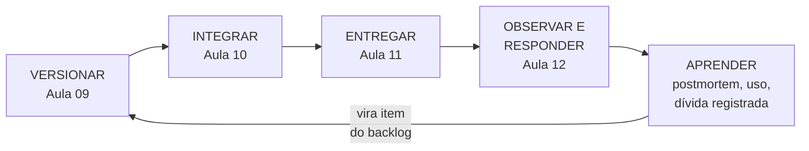

# Aula 12 — Operação: observabilidade e manutenção

> 🎯 Objetivos: distinguir monitorar de observar e escolher o sinal certo — log, métrica ou rastro — para cada pergunta, definir um SLO com orçamento de erro e alertas que exigem ação, conduzir um incidente restaurando antes de diagnosticar, escrever um postmortem sem culpa, e classificar a manutenção e a dívida técnica numa linguagem que quem paga entende.
> 🎬 Slides da aula: [apresentacao-12-observabilidade-e-manutencao.pdf](apresentacao/apresentacao-12-observabilidade-e-manutencao.pdf)

A Aula 11 deixou a versão nova no ar, para 5% dos clientes, com um critério escrito: *"se os pedidos confirmados no canário ficarem 2 pontos abaixo da versão atual, volta"*. Faltaram três coisas. Como se **enxerga** esse número em produção. O que se faz **quando ele é violado**. E como o sistema continua mudando **depois** de entregue, quando o projeto acabou e o time diminuiu.

São os três conceitos desta aula, que fecha o Bloco 3: **observar**, **responder** e **manter**. A partir daqui, o sistema deixa de ser um projeto e passa a ser um serviço — e o que a gestão faz muda de natureza.

## 1. Monitorar a máquina não é observar o serviço

### O painel verde

Na semana seguinte ao lançamento do Pix no [delivery](../../recursos/projetos-para-praticar.md#5-delivery-de-restaurante-do-bairro), o painel de monitoramento mostra tudo verde: processador em 30%, memória em 40%, nenhum servidor fora do ar. E, há dois dias, **um em cada três pagamentos por Pix não é confirmado**. Quem descobriu foi o dono do restaurante, lendo as reclamações dos clientes no Instagram.

Nada de errado com o painel. Ele respondeu exatamente as perguntas que alguém tinha feito a ele: *os servidores estão vivos? estão sobrecarregados?* Ninguém tinha perguntado *os clientes estão conseguindo pagar?*

### Monitoramento e observabilidade

**Monitoramento** é acompanhar, em painéis e alertas, as perguntas que se sabia de antemão que seriam feitas. É necessário, e responde bem ao que já se previu.

**Observabilidade** é outra coisa. O termo vem da teoria de controle — Rudolf Kálmán o usou em 1960 — e lá quer dizer **o quanto o estado interno de um sistema pode ser deduzido a partir do que ele emite para fora**. Em software, a definição que pegou é a de Charity Majors, uma das pessoas que popularizaram o termo: um sistema é observável quando se consegue **fazer a ele perguntas novas, que ninguém previu, sem precisar escrever e implantar código novo para respondê-las**.

| | Monitoramento | Observabilidade |
|---|---|---|
| **responde** | perguntas conhecidas | também as que ninguém previu |
| **a pergunta típica** | *o servidor está de pé?* | *por que só os pagamentos por Pix de clientes de um banco falham, e só depois das 19h?* |
| **depende de** | painéis e alertas configurados | o sistema emitir dados ricos o bastante para investigar |

### Instrumentar o negócio, não só a máquina

A pergunta que orienta tudo: **o que eu preciso saber para responder *"o serviço está bom?"* sem perguntar a ninguém?** No delivery, a resposta não é o processador. É a proporção de pedidos confirmados. Se ela cai, alguma coisa quebrou, seja qual for o componente.

Por isso o que se instrumenta primeiro é o **comportamento do negócio**: pedido criado, pagamento confirmado ou recusado, pedido na cozinha, entrega concluída. É essa lista que teria mostrado o Pix falhando em quinze minutos, e não em dois dias.

A mesma instrumentação responde a uma pergunta que a Aula 08 deixou aberta. O desperdício mais caro do Lean era a **funcionalidade não usada**, *"o relatório que alguém pediu e ninguém abriu"*, que não aparece como problema em lugar nenhum. Com cada uso registrado como evento, ele aparece: o relatório de vendas por bairro foi aberto três vezes em um ano. A decisão de mantê-lo, melhorá-lo ou removê-lo passa a ter um dado — e começa por saber quem é o usuário do outro lado da tela, como mostra a leitura complementar [O usuário do outro lado](../../leituras-complementares/o-usuario-do-outro-lado/README.md).

## 2. Logs, métricas e rastros

Um sistema observável emite três tipos de sinal. Cada um responde a um tipo de pergunta, e nenhum substitui os outros.

| Sinal | O que é | Responde | Custo |
|---|---|---|---|
| **log** (registro) | um evento, com data, hora e detalhes | *o que aconteceu com este pedido, exatamente?* | cresce com o volume de eventos |
| **métrica** | um número agregado ao longo do tempo | *como está o sistema, em geral, e como estava ontem?* | baixo e fixo |
| **rastro** (*trace*) | o caminho de uma requisição por todos os serviços, com o tempo gasto em cada um | *onde, nesse caminho, o tempo foi gasto ou o erro aconteceu?* | médio — costuma-se guardar uma amostra |

### O log estruturado

Um log em texto livre, como `Erro no pagamento do pedido 4471`, é fácil de escrever e difícil de pesquisar. O **log estruturado** registra cada evento como um conjunto de campos, que se filtram e se contam:

```json
{"hora": "2026-11-21T19:42:07Z", "evento": "pagamento_recusado",
 "pedido": 4471, "meio": "pix", "provedor": "banco-x",
 "motivo": "tempo_esgotado", "versao": "2.6.0", "rastro": "a3f9c21e"}
```

Com isso, *"quantos pagamentos por Pix foram recusados por tempo esgotado, por banco, desde a versão 2.6.0?"* é uma consulta, não uma investigação. E repare no campo `versao`: é ele que liga o comportamento em produção à baseline da Aula 09 e ao canário da Aula 11.

> ⚠️ **Log não é lugar de dado pessoal.** O registro acima não tem nome, telefone, endereço nem CPF do cliente: o identificador do pedido basta para chegar a eles, por quem tem permissão. No [prontuário](../../recursos/projetos-para-praticar.md#10-prontuário-de-clínica-escola), isso é ainda mais sério: diagnóstico em log é dado de saúde copiado para um lugar com outro controle de acesso, e a LGPD vale para a cópia. Lembre também da Aula 10, em que os registros de um pipeline vazaram senhas: **log costuma ser lido por mais gente do que o banco de dados**.

### A métrica, e a média que esconde

Métricas são números baratos de guardar e de comparar: pedidos por minuto, erros por minuto, tempo de resposta. São elas que alimentam os painéis e os alertas.

Com tempo de resposta, porém, a média engana. Se o tempo médio de confirmação de um pedido é 1,8 segundo, parece ótimo. Mas a média pode esconder que **um em cada cem clientes espera doze segundos** — e esse cliente desiste. Por isso o tempo se mede em **percentis**:

| Percentil | Quer dizer | No delivery |
|---|---|---|
| **p50** (mediana) | metade dos pedidos é mais rápida que isto | 1,2 s |
| **p95** | 95% dos pedidos são mais rápidos que isto | 4 s |
| **p99** | 99% dos pedidos são mais rápidos que isto; 1% espera mais | 12 s |

O livro de SRE do Google alerta para o efeito em cadeia: num sistema com muitos serviços, o tempo do **pior 1%** de um serviço interno pode virar o tempo **típico** de quem está na ponta.

### O rastro: o que aconteceu com este pedido

A Aula 04 deixou uma dívida. Na arquitetura orientada a eventos do delivery, *"pedido confirmado"* aciona cozinha, entregador e cliente ao mesmo tempo, e isso torna difícil responder *"o que aconteceu com este pedido?"*, porque a história fica espalhada por quem reagiu. O **rastro** é a resposta. Um identificador único nasce com o pedido e viaja com ele por todos os serviços, e cada passo registra quanto tempo levou:

```text
rastro a3f9c21e · pedido 4471 · 38,4 s no total

pedido     recebe e valida          ▏0,2 s
pagamento  autoriza no provedor     ▕████████████████████████████████▏ 37,5 s
  └ provedor externo, 3 tentativas  ▕███████████████████████████████▏ 37,1 s
cozinha    entra na fila            ▏0,1 s
cliente    recebe o aviso           ▏0,4 s
```

Em vez de *"o sistema está lento"*, a resposta é *"o provedor de Pix do banco X leva 37 segundos e o nosso código tenta três vezes"*. É a diferença entre uma tarde de investigação e um minuto de leitura.

### Por onde começar

Num serviço novo, o livro de SRE do Google recomenda começar pelos **quatro sinais de ouro**:

| Sinal | O que mede | No delivery |
|---|---|---|
| **latência** | quanto tempo leva para atender | p95 da confirmação do pedido |
| **tráfego** | quanta demanda chega | pedidos por minuto |
| **erros** | a proporção de requisições que falham | pagamentos recusados por erro nosso |
| **saturação** | o quanto o recurso mais apertado está perto do limite | conexões ocupadas no banco de dados |

Para emitir esses sinais, o padrão aberto que se impôs é o **OpenTelemetry**, nascido em 2019 da fusão de dois projetos anteriores e mantido pela mesma fundação do Kubernetes. A vantagem de gestão é não ficar preso a um fornecedor: o sistema é instrumentado uma vez, e os sinais vão para a ferramenta que o time escolher.

## 3. SLO: quanto de falha é aceitável

### Indicador, objetivo e acordo

Para dizer se o serviço *"está bom"*, é preciso um número e um alvo. Três siglas organizam a conversa:

| Sigla | O que é | No delivery |
|---|---|---|
| **SLI** — indicador de nível de serviço | uma proporção de eventos bons sobre o total | pedidos com Pix confirmados em até 30 s ÷ pedidos com Pix |
| **SLO** — objetivo de nível de serviço | o alvo para o indicador, numa janela de tempo | 99,5% nos últimos 30 dias |
| **SLA** — acordo de nível de serviço | um contrato, com consequência se o objetivo for descumprido | o provedor de Pix devolve parte da tarifa se ficar abaixo de 99% no mês |

O SLO é interno, e o time o persegue. O SLA é externo, e por isso costuma ser mais folgado que o SLO: quem promete 99% em contrato quer ter seu próprio alvo de 99,5%, para descobrir o problema antes de pagar multa.

### Por que não 100%

O dono do restaurante pergunta o óbvio: *"por que não 100%?"*. O livro de SRE do Google responde que **100% quase nunca é o alvo certo**. É impossível de atingir, e cada "nove" a mais custa muito mais que o anterior — enquanto o cliente nem percebe a diferença, porque o próprio celular e a conexão dele falham mais do que isso.

| Objetivo | Indisponibilidade permitida em 30 dias |
|---|---|
| 99% | 7 h 12 min |
| 99,5% | 3 h 36 min |
| 99,9% | 43 min |
| 99,99% | 4 min 19 s |

### O orçamento de erro

O que sobra entre o SLO e 100% é o **orçamento de erro**. No delivery, com cerca de 6.000 pedidos com Pix por mês e SLO de 99,5%, o orçamento é de **30 pedidos por mês** que podem falhar sem que o objetivo seja violado.

A ideia, do SRE do Google, é usar o orçamento como regra de decisão, combinada antes entre negócio e time:

- **enquanto há orçamento**, o time implanta à vontade — com as estratégias da Aula 11;
- **quando o orçamento se esgota**, as implantações de funcionalidades novas param, e o esforço vai para a confiabilidade, até o indicador voltar.

O orçamento transforma uma discussão de opinião — *"estamos indo rápido demais?"* — numa conta que os dois lados aceitaram de antemão. É o equilíbrio entre vazão e estabilidade das métricas DORA da Aula 11, com uma regra de quem decide.

### Alerta é para acordar alguém

Um **alerta** interrompe uma pessoa — às vezes no meio da noite. O livro de SRE é taxativo: **todo alerta precisa exigir ação**, e ação que dependa de julgamento. Se ninguém precisa fazer nada, não é alerta: é métrica, e o lugar dela é o painel.

Daí duas regras:

- **alertar pelo sintoma, não pela causa.** O cliente não sente o processador em 90%; sente o pedido que não confirma. *"Pedidos com Pix confirmados abaixo de 95% por 10 minutos"* é alerta. *"Processador acima de 80%"*, em geral, é painel;
- **alertar pela velocidade com que o orçamento queima.** Se o ritmo de falhas da última hora esgota o orçamento do mês em dois dias, é preciso agir agora. Se esgota em seis meses, pode esperar segunda-feira.

> ⚠️ **Alerta que dispara sem exigir ação treina o time a ignorá-lo.** Depois de duas semanas recebendo avisos irrelevantes, ninguém olha o canal — e o alerta importante chega no meio dos outros. É o mesmo mecanismo do teste instável da Aula 10.

## 4. Incidente: restaurar primeiro, entender depois

### O vocabulário

A gestão de serviços do ITIL, apresentada na leitura complementar [Governança](../../leituras-complementares/governanca/README.md), separa três coisas que no dia a dia se misturam:

| Termo | O que é | No delivery |
|---|---|---|
| **incidente** | interrupção não planejada, ou queda de qualidade, de um serviço | os pagamentos por Pix não confirmam |
| **problema** | a causa, conhecida ou não, de um ou mais incidentes | o provedor de Pix demora, e o nosso código desiste antes da hora |
| **mudança** | qualquer alteração no que está em produção | a versão 2.6.0, implantada às 19h40 |

Na linguagem da leitura complementar [Risco](../../leituras-complementares/risco/README.md), o incidente é o **risco que se materializou**. E o livro de SRE lembra que cerca de 70% das interrupções vêm de uma mudança — razão pela qual a primeira pergunta de todo incidente é a da Aula 09: **o que mudou?**

### O mesmo sábado, bem conduzido

Volte ao sábado das Aulas 09 e 10, agora com tudo o que o bloco ensinou:

| Hora | O que acontece |
|---|---|
| 19h40 | a versão 2.6.0 vai ao ar, num canário de 5% |
| 19h52 | **alerta**: pedidos confirmados no canário 9 pontos abaixo da versão anterior, por 10 minutos |
| 19h53 | Bruno, de plantão, reconhece o alerta e **declara o incidente**: assume o comando e chama Ana |
| 19h55 | *o que mudou?* — a 2.6.0, há 15 minutos; o critério de volta do canário foi violado |
| 19h56 | **canário a 0%**: todos os clientes voltam à 2.5.0 |
| 20h01 | os pedidos confirmados voltam ao normal; o incidente está **mitigado** |
| 20h10 | Bruno avisa o dono do restaurante: o que houve, quantos pedidos, e que o serviço está normal |
| segunda | Ana encontra a causa — o problema — com calma, e o time escreve o **postmortem** |

Quatro coisas fizeram a diferença: um **alerta pelo sintoma**, um **critério de volta escrito antes**, um **caminho de volta pronto**, que era o canário da Aula 11, e a **decisão de restaurar antes de entender**. Às 19h56, ninguém sabia qual era o defeito. Não precisava saber.

### Restaurar primeiro

O princípio mais contraintuitivo da resposta a incidentes é este: **a prioridade é restaurar o serviço, não encontrar a causa**. Procurar o defeito com o sistema fora do ar é gastar o tempo do cliente na curiosidade do time. Os caminhos de restauração são os da Aula 11:

- **reverter** para o artefato anterior, que continua guardado;
- **desligar a flag** da funcionalidade nova;
- **trocar o tráfego de volta** para o ambiente azul;
- **zerar o canário**.

O que torna isso possível é um **plano de volta** decidido antes da implantação, que cabe em quatro perguntas:

| Pergunta | No delivery |
|---|---|
| **quando decidimos voltar?** | pedidos confirmados 2 pontos abaixo da versão anterior por 10 minutos |
| **quem decide?** | quem estiver de plantão, sem consultar ninguém |
| **como se volta?** | canário a 0%; o banco de dados não foi alterado |
| **quanto leva?** | cerca de 3 minutos |

A primeira linha é a que sempre falta. **Sem critério escrito, a decisão de voltar é tomada por desgaste**: tenta-se consertar, espera-se mais um pouco, e a conversa sobre reverter só acontece quando já se passou uma hora.

### Papéis e runbook

Num incidente grande, todo mundo quer ajudar, e por isso ninguém coordena. O modelo do Google, inspirado no sistema de comando de incidentes dos bombeiros, separa papéis:

- o **comandante do incidente** coordena, decide e delega — e não põe a mão no sistema;
- quem cuida da **operação** age no sistema;
- quem cuida da **comunicação** avisa o dono, os clientes e o resto da empresa, para que ninguém interrompa quem está operando.

Num time de três pessoas, como o do delivery, uma pessoa acumula dois papéis. O que importa é que **comandar e operar não fiquem com a mesma pessoa** quando o incidente é grave.

E para cada alerta conhecido existe um **runbook**: o roteiro do que fazer quando ele dispara. No delivery, o do alerta de pagamento:

```markdown
# Runbook — pedidos confirmados abaixo do normal
1. Abra o painel "Pagamentos": a queda é geral ou de um meio só (Pix, cartão)?
2. Houve implantação ou mudança de flag nas últimas 2 horas?
   → Sim: volte a mudança (canário a 0% ou flag desligada) e confira em 5 min.
3. A página de status do provedor de pagamento mostra incidente?
   → Sim: ligue a flag "pagamento-somente-na-entrega" e avise o dono.
4. Nada disso: declare incidente e chame a segunda pessoa do plantão.
Última revisão: 2026-11-10 · Dono: Ana
```

O runbook é documentação de operação, um dos itens de configuração da Aula 09: tem versão, tem dono e precisa corresponder ao sistema que está no ar. A leitura complementar [Documentação](../../leituras-complementares/documentacao/README.md) traz o critério para decidir o que mais documentar.

> 💡 **Tempo de recuperação é a soma de três tempos.** O tempo de **descobrir** — encurtado pela observabilidade —, o de **decidir** — encurtado pelo critério escrito — e o de **agir** — encurtado pelas estratégias da Aula 11. Quando o tempo de recuperação do DORA está alto, é por um desses três que se começa.

## 5. Postmortem sem culpa

### 31 de janeiro de 2017

Por volta das 23h30 (horário UTC), um engenheiro do **GitLab**, que tentava reconstruir a réplica de um banco de dados sobrecarregado, apagou a pasta de dados de um servidor. Era o servidor errado: o principal, e não a réplica. Ele interrompeu o comando em um ou dois segundos, mas cerca de **300 GB** já tinham ido embora.

O time foi buscar os backups, e descobriu que nenhum mecanismo servia. O backup diário com a ferramenta do banco de dados falhava havia tempo por uma incompatibilidade de versão, e os e-mails que avisavam da falha eram **rejeitados pelo servidor de e-mail** — ninguém nunca os recebeu. Os outros mecanismos não cobriam aquele servidor, ou não tinham sido pensados para aquela recuperação.

A salvação foi uma cópia feita manualmente seis horas antes, para o ambiente de testes, e que por acaso ainda existia. O GitLab.com ficou cerca de **18 horas fora do ar** e perdeu seis horas de dados — cerca de 5.000 projetos, 5.000 comentários e 700 contas novas. Os repositórios de código não foram afetados. A empresa transmitiu a recuperação **ao vivo** no YouTube e, dez dias depois, publicou o postmortem. As causas listadas eram do sistema: replicação frágil, **backups que ninguém testava**, falta de dono claro para a restauração. O texto não buscava um culpado.

Repare onde a observabilidade falhou: não no serviço, mas no **backup**. Um mecanismo que falha em silêncio, com um aviso que não chega a ninguém, é o painel verde da seção 1 em outra roupa. **Backup que nunca foi restaurado é uma hipótese, não um backup.**

### O que é um postmortem sem culpa

Um **postmortem** é o registro escrito de um incidente: o impacto, o que se fez para mitigá-lo, as causas e as ações para que não se repita. O livro de SRE do Google define o que o torna **sem culpa** (*blameless*): ele identifica as **causas contribuintes sem acusar nenhuma pessoa ou time**, e parte do princípio de que **todos agiram com boa intenção**, com a informação que tinham no momento.

A justificativa é prática, não moral. John Allspaw, então no Etsy, descreveu em 2012 o que acontece quando a resposta a um erro é procurar quem errou: as pessoas passam a **esconder informação**, e o próximo incidente leva mais tempo para ser entendido. Ele chama a alternativa de **cultura justa**: as pessoas continuam responsáveis, mas responsáveis por **tornar o sistema mais seguro** — e não por pagar pelo erro.

E o GitLab mostra por que a culpa nem resolveria. Trocar o engenheiro deixaria intactas as causas: o comando destrutivo disponível sem confirmação, o servidor principal parecido com a réplica na tela, o backup que falhava em silêncio. O próximo engenheiro cansado, às 23h30, encontraria o mesmo sistema.

> ⚠️ **"Erro humano" é o começo da investigação, não o fim.** Se a conclusão de um postmortem é *"a pessoa não prestou atenção"*, a pergunta seguinte é: **por que o sistema permitiu que a falta de atenção de uma pessoa derrubasse tudo?** É nessa resposta que estão as ações que funcionam.

### Quando escrever, e o que ele contém

O SRE do Google lista os gatilhos mais comuns: indisponibilidade ou degradação visível ao cliente acima de um limite, **qualquer perda de dados**, intervenção de quem estava de plantão (uma volta, uma troca de tráfego), tempo de resolução acima de um limite e **falha de monitoramento** — o incidente descoberto pelo cliente, e não pelo alerta.

O documento cabe em uma ou duas páginas:

| Seção | O que contém |
|---|---|
| **resumo** | duas frases: o que aconteceu e qual foi o impacto |
| **impacto** | quem foi afetado, por quanto tempo, quanto custou — em pedidos, em dinheiro, em orçamento de erro |
| **linha do tempo** | os fatos, com hora: quando começou, quando se descobriu, quando se mitigou |
| **causas contribuintes** | todas as condições que, juntas, produziram o incidente — quase nunca há uma causa só |
| **o que funcionou** | o que ajudou, para ser mantido |
| **ações** | cada uma com **dono e prazo**, verificável, priorizada no backlog como qualquer outro item |

A linha do tempo do sábado da seção 4 tem dois números que todo postmortem deveria registrar: o **tempo para descobrir** (do início do problema ao alerta) e o **tempo para mitigar** (do alerta ao serviço normal).

### Do incidente ao problema

Um incidente isolado se resolve com o postmortem. Incidentes que **se repetem** indicam um **problema**, no sentido do ITIL, e a gestão de problemas é o trabalho de atacar a causa comum. É aqui que o Six Sigma da Aula 08 encontra o seu lugar: a Aula 08 dizia que ele cabe na operação — chamados, implantações, incidentes —, porque ali há repetição e medição. Três incidentes de pagamento num mês são um processo com variação, e não três azares.

E as ações do postmortem que não forem feitas agora vão para o registro de riscos da leitura complementar [Risco](../../leituras-complementares/risco/README.md), com probabilidade, impacto, dono e gatilho. O incidente que aconteceu revela os riscos que ainda não aconteceram.

## 6. Manutenção, evolução e dívida técnica

### O sistema que não muda fica pior

Nos anos 1970, Meir Lehman estudou a evolução de sistemas grandes, e duas das leis que formulou continuam sendo a melhor descrição do que acontece depois da entrega:

- **mudança contínua**: um sistema em uso precisa ser continuamente adaptado, ou fica cada vez menos satisfatório;
- **complexidade crescente**: à medida que o sistema evolui, sua complexidade aumenta — a menos que se trabalhe para reduzi-la.

A primeira diz que **a manutenção não é opcional**. A segunda diz que **ela tem um custo que cresce**, se ninguém cuidar.

### Os quatro tipos de manutenção

"Manutenção" sugere conserto, e conserto é a menor parte dela:

| Tipo | O que é | No delivery | No prontuário |
|---|---|---|---|
| **corretiva** | consertar defeito | o frete arredondado errado | o supervisor que não via os alunos |
| **adaptativa** | acompanhar mudança no ambiente: lei, integração, plataforma | o provedor de Pix muda a API | uma resolução nova sobre o registro de atendimento |
| **perfectiva** | melhorar ou acrescentar o que quem usa pede | o filtro de pedidos por bairro | o relatório de atendimentos por supervisor, para a coordenação |
| **preventiva** | reduzir o risco de defeito futuro | atualizar a biblioteca de pagamento antes do fim do suporte | testar a restauração do backup, todo mês |

Os levantamentos clássicos sobre o assunto, de Lientz e Swanson no fim dos anos 1970, encontraram **cerca de 60% do esforço de manutenção em mudanças perfectivas** e só **cerca de 17% em correção de defeitos**. O retrato se mantém: manter um sistema é, sobretudo, **continuar desenvolvendo-o**.

Daí a armadilha de gestão: **um contrato de manutenção que cobre só a corretiva deixa de fora a maior parte do trabalho.** Adaptar o sistema a uma lei nova não é defeito de ninguém, consome o mesmo time, e a discussão sobre quem paga acontece no pior momento, com o prazo legal correndo.

E a **preventiva** é a que mais se corta, porque evita um problema que ninguém viu. Quem a faz não consegue mostrar o que teria acontecido sem ela — até o dia em que o backup não testado do GitLab é preciso.

> ⚠️ **Quando o projeto acaba, alguém precisa ser designado para o sistema.** Se o time se desfez e ninguém ficou com o serviço, o primeiro incidente encontra uma organização sem dono, sem plantão e sem runbook — e a resposta leva dias, em vez de minutos.

### A dívida técnica

Em 1992, Ward Cunningham descreveu, num relato de experiência, a metáfora que pegou: entregar código que ainda não reflete bem o problema é como **contrair uma dívida**. Um pouco de dívida acelera o desenvolvimento, **desde que seja paga logo**. O perigo é não pagar: cada minuto gasto trabalhando sobre o código que ficou torto é **juro**.

Martin Fowler, em 2009, organizou a dívida em dois eixos: ela foi **deliberada** ou **inadvertida**? Foi **prudente** — o time pesou o custo — ou **imprudente**?

| | Imprudente | Prudente |
|---|---|---|
| **Deliberada** | *"não temos tempo para pensar no desenho"* | *"vamos duplicar a regra do frete para entregar na sexta, e unificar na semana 3"* |
| **Inadvertida** | *"o que é separar em camadas?"* | *"agora que construímos, sabemos como deveria ter sido"* |

Só o quadrante de cima à direita é uma **decisão**, no sentido da Aula 07: tomada de propósito, registrada, com dono e prazo. Os outros três são o que a Aula 07 chamou de qualidade cedendo em silêncio — *"um projeto que parecia ter cabido no prazo"*. E o canto de baixo à direita é inevitável: até o melhor time aprende, construindo, o que deveria ter feito.

O bloco inteiro produziu exemplos de dívida:

- a **flag de liberação** que ficou para sempre, da Aula 11;
- o **teste em quarentena** que nunca saiu de lá, da Aula 10;
- o *"depois a gente adapta"* da acessibilidade, da leitura [O usuário do outro lado](../../leituras-complementares/o-usuario-do-outro-lado/README.md);
- e a **funcionalidade que ninguém usa**, da Aula 08, que não é dívida de código mas cobra juros do mesmo jeito: cada mudança no sistema precisa continuar funcionando com ela. **Remover o que não é usado também é manutenção** — e das mais baratas.

### Registrar e traduzir

A diferença entre dívida e bagunça é o **registro**. Dívida escrita entra no backlog da Aula 06 e disputa prioridade com funcionalidade nova. Dívida não escrita só aparece como uma lentidão crescente que ninguém consegue explicar a quem paga.

E é na explicação que a maioria dos times perde a discussão. O dono do restaurante não entende — e não precisa entender — o que é refatorar. Ele entende tempo e dinheiro:

| No vocabulário técnico | No vocabulário de quem paga |
|---|---|
| *"a regra do frete está duplicada em três lugares"* | *"cada mudança no frete leva uma semana em vez de um dia, e em duas das últimas três quebrou alguma coisa"* |
| *"precisamos refatorar antes de continuar"* | *"podemos fazer duas funcionalidades agora e nenhuma em março, ou uma agora e quatro até março"* |
| *"a biblioteca de pagamento está desatualizada"* | *"em março ela para de receber correção de segurança; depois disso, uma falha conhecida fica aberta no meio do pagamento"* |

**A dívida técnica só entra na disputa por prioridade quando alguém a traduz em tempo, dinheiro ou risco.** Enquanto for apresentada como preferência de engenharia, ela perde para qualquer funcionalidade nova — e com razão, do ponto de vista de quem decide.

> 💡 **Nem toda dívida deve ser paga.** Um sistema que será desligado em um ano não justifica reescrever o frete. A pergunta é a mesma de todo o curso: **quanto custa conviver com isso, contra quanto custa resolver** — e a resposta depende de quanto tempo o sistema ainda vai viver.

> 📖 BEYER et al., *Site Reliability Engineering* (gratuito em [sre.google](https://sre.google/sre-book/table-of-contents/)), capítulos 4 (SLO), 6 (monitoramento), 14 (incidentes) e 15 (postmortem). O [postmortem do GitLab](https://about.gitlab.com/blog/postmortem-of-database-outage-of-january-31/), na íntegra. FOWLER, [*Technical Debt Quadrant*](https://martinfowler.com/bliki/TechnicalDebtQuadrant.html). SOMMERVILLE, *Engenharia de Software*, capítulo de evolução de software, para as leis de Lehman e os tipos de manutenção.

### O bloco inteiro em uma volta

O Bloco 3 começou com um sábado à noite e uma pergunta — *o que mudou?* — e termina fechando um ciclo:



O que se aprende em produção — o incidente, a funcionalidade que ninguém usa, a dívida que cobra juros — volta como item do backlog, e a próxima mudança percorre o mesmo caminho: versionada, integrada, entregue aos poucos, observada. **É o mesmo fio de todo o curso: a mudança é o objeto de trabalho da gestão de projetos**, e um sistema em produção é uma sequência de mudanças que alguém precisa conduzir.

## 🏋️ Exercícios da aula

Na pasta `aula-12/` do seu repositório:

1. **`ex01.md`** — o [delivery](../../recursos/projetos-para-praticar.md#5-delivery-de-restaurante-do-bairro) tem hoje seis alertas, todos no mesmo canal: (a) uso de processador acima de 80%; (b) memória acima de 70%; (c) pedidos confirmados abaixo de 90% por 10 minutos; (d) disco do servidor de banco de dados acima de 85%; (e) um pedido demorou mais de 10 segundos para confirmar; (f) mais de 2% de erros no pagamento por 5 minutos. Faça três coisas: (i) classifique cada um em **alerta** (acorda alguém), **métrica de painel** ou **apagar**, justificando em uma linha; (ii) proponha o **SLO** do delivery — o indicador, o objetivo e a janela — e calcule o **orçamento de erro** em pedidos por mês, considerando 8.000 pedidos mensais; (iii) escreva o **log estruturado** do evento "pedido cancelado pelo cliente", **sem nenhum dado pessoal**. *Confere assim: a (e) é um pedido isolado — o que se acompanha é o percentil, não cada pedido lento. A (d) só vira alerta se for medida pela velocidade — "o disco enche em menos de 4 horas" exige ação; "85%" não diz quando. Se o seu log tem nome, telefone ou endereço, refaça: o identificador do pedido basta. E, com SLO de 99,5%, o orçamento de 8.000 pedidos é de 40.*

2. **`ex02.md`** — escreva o **postmortem sem culpa** deste incidente do [prontuário de clínica-escola](../../recursos/projetos-para-praticar.md#10-prontuário-de-clínica-escola). Segunda-feira, 7h50: a versão 3.4.0, com uma mudança na regra de quem vê qual prontuário, é implantada em todos os servidores de uma vez. 8h10: os supervisores deixam de ver os prontuários dos seus alunos. 8h40: a coordenação liga para o time — não houve alerta. 9h15: o time identifica a mudança da regra de acesso. 9h20: o time tenta corrigir a regra e implantar de novo. 10h30: o time desiste e reverte para a 3.3.2. 10h45: tudo normal. Quarenta atendimentos começaram atrasados. Seu postmortem precisa ter as seis seções da seção 5, o **tempo para descobrir** e o **tempo para mitigar**, pelo menos **três causas contribuintes** e pelo menos **três ações** com dono e prazo. *Confere assim: se alguma causa é "o desenvolvedor não testou" ou "falta de atenção", reescreva perguntando por que o sistema permitiu. Há pelo menos uma causa em cada aula do bloco: a implantação em todos de uma vez (Aula 11), a ausência de alerta pelo sintoma (seção 3) e os 70 minutos tentando corrigir para frente sem critério de volta (seção 4). E "ter mais cuidado" não é ação: ação tem dono, prazo e dá para conferir se foi feita.*

3. **`ex03.md`** — 🌶️ **Desafio.** O delivery está no ar há dois anos. O dono quer **quatro funcionalidades novas** antes do inverno, e o time listou quatro pendências: (a) a regra do frete está duplicada em três lugares do código, e cada mudança nela leva uma semana; (b) há 14 *feature flags* no código, e 9 delas estão ligadas para 100% dos clientes há mais de seis meses; (c) a biblioteca de pagamento está duas versões principais atrás, e a versão em uso deixa de receber correções de segurança em março; (d) o relatório de vendas por bairro, que o dono pediu, foi aberto três vezes em um ano. **Escreva a recomendação ao dono**, contendo: (i) para cada pendência, o tipo de manutenção e a decisão — **pagar agora, agendar ou não pagar** —, com o motivo; (ii) as duas pendências mais importantes **traduzidas para tempo, dinheiro ou risco**, no vocabulário dele; (iii) **o que se perde** com a sua recomendação, em funcionalidades ou em prazo. *Confere assim: a (c) tem data e não é opcional — é adaptativa e preventiva ao mesmo tempo, e depois de março vira risco de segurança no meio do dinheiro do restaurante. A (d) se resolve removendo, não melhorando. E se a palavra "refatorar" aparece no texto ao dono sem tradução, ele vai escolher as funcionalidades novas — e com razão.*

### 📤 Entrega

Estes exercícios são feitos em sala e vão para o **seu repositório** `exercicios-projeto-software`:

```bash
cd ..                 # da pasta da aula para a raiz do repositório
git add aula-12/
git commit -m "Resolve exercícios da aula 12"
git push
```

Confira no navegador que a pasta apareceu em `github.com/SEU-USUARIO/exercicios-projeto-software`.

## 🧠 Revisão

[8 questões de múltipla escolha](revisao/README.md) para conferir se os conceitos ficaram sólidos. Responda sem consultar a aula — depois volte e corrija.

**A entrega é pelo formulário:** [responder a revisão da Aula 12](https://docs.google.com/forms/d/e/1FAIpQLSeIIMoSN-qJKycgLCIWTblfWSsoGwfRtuucGGx6wlJuGZBEJg/viewform)

Entre com uma conta Google, selecione seu nome na lista e informe seu usuário do GitHub — só o usuário, não o endereço do perfil. Se o seu nome ainda não estiver na lista, marque a última opção e escreva o nome completo no campo seguinte. É **uma resposta por aluno** e não dá para editar depois de enviar, então confira antes. A nota é liberada no AVA depois da revisão em sala e da divulgação do gabarito.

---

⬅️ [Aula 11 — Entrega e implantação contínuas](../aula-11-entrega-e-implantacao-continuas/README.md) | 📚 [Leituras complementares](../../leituras-complementares/README.md)
